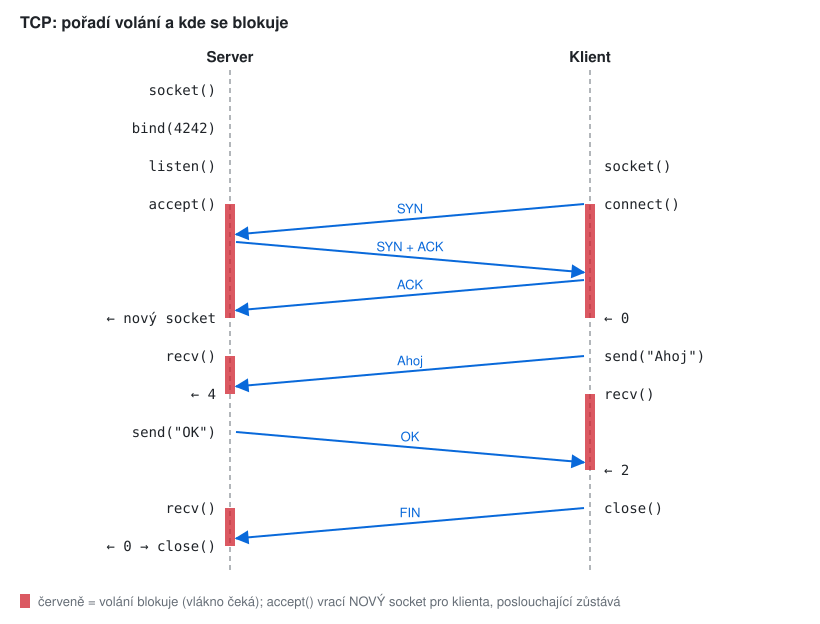
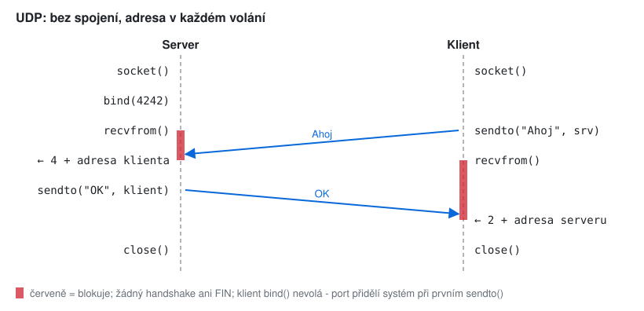

# KIV/UPS cvičení 2.

## Síťové programování I.: BSD sockety v C

Jindrich Skupa & Martin Ubl

### https://github.com/jindrichskupa/kiv-ups

---

# Agenda

- TCP vs. UDP z pohledu programátora
- Pořadí volání a kde se blokuje
- Adresy a endianita (`sockaddr_in`, `htons`)
- Návratové hodnoty a chybové stavy
- Paralelní obsluha klientů: vlákna, `select()`
- Příklady: kreslení, hledání chyb, doplňování kódu, výpočty
- Plán (90 min): úvod 5 · př. 1 (10) · 2 (8) · 3 (12) · 4 (8) · 5 (10) · 6 (15) · 7 (10) · shrnutí 5; př. 8–15 jsou bonus

Ukázky: https://github.com/MartinUbl/KIV-UPS-Samples

---

# Tahák - volání

| | server | klient |
|-|--------|--------|
| TCP | `socket, bind, listen, accept, recv, send, close` | `socket, connect, send, recv, close` |
| UDP | `socket, bind, recvfrom, sendto, close` | `socket, sendto, recvfrom, close` |

- `AF_INET` / `AF_INET6` / `AF_UNIX`, `SOCK_STREAM` (TCP) / `SOCK_DGRAM` (UDP)
- blokuje typicky: `accept`, `connect`, `recv`, `recvfrom` (a `send`, když je plný buffer)

<small>Pozn.: TCP je spojovaný - adresa protějšku je daná spojením a `accept()` vytváří nový socket pro každého klienta. UDP je nespojovaný - jeden socket pro všechny, adresa se uvádí v každém `sendto` a vrací z každého `recvfrom`. V semestrálce používejte vždy **blokující** sockety (neblokující jen se schválením cvičícího).</small>

---

# Příklad 1 - nakreslete TCP

Nakreslete časový diagram serveru a klienta:

- a) server čeká na portu 4242, klient se připojí, pošle `Ahoj`, server odpoví `OK`, klient spojení ukončí
- b) vyznačte, **která volání blokují** a do kdy
- c) vyznačte pakety, které při tom jdou po síti

---

# Řešení 1



---

# Příklad 2 - endianita

- a) Zapište port 8080 hexadecimálně. Jaké bajty jdou po síti a jak leží v paměti na x86?
- b) Server zapomene na `htons(8080)`. Na jakém portu ve skutečnosti poslouchá?
- c) Jakou IP adresu představuje číslo `0x0A000001`? Co vrátí `htonl(0x0A000001)` na x86?
- d) Pro který port chybějící `htons` nevadí?

<small>Pozn.: síťové pořadí bajtů je big-endian (nejvyšší bajt první), x86 a ARM v PC jsou little-endian. `htons` = host to network short (16 b), `htonl` = long (32 b), opačně `ntohs`, `ntohl`.</small>

---

# Řešení 2

- a) 8080 = `0x1F90`; síť: `1F 90`; paměť x86: `90 1F`
- b) bajty `90 1F` přečte síť jako `0x901F` = **36895**
- c) `0A.00.00.01` = **10.0.0.1**; `htonl` na x86 vrátí `0x0100000A` (v paměti pak leží `0A 00 00 01`)
- d) pro porty se stejnými bajty: `0x0101` = 257, `0x1F1F` = 7967, … (a port 0)

<small>Pozn.: chyba z bodu b) se na jednom PC neprojeví, pokud ji udělají server i klient stejně - oba použijí port 36895. Ukáže se až proti klientovi v jiném jazyce nebo přes `nc`, `ss -tlnp`.</small>

---

# Příklad 3 - najděte chyby

```c
int s = socket(AF_INET, SOCK_STREAM, 0);
struct sockaddr_in a;
a.sin_family = AF_INET;
a.sin_port = 4242;
a.sin_addr.s_addr = inet_addr("127.0.0.1");
bind(s, (struct sockaddr *)&a, sizeof(a));
listen(s, 5);
int c = accept(s, NULL, NULL);
char *buf = malloc(256);
int n = recv(c, buf, sizeof(buf), 0);
buf[n] = '\0';
if (strcmp(buf, "LOGIN pepa\n") == 0)
    send(c, "OK\n", 4, 0);
```

---

# Řešení 3

- chybí `memset` struktury (smetí v `sin_zero`)
- `sin_port = 4242` bez `htons` → poslouchá na 37392
- `127.0.0.1` → spojení jen z tohoto PC; pro semestrálku `INADDR_ANY`
- nekontroluje se `socket`, `bind`, `listen`, `accept` (typicky "Address already in use")
- `sizeof(buf)` = velikost **ukazatele** = 8 → přečte max. 8 bajtů
- `n` může být `-1` (zápis do `buf[-1]`) nebo `0` (odpojení); při `n == 256` přetečení
- `recv` nemusí vrátit celou zprávu (ani právě jednu)
- `send(…, 4, …)` pošle i `\0` navíc
- chybí `close(c)`, `close(s)`, `free(buf)`

<small>Pozn.: 4242 = `0x1092`, bez `htons` jdou bajty `92 10` = 37392.</small>

---

# Příklad 4 - TCP je proud bajtů

Klient zavolá rychle za sebou 3× `send(s, "AB", 2, 0)`. Server pak volá `recv(c, buf, 100, 0)`.

- a) Kolikrát musí server zavolat `recv`, aby dostal všechno? Co může vracet?
- b) Totéž přes UDP: 3× `sendto("AB")`, server volá `recvfrom(buf, 100)`.
- c) Klient pošle jednou 100 kB. Kolik `recv` (buffer 4096) bude potřeba?

---

# Řešení 4

- a) **1 až 6×** - např. `ABABAB` najednou, nebo `AB` + `ABAB`, nebo `A` + `BAB` + `AB` … hranice `send` se neuchovávají
- b) přesně **3×** po 2 B - datagram je celek; ale některý se může ztratit nebo přijít v jiném pořadí
- c) **nejméně 25×** (100 000 / 4096 = 24,4), v praxi víc - podle toho, jak rychle data chodí

<small>Pozn.: na jednom PC (loopback) se data obvykle "slijí" a test projde náhodou. Chyba se projeví až po síti nebo pod zátěží - testujte i s `nc` a posíláním po kouscích.</small>

---

# Příklad 5 - chybové stavy

Co uvidí server (blokující `recv` na klientském socketu), když:

- a) klient skončí přes `kill -9`?
- b) klientovi někdo vytáhne síťový kabel?
- c) server pošle data klientovi, který už spojení zavřel?
- d) server spadne a hned ho znovu spustíte?

---

# Řešení 5

- a) jádro klienta spojení zavře (FIN) → `recv` vrátí **0**
- b) **nic** - `recv` čeká navždy; zjistí se až při `send` (po timeoutu retransmisí) nebo aplikačním pingem
- c) první `send` projde, protějšek odpoví RST, další `send` → signál **SIGPIPE** a proces skončí
- d) `bind` → **Address already in use** (staré spojení je v TIME_WAIT)

<small>Pozn.: c) řeší `send(…, MSG_NOSIGNAL)` nebo `signal(SIGPIPE, SIG_IGN)`. d) řeší `setsockopt(SO_REUSEADDR)` před `bind`. b) řešte v protokolu (ping/pong + timeout), ne `TCP_KEEPALIVE` - chová se všude jinak.</small>

---

# Příklad 6 - doplňte `select()`

```c
int cl[64], n = 0;
fd_set rd;
for (;;) {
    FD_ZERO(&rd);
    FD_SET(srv, &rd);
    int maxfd = srv;
    for (int i = 0; i < n; i++) { /* (1) */ }
    select(/* (2) */, &rd, NULL, NULL, NULL);
    if (FD_ISSET(srv, &rd))
        cl[n++] = accept(srv, NULL, NULL);
    for (int i = 0; i < n; i++)
        if (FD_ISSET(cl[i], &rd)) { /* (3) */ }
}
```

- doplňte (1)–(3); proč je `FD_ZERO` uvnitř smyčky? Co chybí u `accept`?

---

# Řešení 6

```c
/* (1) */ FD_SET(cl[i], &rd); if (cl[i] > maxfd) maxfd = cl[i];
/* (2) */ maxfd + 1
/* (3) */ int r = recv(cl[i], buf, sizeof(buf), 0);
          if (r <= 0) { close(cl[i]); cl[i] = cl[--n]; i--; }
          else        handle(i, buf, r);
```

- `select` množinu **přepíše** - nechá v ní jen připravené sockety, proto se plní znovu
- u `accept` chybí kontrola `n < 64` a návratové hodnoty

<small>Pozn.: první parametr je "nejvyšší deskriptor + 1", ne počet socketů. `fd_set` má limit `FD_SETSIZE` (1024) - pro víc klientů `poll()` / `epoll()`.</small>

---

# Příklad 7 - zvolte architekturu

Varianty: **A** vlákno na klienta, **B** jedno síťové vlákno + předávání požadavků (lobby, místnosti), **C** jedno vlákno na všechno (`select`), **D** acceptor + vlákno lobby + vlákno na místnost.

- a) piškvorky, 2 hráči na hru, nejvýš 20 hráčů
- b) jednoduchý chat, 500 klientů, server jen přeposílá zprávy
- c) karetní hra: lobby a až 100 místností po 4 hráčích
- d) hra proti počítači, tah AI se počítá několik sekund

---

# Řešení 7

- a) **A** (nejjednodušší) nebo **C** - zátěž je malá, rozhoduje čitelnost kódu
- b) **C** - práce na zprávu je minimální, 500 vláken by jen čekalo
- c) **D** - místnosti jsou nezávislé, každá má svůj stav i svoje sockety
- d) **B** - výpočet nesmí blokovat síťové vlákno, jinak ostatní klienti "zamrznou"

<small>Pozn.: správně je víc odpovědí - u obhajoby musíte umět říct proč. Kdekoli vlákna sdílí stav (seznam hráčů, místnosti), patří k němu mutex.</small>

---

# Příklad 8 - nakreslete UDP (bonus)
<!-- bonus -->

Stejná komunikace jako v příkladu 1 (TCP), ale přes UDP.

- a) Která volání zmizí a proč?
- b) Odkud server zná adresu, kam poslat `OK`?
- c) Co se stane, když server ještě neběží a klient pošle datagram?

---

# Řešení 8 (bonus)
<!-- bonus -->



- a) `listen`, `accept`, `connect` - není co navazovat; zmizí i handshake a FIN
- b) z `recvfrom()` - vyplní strukturu s adresou a portem odesílatele
- c) datagram se ztratí (cílový počítač vrátí ICMP port unreachable), klient na `recvfrom` čeká navždy

<small>Pozn.: proto u UDP potřebujete vlastní timeout (`SO_RCVTIMEO` nebo `select` s časovým limitem) a opakování.</small>

---

# Příklad 9 - vyplňte adresu (bonus)
<!-- bonus -->

```c
struct sockaddr_in a;
memset(&a, 0, sizeof(a));
a.sin_family      = ______;
a.sin_port        = ______;   /* 4242 */
a.sin_addr.s_addr = ______;   /* a) server: všechna rozhraní */
______________________;       /* b) klient: 192.168.1.42 */
bind(s, (struct sockaddr *)&a, ______);
```

- c) Proč `bind` bere `struct sockaddr *` a k tomu ještě délku?
- d) Jak se změní kód pro IPv6?

---

# Řešení 9 (bonus)
<!-- bonus -->

```c
a.sin_family      = AF_INET;
a.sin_port        = htons(4242);
a.sin_addr.s_addr = htonl(INADDR_ANY);              /* a) 0.0.0.0 */
inet_pton(AF_INET, "192.168.1.42", &a.sin_addr);    /* b) */
bind(s, (struct sockaddr *)&a, sizeof(a));
```

- c) rozhraní je univerzální pro všechny rodiny (`sockaddr_in`, `sockaddr_in6`, `sockaddr_un`), délka říká jádru, kolik bajtů smí číst (kontrola vstupu)
- d) `struct sockaddr_in6`, `AF_INET6`, `sin6_port`, `sin6_addr = in6addr_any`

<small>Pozn.: `inet_addr()` je zastaralé (nerozliší chybu od 255.255.255.255), používejte `inet_pton` / `inet_ntop`, případně `getaddrinfo()`, které vrátí IPv4 i IPv6 adresy jména.</small>

---

# Příklad 10 - kolik bajtů odejde? (bonus)
<!-- bonus -->

```c
char *m = "KIVUPS";
char a[] = "KIVUPS";
send(s, "KIVUPS", strlen("KIVUPS"), 0);   /* a) */
send(s, "KIVUPS", sizeof("KIVUPS"), 0);   /* b) */
send(s, m, sizeof(m), 0);                 /* c) */
send(s, a, sizeof(a), 0);                 /* d) */
```

---

# Řešení 10 (bonus)
<!-- bonus -->

- a) **6** - `strlen` nepočítá ukončovací `\0`
- b) **7** - řetězcový literál má v `sizeof` i `\0`
- c) **8** (na 64bit) - velikost ukazatele; pošle `KIVUPS\0` a 1 bajt smetí za ním
- d) **7** - pole včetně `\0`

<small>Pozn.: nula navíc rozbije protokol nenápadně - C server ji "nevidí", Java klient ji přečte jako znak a `"OK\0".equals("OK")` je false.</small>

---

# Příklad 11 - co vrátil `recv`? (bonus)
<!-- bonus -->

`int n = recv(c, buf, 100, 0);` - co znamená a co dělat, když:

- a) `n == 100`
- b) `n == 37`
- c) `n == 0`
- d) `n == -1`, `errno == ECONNRESET`
- e) `n == -1`, `errno == EINTR`

---

# Řešení 11 (bonus)
<!-- bonus -->

<style scoped>table { font-size: 19px; }</style>

| `n` | význam | reakce |
|-----|--------|--------|
| 100 | buffer plný, v jádře může čekat další | zpracovat, číst dál |
| 37 | přišlo zatím 37 B - normální stav | uložit do bufferu zprávy, číst dál |
| 0 | protějšek korektně ukončil spojení (FIN) | `close()`, odebrat klienta |
| -1, `ECONNRESET` | spojení shozeno (RST) | `close()`, odebrat klienta |
| -1, `EINTR` | volání přerušil signál | zavolat `recv` znovu |

<small>Pozn.: `recv` vrací počet bajtů, ne zpráv. Jediné spolehlivé pravidlo: zprávu skládat v bufferu, dokud není celá (podle délky nebo oddělovače).</small>

---

# Příklad 12 - UDP a buffer (bonus)
<!-- bonus -->

Server čeká `recvfrom(s, buf, 512, 0, …)`, přijde datagram 1000 B.

- a) Co vrátí `recvfrom`? Kde je zbylých 488 B?
- b) Klient pošle 3 datagramy po 100 B, server má buffer 1000 B. Kolik dostane jedním voláním?
- c) Do jaké velikosti datagramu se v praxi nemusíte bát fragmentace?

---

# Řešení 12 (bonus)
<!-- bonus -->

- a) **512** - zbytek datagramu je **zahozen** (Linux nastaví `MSG_TRUNC`)
- b) **100** - jeden `recvfrom` = vždy jeden datagram, nikdy dva najednou
- c) zhruba **do 500 B** (bezpečné minimum), typicky do ~1400 B (Ethernet MTU 1500 − hlavičky)

<small>Pozn.: buffer pro UDP dimenzujte na největší možný datagram (max. 65 507 B), nebo protokolem zaručte malou velikost zpráv.</small>

---

# Příklad 13 - proč ne takhle? (bonus)
<!-- bonus -->

```c
fcntl(c, F_SETFL, O_NONBLOCK);
for (;;) {
    int r = recv(c, buf, sizeof(buf), 0);
    if (r > 0)
        handle(buf, r);
    sleep(1);
}
```

- a) Jaké zpoždění má odpověď? Co se stane, když `sleep` smažete?
- b) Co se stane, když se klient odpojí?
- c) Jak to napsat správně?

---

# Řešení 13 (bonus)
<!-- bonus -->

- a) až **1 s** zpoždění na každou zprávu; bez `sleep` aktivní čekání = **100 % CPU** jednoho jádra
- b) `r == 0` se ignoruje → smyčka běží navždy nad mrtvým socketem
- c) **blokující** `recv` (vlákno spí, probudí ho jádro) nebo `select` / `poll` s timeoutem

<small>Pozn.: neblokující socket + sleep je totéž co blokující socket, jen pomalejší a dražší. AI asistenti ho rádi generují - v semestrálce ho musíte umět obhájit, takže ho tam nedávejte.</small>

---

# Příklad 14 - kolik stojí vlákna? (bonus)
<!-- bonus -->

Server vytváří vlákno pro každého klienta, výchozí zásobník vlákna je 8 MB (Linux).

- a) Kolik virtuální paměti zabere 1000 klientů? A 10 000?
- b) Proč server se 1000 vlákny přesto nespotřebuje 8 GB RAM?
- c) Kolik vláken se vešlo do 32bitového procesu (3 GB uživatelského prostoru)?
- d) Co se změní, když místo vláken použijete `fork()`?

---

# Řešení 14 (bonus)
<!-- bonus -->

- a) 1000 · 8 MB = **8 000 MB ≈ 7,8 GB**; 10 000 → **≈ 78 GB** virtuální paměti
- b) zásobník je jen **rezervovaný** adresní prostor, fyzicky se přidělí jen použité stránky (typicky desítky kB na vlákno)
- c) 3072 / 8 ≈ **384 vláken** - proto se dřív zmenšoval zásobník (`pthread_attr_setstacksize`)
- d) každý klient má vlastní proces a **oddělenou paměť** (copy-on-write) → sdílený stav hry musí jít přes IPC; vlákna sdílí paměť, ale potřebují zámky

---

# Příklad 15 - totéž ve Windows (bonus)
<!-- bonus -->

Server pro Linux chcete přeložit ve Windows (Winsock). Co musíte změnit?

---

# Řešení 15 (bonus)
<!-- bonus -->

- před prvním voláním `WSAStartup()`, na konci `WSACleanup()`
- `close()` → **`closesocket()`**; socket je typ `SOCKET`, chyba je `INVALID_SOCKET` (ne `-1`)
- chybový kód přes `WSAGetLastError()` místo `errno`
- `select()` funguje **jen se sockety** (ne se souborem ani se stdin)
- hlavičky `<winsock2.h>`, `<ws2tcpip.h>`, linkovat `ws2_32.lib`

<small>Pozn.: v Linuxu je socket obyčejný souborový deskriptor (jde na něj `read`/`write`, do `select` i se soubory), ve Windows je to zvláštní systémový objekt.</small>

---

# Shrnutí

- TCP: `accept` vrací nový socket; `recv` vrací bajty, ne zprávy
- UDP: jeden datagram = jeden `recvfrom`, může se ztratit, přijít jindy, být oříznut
- vždy `htons` / `htonl`, kontrolovat návratové hodnoty, `0` = odpojení
- server poslouchá na `INADDR_ANY` / `in6addr_any`, ne na `127.0.0.1`
- paralelní obsluha: vlákna (sdílená paměť + zámky) nebo jedno vlákno se `select`/`poll`
- v semestrálce blokující sockety

---

# Slovníček zkratek

<style scoped>table { font-size: 16px; }</style>

| zkratka | význam |
|---------|--------|
| BSD sockets | rozhraní pro síťovou komunikaci z Berkeley Unixu, dnes standard POSIX |
| TCP, UDP | Transmission Control Protocol (spojovaný, spolehlivý proud), User Datagram Protocol |
| `AF_INET`, `AF_INET6`, `AF_UNIX` | rodiny adres: IPv4, IPv6, lokální socket v souborovém systému |
| `SOCK_STREAM`, `SOCK_DGRAM` | typ socketu: proud bajtů (TCP), datagramy (UDP) |
| `INADDR_ANY`, `in6addr_any` | "všechna rozhraní" (0.0.0.0, ::) |
| `htons`, `htonl`, `ntohs`, `ntohl` | převod host ↔ network byte order, 16 / 32 bitů |
| big-endian, little-endian | nejvyšší / nejnižší bajt na nejnižší adrese |
| SYN, ACK, FIN, RST | příznaky TCP: navázání, potvrzení, ukončení, shození spojení |
| TIME_WAIT | stav po ukončení spojení, port je chvíli blokovaný |
| SIGPIPE | signál při zápisu do zavřeného spojení (výchozí reakce: ukončení procesu) |
| `select`, `poll`, `epoll` | čekání na více socketů najednou |
| IPC | Inter-Process Communication - komunikace mezi procesy |
| MTU | Maximum Transmission Unit - největší paket linky (Ethernet 1500 B) |
| Winsock | implementace socketů ve Windows |
