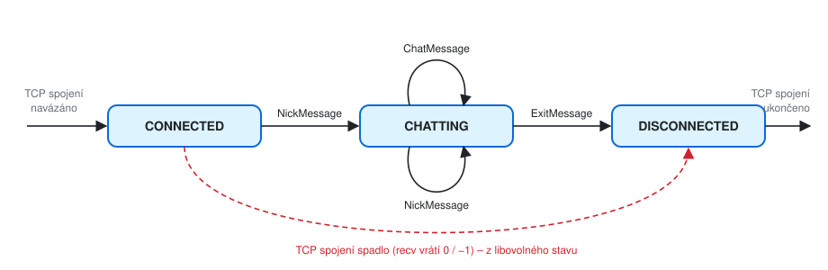
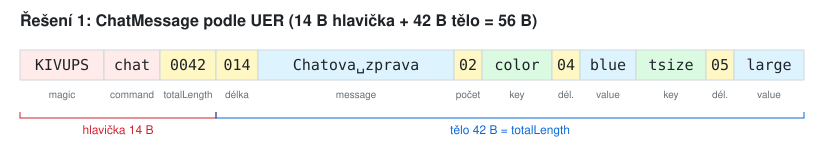
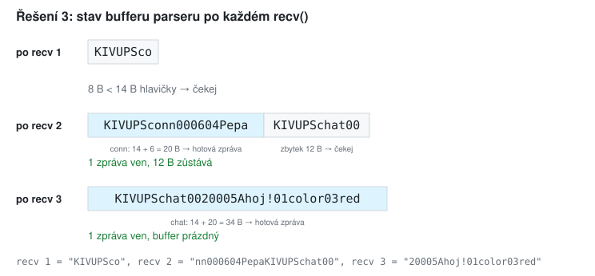
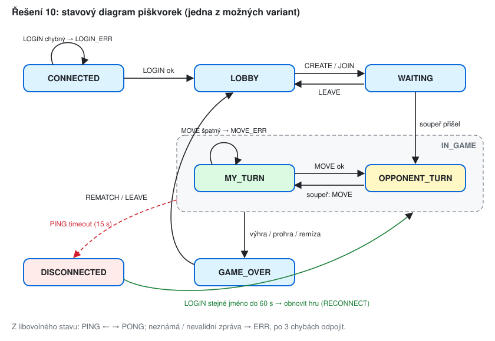

# KIV/UPS cvičení 4.

## Návrh aplikačního protokolu

Jindrich Skupa & Martin Ubl

### https://github.com/jindrichskupa/kiv-ups

---

# Agenda

- Hlavička zprávy, TLV vs. oddělovače, escapování
- Formalizace v ASN.1 a pravidla serializace (UER)
- Stavový diagram protokolu
- Úkol: chat klient proti serveru `chatserver`
- Plán (90 min): úvod a teorie 10, příklady 1–5 35, chat klient 30, rezerva a diskuse 15

---

# Hlavička zprávy

- TCP je **proud bajtů**: jedno `send()` ≠ jedno `recv()`, hranice zpráv si určuje protokol
- typická hlavička: **magic** (identifikace protokolu) + **opkód** (typ zprávy) + **délka**

| magic | opkód | délka těla | tělo |
|-------|-------|------------|------|
| `KIVUPS` | `chat` | `0042` | `014Chatova zprava02color04bluetsize05large` |

<small>Pozn.: magic se dá ověřit hned po přijetí prvních bajtů - když nesedí, nemluví s námi náš klient a spojení zavřeme. Pevná délka hlavičky (zde 14 B) znamená, že parser vždy ví, kolik bajtů čekat nejdřív.</small>

---

# Délka, nebo oddělovač?

| přístup | příklad | konec pole / zprávy | problém |
|---------|---------|---------------------|---------|
| TLV (Type-Length-Value) | `04Hrac05Heslo` | délka předem | délka musí sedět, omezená šířkou čísla |
| oddělovače | `LOGIN\|Hrac\|Heslo⏎` | znak `\|`, konec řádku | znak se může objevit v datech → **escapování** |

- escapování: zvolený znak `\` ruší význam následujícího znaku: `\|`, `\\`, `\n`

<small>Pozn.: `⏎` = konec řádku. Pozor na CR vs. CRLF vs. LF - Windows klient pošle `\r\n`, Linux server čeká `\n`. Escapovací znak se v literatuře jmenuje DLE (Data Link Escape).</small>

---

# ASN.1 → serializace (UER)

<style scoped>table { font-size: 19px; }</style>

| ASN.1 | zápis na drátě | příklad |
|-------|----------------|---------|
| `IA5String ("KIVUPS")`, výčet stejně dlouhých řetězců | řetězec tak, jak je | `KIVUPS`, `chat` |
| `INTEGER(p..q)` | číslo doplněné nulami na šířku podle q | `INTEGER(0..9999)`: 41 → `0041` |
| `IA5String (SIZE(p..q))` | délka (šířka podle q) + řetězec | `SIZE(1..99)`: `blue` → `04blue` |
| `SEQUENCE (SIZE(p..q)) OF X` | počet prvků (šířka podle q) + prvky | `SIZE(0..10)`: 2 prvky → `02…` |
| `SEQUENCE { … }` | pole za sebou v pořadí definice | |

- šířka čísla: q < 10 → 1 znak, q < 100 → 2, q < 1000 → 3, q < 10 000 → 4
- `totalLength` = délka těla zprávy **bez** 14 B hlavičky

<small>Pozn.: přesná definice je v `KIV-UPS-Samples/chatserver` (`ASN1-protocol.md`, `UER.md`), při rozdílu platí repozitář. IA5String = ASCII bez diakritiky.</small>

---

# Zadání: UPSChatProtocol (výňatek)

```
MessageHeader { MessageType:Type } ::= SEQUENCE {
  magic        IA5String ("KIVUPS"),
  command      Type,                      -- "nick" | "chat" | "conn" | "disc" | "exit"
  totalLength  INTEGER(0..9999)
}
NickMessage ::= SEQUENCE { header MessageHeader{{"nick"}}, newNick NickType, oldNick NickType OPTIONAL }
ChatMessage ::= SEQUENCE {
  header      MessageHeader{{"chat"}},
  message     IA5String (SIZE(1..999)),
  parameters  SEQUENCE(SIZE(0..10)) OF MessageParameter
}
MessageParameter ::= SEQUENCE { key IA5String ("color" | "tsize"), value IA5String (SIZE(1..99)) }
ConnDisconnMessage ::= SEQUENCE { header MessageHeader{{"conn" | "disc"}}, nick NickType }
ExitMessage ::= SEQUENCE { header MessageHeader{{"exit"}}, reason IA5String (SIZE(1..99)) }
NickType ::= IA5String(SIZE(4..32))
```

---

# Stavový diagram



<small>Pozn.: stav určuje, které zprávy jsou dovolené. Zpráva, která do stavu nepatří, je chyba protokolu, i když je syntakticky správně.</small>

---

# Příklad 1 - serializujte

Zapište podle UER zprávu `ChatMessage`:

- message: `Chatova zprava`
- parameters: `color = blue`, `tsize = large`

Spočítejte `totalLength` a celkovou délku zprávy v bajtech.

---

# Řešení 1



```
KIVUPSchat0042014Chatova zprava02color04bluetsize05large
```

<small>Pozn.: v podkladech (PDF) je u tohoto příkladu `0014`, `2` a `size` - délka zprávy má mít 3 znaky (SIZE(1..999)), počet parametrů 2 znaky (SIZE(0..10), q = 10) a klíč je `tsize`. S těmito chybami vyjde tělo 41 B, správně 42 B.</small>

---

# Příklad 2 - deserializujte

Rozložte na pole a určete typ zprávy:

- a) `KIVUPSexit001311Jdu na obed`
- b) `KIVUPSchat0020005Ahoj!01color03red`
- c) `KIVUPSconn000604Pepa`

---

# Řešení 2

<style scoped>table { font-size: 19px; }</style>

| | hlavička | tělo |
|-|----------|------|
| a) | `KIVUPS` `exit` `0013` | reason: `11` + `Jdu na obed` (11 znaků, 2 + 11 = 13) |
| b) | `KIVUPS` `chat` `0020` | message `005` `Ahoj!`; parametrů `01`; `color` = `03` `red` |
| c) | `KIVUPS` `conn` `0006` | nick `04` `Pepa` |

<small>Pozn.: postup je vždy stejný - přečíst 14 B hlavičky, podle `command` vybrat definici, podle `totalLength` vědět, kolik bajtů čekat, a pak pole podle definice zleva doprava.</small>

---

# Příklad 3 - TCP fragmentace

Server přijme tyto tři `recv()` (2 zprávy z Příkladu 2c a 2b):

```
recv 1: "KIVUPSco"
recv 2: "nn000604PepaKIVUPSchat00"
recv 3: "20005Ahoj!01color03red"
```

- a) Nakreslete stav bufferu parseru po každém `recv()`.
- b) Kdy může parser předat zprávu dál?
- c) Co by se stalo, kdyby server bral každý `recv()` jako jednu zprávu?

---

# Řešení 3



- b) až když má celou hlavičku (14 B) **a** `14 + totalLength` bajtů
- c) recv 1 by byl nevalidní (krátký), recv 2 by obsahoval půl jiné zprávy → server by klienta odpojil, i když posílá správně

<small>Pozn.: buffer je potřeba **pro každého klienta zvlášť** a zbytek po odebrání zprávy se nesmí zahodit. Na localhostu fragmentace skoro nenastane, proto se chyba projeví až po síti.</small>

---

# Příklad 4 - escapování

Protokol: `PŘÍKAZ|pole|pole⏎`, escapovací znak `\` (`\|` = znak `|`, `\\` = znak `\`, `\n` = konec řádku v textu).

- a) Zakódujte zprávu `CHAT` s textem `a|b`.
- b) Zakódujte `CHAT` s textem `C:\temp`.
- c) Zakódujte `CHAT` s dvouřádkovým textem `ahoj` / `cau`.
- d) Dekódujte `CHAT|a\\|b⏎`. Kolik má polí?

---

# Řešení 4

- a) `CHAT|a\|b⏎`
- b) `CHAT|C:\\temp⏎`
- c) `CHAT|ahoj\ncau⏎` (`\n` jsou 2 znaky, `⏎` je skutečný konec řádku)
- d) `\\` je znak `\`, následující `|` je oddělovač → **3 pole**: `CHAT`, `a\`, `b`

<small>Pozn.: dekódovat se musí znak po znaku zleva - hledat `|` pomocí `split("|")` je chyba, protože nerozliší `\|` od `|`. Escapovat se musí i samotný escapovací znak, jinak nejde zapsat text končící `\`.</small>

---

# Příklad 5 - co se smí kdy

Podle stavového diagramu chatu:

- a) Které zprávy smí klient poslat ve stavu CONNECTED?
- b) Klient hned po připojení pošle `ChatMessage`. Co udělá server?
- c) Co musí server udělat po `ExitMessage`?
- d) Klient pošle `NickMessage` s `oldNick`, který nepatří jemu. Je to chyba syntaxe, nebo stavu?

---

# Řešení 5

- a) jen `NickMessage` (přihlášení jménem)
- b) zpráva je syntakticky správně, ale ve stavu CONNECTED nepovolená → chyba protokolu, odpověď s chybou nebo odpojení
- c) přejít do DISCONNECTED: oznámit ostatním (`disc`), uvolnit jméno, buffer a socket (`close`)
- d) ani jedno - je to **sémantická** chyba (validace obsahu), server ji musí kontrolovat sám

<small>Pozn.: kontroly jsou tři vrstvy - syntaxe (jde zprávu rozparsovat?), stav (smí přijít teď?), obsah (dává smysl?). Server nesmí věřit klientovi v žádné z nich.</small>

---

# Úkol - chat klient

- server: `chatserver` z `https://github.com/MartinUbl/KIV-UPS-Samples`, běží na `0.0.0.0:4242`
- napište klienta (libovolný jazyk), který se přihlásí jménem a pošle zprávu
- nejdřív vyzkoušejte ručně:

```
printf 'KIVUPSnick000604Pepa' | nc <server> 4242
printf 'KIVUPSnick000604PepaKIVUPSchat0010005Ahoj!00' | nc <server> 4242
```

<small>Pozn.: časté chyby - chybějící nuly v délkách, `\0` na konci řetězce z C (`sizeof` místo `strlen`), překlep v magic, diakritika (IA5 je jen ASCII). Server loguje, co přijal - sledujte jeho výpis.</small>

---

# Příklad 6 - volitelné pole (bonus)
<!-- bonus -->

- a) Serializujte `NickMessage` s `newNick = Pepa123` bez `oldNick`.
- b) Totéž s `oldNick = Franta`.
- c) Jak příjemce pozná, že `oldNick` chybí?

---

# Řešení 6
<!-- bonus -->

- a) `KIVUPSnick000907Pepa123`
- b) `KIVUPSnick001707Pepa12306Franta`
- c) z `totalLength`: po přečtení `newNick` (9 B) zbývá 0 B → `oldNick` není

<small>Pozn.: kdyby `OPTIONAL` pole nebylo poslední, délka by nestačila - musel by se přidat příznak přítomnosti (např. 1 znak `0`/`1`).</small>

---

# Příklad 7 - TLV (bonus)
<!-- bonus -->

Přihlášení posílá jméno a heslo jako 2 pole s 2místnou délkou.

- a) Rozložte `03Eva0812345678`.
- b) Zakódujte jméno `Jan`, heslo `heslo123`.
- c) Co s heslem dlouhým 120 znaků?
- d) Binární TLV: typ 1 B, délka 2 B (big-endian). Zapište hexadecimálně pole typu `0x01` s hodnotou `Eva`.

---

# Řešení 7
<!-- bonus -->

- a) `03` → `Eva`, `08` → `12345678`
- b) `03Jan08heslo123`
- c) do 2 číslic se vejde max. 99 → odmítnout (validace délky), nebo rozšířit protokol na 3 číslice
- d) `01 00 03 45 76 61`

<small>Pozn.: TLV se dá zanořovat - hodnota může sama obsahovat další TLV pole. Binární délka 2 B unese až 65 535 B a nemá problém s "kolik číslic".</small>

---

# Příklad 8 - text vs. binár (bonus)
<!-- bonus -->

Tah v piškvorkách: `x, y ∈ 0..14`, hráč 1 nebo 2.

- a) Kolik bajtů má textová zpráva `MOVE|7|12|1⏎`?
- b) Kolik zabere binárně: opkód 1 B + x, y, hráč po 1 B?
- c) Kolik nejméně bitů potřebuje samotný tah (x, y, hráč)?
- d) Co je pro semestrálku výhodnější a proč?

---

# Řešení 8
<!-- bonus -->

- a) 4 + 1 + 1 + 1 + 2 + 1 + 1 + 1 = **12 B**
- b) **4 B**
- c) 15 hodnot → 4 bity na souřadnici, hráč 1 bit → 4 + 4 + 1 = **9 bitů** (2 B)
- d) textový protokol - otestujete ho pomocí `nc`, přečtete v `tcpdump` i v logu; úspora 8 B na tahu je při hraní nepodstatná

<small>Pozn.: binární protokol navíc řeší endianitu (`htons`) a zarovnání struktur. Textový řeší escapování a převody čísel. U her s pár zprávami za sekundu vyhrává čitelnost.</small>

---

# Příklad 9 - ASN.1 MoveMessage (bonus)
<!-- bonus -->

- a) Doplňte do `UPSChatProtocol` zprávu `MoveMessage` s poli `x` a `y` (0–14).
- b) Co je potřeba změnit v `MessageType`?
- c) Serializujte tah `x = 7, y = 12`.

---

# Řešení 9
<!-- bonus -->

```
MessageType ::= IA5String("nick" | "chat" | "conn" | "disc" | "exit" | "move")

MoveMessage ::= SEQUENCE {
  header  MessageHeader{{"move"}},
  x       INTEGER(0..14),
  y       INTEGER(0..14)
}
```

- b) přidat `"move"` - musí mít také 4 znaky, aby zůstal pevně dlouhý opkód
- c) `INTEGER(0..14)` → 2 znaky: `KIVUPSmove00040712`

---

# Příklad 10 - stavový diagram hry (bonus)
<!-- bonus -->

Navrhněte stavový diagram pro piškvorky (nebo vaši semestrální hru):

- přihlášení, lobby, čekání na soupeře, hra (můj tah / tah soupeře), konec hry
- chybné přihlášení a chybný tah
- výpadek spojení a návrat do rozehrané hry

---

# Řešení 10
<!-- bonus -->



---

# Příklad 11 - tabulka stav × zpráva (bonus)
<!-- bonus -->

Doplňte pro diagram z Příkladu 10, co server udělá:

<style scoped>table { font-size: 19px; }</style>

| zpráva \ stav | CONNECTED | LOBBY | WAITING | MY_TURN | OPPONENT_TURN |
|---------------|-----------|-------|---------|---------|---------------|
| LOGIN | | | | | |
| CREATE / JOIN | | | | | |
| MOVE | | | | | |
| LEAVE | | | | | |
| PING | | | | | |

---

# Řešení 11
<!-- bonus -->

<style scoped>table { font-size: 17px; }</style>

| zpráva \ stav | CONNECTED | LOBBY | WAITING | MY_TURN | OPPONENT_TURN |
|---------------|-----------|-------|---------|---------|---------------|
| LOGIN | ověřit → LOBBY / LOGIN_ERR | chyba | chyba | chyba | chyba |
| CREATE / JOIN | chyba | → WAITING | chyba | chyba | chyba |
| MOVE | chyba | chyba | chyba | ověřit tah → OPPONENT_TURN / MOVE_ERR | chyba (není na tahu) |
| LEAVE | chyba | odhlásit | → LOBBY | vzdát → GAME_OVER | vzdát → GAME_OVER |
| PING | PONG | PONG | PONG | PONG | PONG |

<small>Pozn.: "chyba" = odpověď ERR a zvýšit počítadlo chyb klienta. Tabulka je přímo osnova `switch`/`match` v kódu serveru.</small>

---

# Příklad 12 - validace (bonus)
<!-- bonus -->

Co má server udělat s těmito vstupy (protokol chatu, klient ve stavu CHATTING)?

- a) `KIVUPXchat0010005Ahoj!00`
- b) `KIVUPSfoo!0000`
- c) `KIVUPSchat-005Ahoj!`
- d) `KIVUPSchat9999` a pak nic
- e) `KIVUPSnick000402Jo`
- f) `KIVUPSnick000607Pepa123` (délka nesedí)

---

# Řešení 12
<!-- bonus -->

- a) špatný magic → nemluví s námi náš klient → **odpojit hned**
- b) neznámý opkód → ERR, počítadlo chyb +1
- c) délka není číslo → nelze najít konec zprávy → **odpojit**
- d) max. tělo `ChatMessage` je 3 + 999 + 2 + 10 · (5 + 2 + 99) = **2064 B** → 9999 je víc → odpojit hned, nečekat na 9999 B
- e) `NickType` je `SIZE(4..32)`, `Jo` má 2 znaky → ERR
- f) tělo deklaruje 6 B, ale `07Pepa123` má 9 B → zbytek by se četl jako další zpráva → odpojit

<small>Pozn.: pravidlo - pokud se po chybě dá spolehlivě najít začátek další zprávy, stačí ERR a po N (např. 3) chybách odpojit. Pokud ne (rozbitá délka, magic), odpojit hned. Délku z drátu nikdy nepoužívat k alokaci bez kontroly maxima.</small>

---

# Příklad 13 - keepalive (bonus)
<!-- bonus -->

Server chce poznat, že klient zmizel (vytažený kabel, uspaný notebook).

- a) Navrhněte zprávy a časování aplikačního PING/PONG.
- b) Za jak dlouho server výpadek pozná?
- c) Linux `TCP_KEEPALIVE` má výchozí hodnoty 7200 s nečinnosti, pak 9 sond po 75 s. Za jak dlouho pozná výpadek on?
- d) Co udělat s rozehranou hrou, když klient vypadne?

---

# Řešení 13
<!-- bonus -->

- a) klient posílá `PING` každých 5 s, server odpoví `PONG`; server odpojí klienta, od kterého 15 s nepřišla **žádná** zpráva
- b) nejpozději za 15 s (+ až 5 s, než by přišel další PING)
- c) 7200 + 9 · 75 = **7875 s ≈ 2 h 11 min** - pro hru nepoužitelné, navíc jiné na každém OS
- d) hru pozastavit, soupeři oznámit výpadek, držet stav např. 60 s; když se klient přihlásí stejným jménem, vrátit ho do hry (RECONNECT), jinak hra končí

<small>Pozn.: TCP o výpadku protějšku neví, dokud nic nepošle - `recv()` na mrtvém spojení může čekat donekonečna. Proto aplikační keepalive, ne `TCP_KEEPALIVE`.</small>

---

# Shrnutí

- TCP = proud bajtů → hranice zpráv: pevná hlavička + délka, nebo oddělovače + escapování
- hlavička: magic, opkód, délka; parser bufferuje, dokud nemá celou zprávu
- ASN.1 popisuje zprávy, UER říká, jak je zapsat na drát
- stavový diagram: které zprávy kdy smí přijít
- server validuje syntaxi, stav i obsah a nikdy nevěří klientovi

---

# Slovníček zkratek

<style scoped>table { font-size: 19px; }</style>

| zkratka | význam |
|---------|--------|
| magic | pevná sekvence bajtů na začátku zprávy, identifikuje protokol |
| opkód | operační kód - typ zprávy (`nick`, `chat`, …) |
| TLV | Type-Length-Value - pole s typem a délkou předem |
| DLE | Data Link Escape - escapovací znak |
| CR, LF, CRLF | Carriage Return (`\r`), Line Feed (`\n`), jejich dvojice (Windows) |
| ASN.1 | Abstract Syntax Notation One - jazyk pro popis struktury zpráv |
| BER, XER, UER | Basic / XML Encoding Rules (standardní), UER = pravidla zápisu pro UPS |
| IA5String | řetězec ASCII znaků (International Alphabet No. 5) |
| keepalive | zpráva, která jen potvrzuje, že protějšek žije (PING/PONG) |
