# KIV/UPS cvičení 5.

## Fyzická vrstva

Jindrich Skupa & Martin Ubl

### https://github.com/jindrichskupa/kiv-ups

---

# Agenda

- Fyzická vrstva - co řeší
- Signál, spektrum, přenosové pásmo
- Bitová vs. modulační rychlost
- Nyquist - kanál bez šumu
- Decibely
- Shannon - kanál se šumem
- Synchronní, asynchronní a arytmický přenos
- Arytmický přenos (UART - Universal Asynchronous Receiver/Transmitter), start/stop bit, 8N1
- Příklady průběžně u každého tématu (modem, Ethernet, UART)
- Plán (90 min): teorie ~25 min, příklady 1–7 (~50 min), 8–11 a slidy "Z praxe" jako bonus

---

# Motivace

- proč měl telefonní modem strop **33,6 kb/s** (a pak "zázračných" 56k)?
- jak mohl Ethernet skočit ze **100 na 1000 Mb/s** na **stejném kabelu**?
- proč má sériová linka 9600 Bd jen **960 B/s**?
- odpovědi dává fyzická vrstva: šířka pásma, šum, počet stavů signálu a synchronizace

---

# Fyzická vrstva (L1 ISO/OSI)

- přenáší **bity** jako fyzikální signál (napětí, proud, světlo, rádiové vlny)
- neví nic o rámcích, adresách ani významu dat
- definuje
	- médium a konektory (UTP/RJ-45, optické vlákno/LC, rádio)
	- napěťové úrovně, impedance, vlnové délky
	- linkové kódování a modulaci (NRZ - Non-Return-to-Zero, Manchester, PAM - Pulse Amplitude Modulation, QAM - Quadrature Amplitude Modulation, ...)
	- časování a synchronizaci (kdy je "teď" bit)
- příklady: RS-232, RS-485, 1000BASE-T, 802.11 PHY, DSL, USB PHY

---

# Přenosové pásmo

- **šířka pásma** `B = f_max − f_min` [Hz]
- hranice typicky v bodě poklesu o **3 dB** (poloviční výkon)
- **základní pásmo** (baseband) - signál od ~0 Hz (Ethernet, UART)
- **přeložené pásmo** (passband) - signál posunutý modulací na nosnou (rádio, DSL, kabelovka)

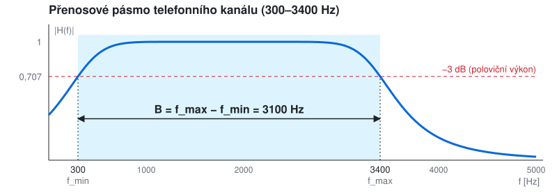

---

# Proč tolik vzorců? (mapa)

Otázka je pořád jedna: **kolik b/s dostanu přes daný kanál?** Každý vzorec odpovídá na jeden kus.

```
co posílám:       v_p = v_m · log2(N)         kolik bitů nese signál, který vysílám
kanál bez šumu:   C = 2B · log2(N)            Nyquist - pásmo B omezí počet symbolů/s (max 2B)
kanál se šumem:   C = B · log2(1 + S/N)       Shannon - šum omezí, kolik stavů N rozliším
jak zadat šum:    SNR_dB = 10 · log10(S/N)    v praxi se S/N udává v dB → nejdřív převést
```

- `v_p` - **moje volba** (kolik symbolů/s a kolik stavů)
- Nyquist - strop daný **pásmem** (víc symbolů/s kanál nepropustí)
- Shannon - strop daný **šumem** (víc stavů v šumu nerozliším) → absolutní mez
- reálně: `v_p ≤ min(Nyquist, Shannon)`; dB jsou jen pohodlný zápis `S/N` a útlumů

---

# Bitová vs. modulační rychlost

- **modulační rychlost** `v_m` [Bd, baud] - počet změn signálu (symbolů) za sekundu
- **bitová rychlost** `v_p` [b/s] - počet přenesených bitů za sekundu
- symbol může nabývat `N` stavů (úrovní, fází, ...) → nese `log2(N)` bitů

```
v_p = v_m · log2(N)
```

- `N = 2` → 1 b/s = 1 Bd
- `N = 16` (QAM-16) → 4 bity/symbol, 2400 Bd = 9600 b/s (modem V.32)

---

# Více úrovní = více bitů

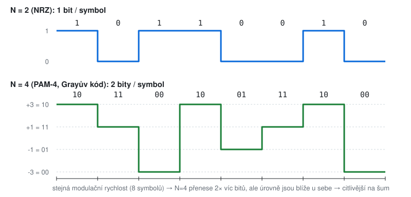

---

# Nyquist (1924/1928) - kanál bez šumu

```
C = 2 · B · log2(N)        [b/s]
```

- **východiska**
	- ideální kanál: žádný šum, ideální dolní propust se šířkou `B`
	- kanálem lze přenést max. **2B symbolů/s** (víc → symboly se slévají, ISI - Inter-Symbol Interference, mezisymbolová interference)
- **význam**
	- při daném pásmu lze rychlost zvýšit jen **více úrovněmi** `N`
	- teoreticky neomezeně - prakticky úrovně "zaniknou" v šumu → Shannon
- příklad: `B = 3100 Hz, N = 2` → `C = 6200 b/s`

---

# Nyquist - vzorkovací teorém

- stejný základ, opačný směr (analog → digital)
- signál s max. frekvencí `f_max` lze přesně rekonstruovat, pokud `f_vz > 2 · f_max`
- telefon: pásmo do 3,4 kHz → vzorkování **8 kHz**, 8 bitů/vzorek → **64 kb/s** (DS0, ISDN B-kanál)
- audio CD: do 20 kHz → **44,1 kHz**

---

# Příklad 1 - Nyquist

- Kanál bez šumu má šířku pásma `B = 4 kHz`.
	- a) Jaká je max. bitová rychlost při 2 úrovních?
	- b) A při 8 úrovních?
	- c) Kolik úrovní je potřeba pro 64 kb/s?

---

# Řešení 1

- a) `2 · 4000 · log2(2)` = **8 kb/s**
- b) `2 · 4000 · log2(8) = 2 · 4000 · 3` = **24 kb/s**
- c) `64000 = 2 · 4000 · log2(N)` → `log2(N) = 8` → **N = 256**

---

# Decibely

- logaritmický **poměr** dvou výkonů, ne jednotka

```
X [dB] = 10 · log10(P1 / P2)
```

| dB | poměr výkonu |
|----|--------------|
| 0 | 1× |
| 3 | ≈ 2× |
| 10 | 10× |
| 20 | 100× |
| 30 | 1000× |
| −3 | ≈ 0,5× |

- proč: obrovské rozsahy + násobení → sčítání (zesílení a útlumy se sčítají)
- **SNR** (Signal-to-Noise Ratio, odstup signál/šum) = `P_signál / P_šum`, udává se v dB

```
SNR_dB = 10 · log10(S/N)          S/N = 10^(SNR_dB / 10)
```

---

# Decibely - z násobení sčítání

- každý článek trasy (kabel, konektor, zesilovač) **násobí** výkon svým poměrem → celkem = **součin**
- logaritmus mění součin na součet: `log(a · b) = log(a) + log(b)`

```
poměr:   P_rx / P_tx = 1/1000  ·  1/2        = 1/2000      (kabel · konektory)
dB:      10 · log10(...) = −30 dB  +  (−3 dB)  = −33 dB
```

- v dB tedy stačí **sčítat a odčítat** (z hlavy), násobení řeší logaritmus
- zpět na poměr až na konci: `−33 dB → 10^(−33/10) ≈ 1/2000`
- stejně dělení → odčítání: `S/N` v dB = signál [dB] − šum [dB]

---

# Decibely - rychlé počítání z hlavy

- stačí si pamatovat: **+10 dB = ×10**, **+3 dB = ×2**
- `6 dB = 3 + 3` → ×4
- `7 dB = 10 − 3` → ×5
- `13 dB = 10 + 3` → ×20
- `37 dB = 30 + 10 − 3` → ×5000
- útlum trasy: kabel `−30 dB`, konektory `−3 dB` → celkem `−33 dB` = ×1/2000

---

# Příklad 2 - decibely (z hlavy)

- Převeďte na poměr: `6 dB`, `9 dB`, `13 dB`, `23 dB`, `37 dB`, `−10 dB`
- Převeďte na dB: `S/N = 1000`, `S/N = 316`, `S/N = 2`, `S/N = 50 000`

---

# Řešení 2

- `6 dB` = ×4, `9 dB` = ×8, `13 dB` = ×20, `23 dB` = ×200, `37 dB` = ×5000, `−10 dB` = ×0,1
- `1000` = 30 dB, `316` ≈ 25 dB, `2` ≈ 3 dB, `50 000` ≈ 47 dB

---

# Shannon (-Hartley, 1948) - kanál se šumem

```
C = B · log2(1 + S/N)      [b/s]
```

- **S/N je poměr, ne dB!** Nejdřív převést: `S/N = 10^(SNR_dB / 10)`
- **východiska**
	- kanál s bílým Gaussovským šumem (AWGN - Additive White Gaussian Noise)
	- platí pro **libovolnou** modulaci a kódování - v rovnici není počet stavů `N`
- **význam**
	- teoretická **horní mez** bezchybného přenosu - nelze překonat
	- 2× větší `B` → 2× větší `C`
	- 2× větší `S/N` (+3 dB) → jen cca +1 b/s na každý Hz
	- moderní kódy (LDPC - Low-Density Parity-Check, turbo kódy) se blíží na zlomky dB

---

# Nyquist vs. Shannon

- Nyquist: kolik přenesu s `N` úrovněmi **bez šumu**
- Shannon: kolik přenesu **nejvýše**, ať dělám cokoliv
- reálný strop = **menší** z obou hodnot
- kombinace: kolik úrovní má smysl použít?

```
2B · log2(N) = B · log2(1 + S/N)   →   N = √(1 + S/N)
```

- pozor: `N` = počet stavů, `S/N` = poměr výkonu signálu a šumu (Noise) - jiné N

---

# Příklad 3 - Shannon

- Telefonní linka `B = 3100 Hz`, `SNR = 30 dB`.
	- a) Jaká je max. teoretická kapacita?
	- b) Porovnejte s odhadem `B · SNR_dB / 3`.
- Kanál `B = 1 MHz`, `S/N = 255` (cca 24 dB).
	- c) Jaká je kapacita podle Shannona?
	- d) Kolik úrovní má smysl použít (Nyquist)?

---

# Řešení 3

- a) `S/N = 10^3 = 1000` → `3100 · log2(1001) = 3100 · 9,97` ≈ **30,9 kb/s**
- b) `3100 · 30 / 3 = 31 kb/s` - odhad sedí
- c) `10^6 · log2(256)` = **8 Mb/s**
- d) `N = √(1 + 255) = 16` úrovní

---

# Příklad 4 - kapacita z pásma a SNR

- a) Kanál má odstup signál/šum `10 dB` a pracuje v pásmu `1 - 3 MHz`. Jaká je jeho max. kapacita?
- b) Kolik úrovní signálu má smysl použít?

---

# Řešení 4

- a) `B = 3 − 1 = 2 MHz`, `S/N = 10^(10/10) = 10`
	- `C = 2 · 10^6 · log2(11) = 2 · 10^6 · 3,46` ≈ **6,92 Mb/s**
- b) `N = √(1 + 10) ≈ 3,3` → zaokrouhlit **dolů na mocninu 2** → `N = 2` (`2 · 2 · 10^6 · 1` = 4 Mb/s)
	- `N = 4` → 8 Mb/s > 6,92 Mb/s → nad Shannonovou mezí, přijímač by úrovně v šumu nerozlišil

---

# Synchronizace

- přijímač musí vědět **kdy** signál vzorkovat a **kde začíná** znak/rámec
- hodiny vysílače a přijímače nikdy nejsou přesně stejné → **drift**
- řešení
	- hodiny posílat zvlášť
	- hodiny "schovat" do signálu
	- synchronizovat se znovu a často

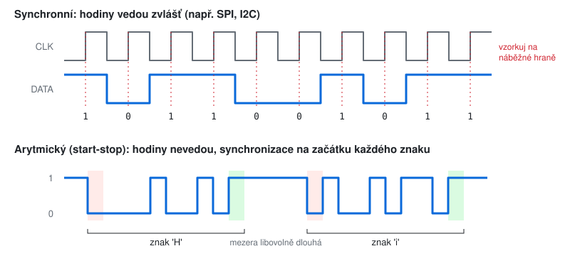

---

# Synchronní přenos

- trvalá časová vazba mezi vysílačem a přijímačem
- hodiny
	- **zvláštním vodičem** - SPI, I2C, paralelní sběrnice
	- **obsažené v signálu** - Manchester (10BASE-T), skupinové kódy, scrambling (příště)
- data jdou souvisle v blocích (rámcích), mezi nimi výplň/preambule
- vyšší efektivita, vhodný pro vysoké rychlosti
- příklady: Ethernet, SDH/SONET, HDLC, USB

---

# Synchronní přenos - animace


- přijímač má takt od vysílače → ví přesně, kdy vzorkovat, i při dlouhé řadě stejných bitů

---

# Asynchronní a arytmický přenos

- **asynchronní** - žádná časová vazba, znaky/události přicházejí kdykoliv
	- řízení pomocí potvrzování (handshake) - např. Centronics STROBE/ACK
- **arytmický (start-stop)** - asynchronní mezi znaky, **synchronní uvnitř znaku**
	- synchronizace se obnovuje sestupnou hranou start bitu každého znaku
	- hodiny stačí "dost přesné" na ~10 bitů

- pozor na terminologii: anglické **"asynchronous serial"** (UART) = česky **arytmický** přenos

---

# Arytmický přenos - synchronizace (animace)


- hodiny přijímače běží jen během znaku, každá sestupná hrana START bitu je spustí znovu od nuly

---

# Arytmický přenos - rámec znaku


- **klid** (idle, mark) = log. 1
- **start bit** = log. 0, sestupná hrana 1→0 spustí časovač přijímače
- **data** 5 - 9 bitů, **LSB první** (Least Significant Bit = nejnižší bit, MSB = nejvyšší)
- **parita** (volitelně)
- **stop bit(y)** = log. 1, vrací linku do klidu → zaručí hranu pro další start
- přijímač vzorkuje uprostřed bitu (typicky 16× oversampling, rozhoduje většina ze 3 vzorků)

---

# Je start bit opravdu bit?

- **ano** - zabírá plný bitový interval `T = 1 / v_m` (9600 Bd → 104 µs)
- nese jedinou informaci: "začíná znak" → hodnota vždy 0, ne data
- počítá se do přenosové rychlosti → **režie**
- stop bit může být **1, 1,5 nebo 2** - spíš minimální doba klidu než "bit"
- chybný stop bit (přijato 0) → **framing error**

---

# Zápis parametrů: 8N1

- `9600 8N1` = 9600 Bd, **8** datových bitů, **N** žádná parita, **1** stop bit
- parita: `N` none, `E` even (sudá), `O` odd (lichá), `M` mark (vždy 1), `S` space (vždy 0)
- běžné kombinace
	- `8N1` - defaultní téměř všude (konzole, Arduino, GPS)
	- `7E1` - staré terminály, ASCII
	- `8E1` - Modbus RTU (nebo 8N2)
	- `8N2` - DMX512 (250 kBd)
- typické rychlosti [Bd]: 1200, 2400, 4800, **9600**, 19200, 38400, 57600, **115200**
	- modulační rychlost; UART má 2 úrovně (`N = 2`) → **1 Bd = 1 b/s** na lince, proto se často píše i „baud rate“ = b/s
	- b/s na lince ≠ užitečná data: start, parita a stop jsou režie
- efektivita `8N1`:
	- 1 znak (bajt) = START + 8 dat + STOP = **10 bitů** na lince, užitečných je 8 → `8 / 10` = **80 %**
	- 9600 Bd = 9600 b/s na lince → `9600 / 10` = **960 znaků (B/s)**
	- užitečných bitů: `960 · 8 = 7680 b/s` (= 80 % z 9600)
	- pozor: ne `9600 / 8 = 1200 B/s` - to by platilo bez start a stop bitu

---

# Příklad 5 - nakreslete (u tabule)

- Nakreslete průběh na lince TX pro znak `'K'` (`0x4B`)
	- a) v režimu `8N1`
	- b) v režimu `7E1`
- Nakreslete znak `'k'` (`0x6B`) v režimu `8E2` (8 dat, sudá parita, 2 stop bity) - jaký je rozdíl proti `'K'`?
- Vyznačte start bit, datové bity, paritu, stop bit a okamžiky vzorkování.

---

# Řešení 5a - 'K' v 8N1

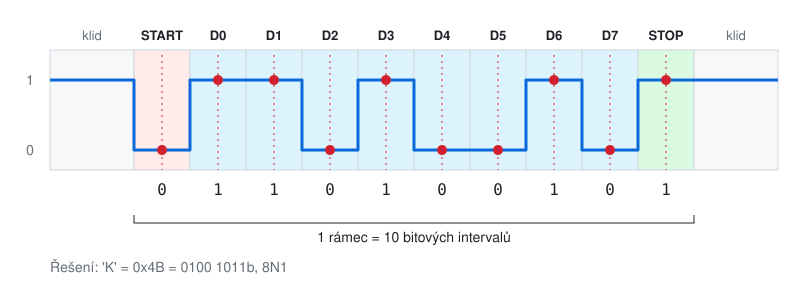

- `0x4B = 0100 1011b` → odesílá se od LSB: `1 1 0 1 0 0 1 0`
- na lince: `0 | 1 1 0 1 0 0 1 0 | 1`

---

# Řešení 5b - 'K' v 7E1

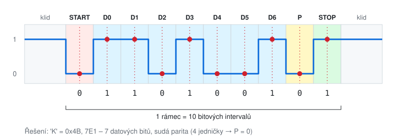

- 7 bitů: `100 1011b` → od LSB: `1 1 0 1 0 0 1`
- počet jedniček = 4 (sudý) → sudá parita **P = 0**
- na lince: `0 | 1 1 0 1 0 0 1 | 0 | 1`

---

# Řešení 5c - 'k' v 8E2

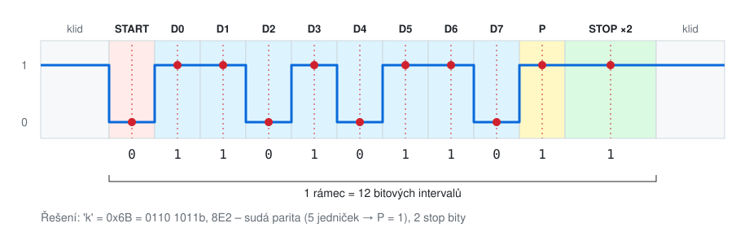

- `0x6B = 0110 1011b` → od LSB: `1 1 0 1 0 1 1 0` (proti `'K'` se liší jen D5 - malé/velké písmeno = bit 5)
- počet jedniček = 5 (lichý) → sudá parita **P = 1**
- na lince: `0 | 1 1 0 1 0 1 1 0 | 1 | 1 1` → **12 bitových intervalů** (8N1 jen 10)

---

# Příklad 6 - dekódujte

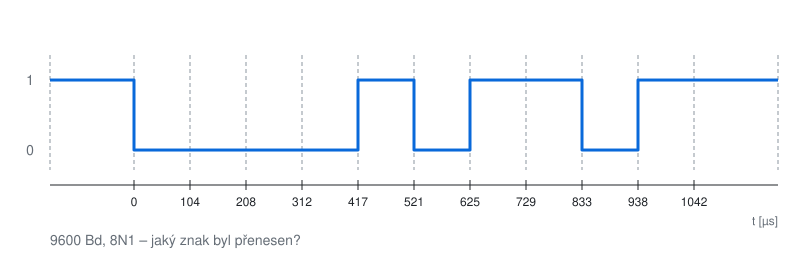

- Jaký znak byl přenesen?
- Jaký by byl paritní bit při `8E1`?

---

# Řešení 6

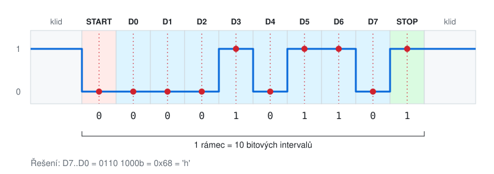

- na lince: `0 | 0 0 0 1 0 1 1 0 | 1` → D0..D7 = `0001 0110`
- otočit (LSB první): D7..D0 = `0110 1000b` = **`0x68 = 'h'`**
- jedničky: 3 (lichý počet) → při `8E1` je **P = 1**

---

# Tolerance hodin

- bez společných hodin se chyba načítá od start bitu do konce rámce
- poslední vzorek (stop bit) je v čase `9,5 T` od sestupné hrany
- vzorek musí zůstat v rámci bitu → chyba < `0,5 T`

```
max. odchylka ≈ 0,5 / 9,5 ≈ 5,3 %   (součet obou stran)
```

- prakticky se doporučuje < 2 - 3 %
- proto nelze posílat dlouhé bloky bez resynchronizace → každý znak má vlastní start bit

---

# Příklad 7 - doba přenosu a tolerance

- a) Jak dlouho trvá přenos 1 KiB při `9600 8N1`? A při `9600 8E2`? A `115200 8N1`?
- b) Kolik bajtů/s skutečně přenese linka `115200 8N1`?
- c) Vysílač běží na 9800 Bd, přijímač je nastaven na 9600 Bd (`8N1`). Přijme znak správně?

---

# Řešení 7

- a) 1 KiB = 1024 B
	- `8N1`: `1024 · 10 / 9600` ≈ **1,07 s**
	- `8E2`: `1024 · 12 / 9600` = **1,28 s**
	- `115200 8N1`: `10240 / 115200` ≈ **89 ms**
- b) `115200 / 10` = **11 520 B/s** (ne 14 400)
- c) hodiny se liší o `9800 − 9600 = 200 Bd` → relativně `200 / 9600` ≈ **2,1 %**
	- přijímač se seřídí na hraně START bitu, pak už jen počítá: poslední vzorek (střed STOP bitu) je `1 + 8 + 0,5 = 9,5` bitu od hrany
	- chyba se za 9,5 bitu nasčítá: `9,5 · 2,1 %` ≈ **0,2 bitu**
	- vzorek smí ujet max. o **půl bitu** (pak by četl sousední bit) → `0,2 < 0,5` → **přijme správně**

---

# Příklad 8 - potřebné SNR (bonus)
<!-- bonus -->

- Chceme přenášet **100 Mb/s** kanálem se šířkou pásma **20 MHz**.
	- Jaké minimální SNR [dB] potřebujeme?
- Co když pásmo zdvojnásobíme (40 MHz, Wi-Fi channel bonding)?

---

# Řešení 8
<!-- bonus -->

- `C/B = 100 / 20 = 5` → `S/N = 2^5 − 1 = 31` → `10 · log10(31)` ≈ **14,9 dB**
- 40 MHz: `C/B = 2,5` → `S/N = 2^2,5 − 1 ≈ 4,66` → **6,7 dB** - širší pásmo snese víc šumu

---

# Příklad 9 - útlum a kapacita (bonus)
<!-- bonus -->

- Kabel 10 km s útlumem `3 dB/km`, 2 konektory po `1,5 dB`, šířka pásma `1 MHz`.
- Signál na výstupu vysílače je o `63 dB` silnější než šum na přijímači.
	- a) O kolik dB se signál cestou zeslabí? Kolikrát je to?
	- b) Jaké je SNR?
	- c) Jaká je max. kapacita kanálu?

---

# Řešení 9
<!-- bonus -->

- a) `10 · 3 + 2 · 1,5 = 33 dB` → `30 + 3` → ×1000 · ×2 = **2000× slabší**
- b) `SNR = 63 − 33 = 30 dB` → `S/N = 1000`
- c) `C = 10^6 · log2(1001)` ≈ **9,97 Mb/s**

---

# Z praxe
<!-- bonus -->

| kanál | B | SNR | Shannon C | reálně |
|-------|---|-----|-----------|--------|
| telefonní linka | 3,1 kHz | ~35 dB | ~36 kb/s | V.34: 33,6 kb/s |
| ADSL (downstream) | ~1 MHz | proměnné | desítky Mb/s | 8 - 24 Mb/s |
| Wi-Fi, kanál 20 MHz | 20 MHz | 25 dB | ~166 Mb/s | 802.11ac 1 stream: 86,7 Mb/s |

- 56k modem (V.90) "porušuje" Shannona? Ne - jiný model kanálu: digitální ústředna, šum hlavně kvantizační, využívá přímo PCM (Pulse Code Modulation) 8 kHz × 7 bitů

---

# Příklad 10 - modem (motivační) (bonus)
<!-- bonus -->

- Telefonní linka přenáší **300 - 3400 Hz**, SNR ≈ **30 dB**.
- Modem **V.32** (1984): nosná **1800 Hz**, **2400 Bd**, **QAM-16**.
	- QAM-16 = signál má **16 různých stavů** → každý symbol nese `log2(16) = 4` bity (jak stavy vypadají → příště, modulace)
	- a) Jaká je šířka pásma linky?
	- b) Jakou bitovou rychlost modem má?
	- c) Jaká je Shannonova mez linky? Kolik % z ní modem využije?
	- d) V.32bis jede 14 400 b/s při stejných 2400 Bd. Kolik bitů nese symbol, kolik stavů potřebuje?
	- e) Proč modem prostě nezvýší modulační rychlost na 4800 Bd?
	- f) Proč vůbec "modem"? Proč nejde po lince poslat přímo obdélníky jako u UART?

---

# Řešení 10
<!-- bonus -->

- a) `B = 3400 − 300` = **3100 Hz**
- b) `2400 · log2(16) = 2400 · 4` = **9600 b/s**
- c) `3100 · log2(1001)` ≈ **30,9 kb/s** → modem využije `9600 / 30 900` ≈ **31 %**
- d) `14 400 / 2400` = **6 bitů** → `2^6` = **64 stavů** (reálně 128 bodů: 6 bitů + 1 bit trellis kódu - stejný trik jako 1000BASE-T)
- e) QAM s `R` Bd zabere ≈ `R` Hz kolem nosné: 2400 Bd → 600 - 3000 Hz ✓, 4800 Bd → 4800 Hz > 3100 Hz → symboly se slévají (ISI)
- f) linka nepřenese stejnosměrnou složku ani nízké frekvence (transformátory, 48 V napájení telefonu) ani nic nad 3,4 kHz → data se musí **namodulovat** na nosnou uprostřed pásma → **MO**dulator-**DEM**odulator

---

# Proč zrovna tahle čísla? (modem)
<!-- bonus -->

- **300 - 3400 Hz**: stačí pro srozumitelnost řeči (souhlásky); dole pryč brum 50 Hz a transformátory, nahoře PCM vzorkování **8 kHz** → Nyquist 4 kHz minus rezerva pro filtr
- **nosná 1800 Hz**: střed pásma → `1800 ± 1200 Hz` = 600 - 3000 Hz, okraje pásma nejvíc zkreslují
- **2400 Bd**: nejvíc, co se s rezervou vejde; násobek 600 Bd starších modemů (V.22: 600 Bd, 1200 b/s)
- **16 stavů**: víc, než SNR telefonu spolehlivě unese bez kódování → V.32bis a V.34 přidaly trellis kód
- **pískání a šum modemu**: tón 2100 Hz vypíná potlačovače ozvěny v ústředně, "šum" = měření linky (line probing) → modem si změří pásmo a SNR, tj. "spočítá Shannona", a vybere rychlost
- **V.34 - 33,6 kb/s** = prakticky Shannonova mez analogové linky
- **V.90 - 56k**: ústředna je digitální → `8000 vzorků/s × 7 bitů = 56 000 b/s` (8. bit v US okruzích T1 "kradený" pro signalizaci); jen směr k uživateli, nahoru 33,6 kb/s

---

# Příklad 11 - Ethernet 100 → 1000 Mb/s (motivační) (bonus)
<!-- bonus -->

- **100BASE-TX** (1995): kabel Cat5 (do 100 MHz), **1 pár pro každý směr**, **125 MBd**, 1 bit/symbol, ale jen **4 z 5 bitů** na lince jsou data (pátý pomáhá synchronizaci - příště)
	- a) Kolik užitečných Mb/s přenese jeden směr?
- Zadání pro **1000BASE-T** (1999): **10× rychleji**, **stejný kabel Cat5**, 100 m
	- b) Navrhněte jak. Nástroje: počet párů, modulační rychlost, bity/symbol, kódování.
	- c) Proč prostě nezvýšit modulační rychlost na 1250 MBd?
	- d) Proč PAM-5, když se posílají 2 bity/symbol a stačilo by PAM-4?
	- e) Jak může jeden pár přenášet oba směry najednou?

---

# Řešení 11
<!-- bonus -->

- a) `125 MBd × 1 bit × 4/5` = **100 Mb/s**
- b) rozklad 10× (125 MBd zůstává!)
	- **×4** - všechny 4 páry, oba směry současně
	- **×2,5** - užitečné bity na symbol: `0,8 → 2` (PAM-5)
	- `4 páry × 125 MBd × 2 bity` = **1000 Mb/s**
- c) Nyquist: 1250 MBd potřebuje pásmo ≥ **625 MHz**, Cat5 je specifikován do **100 MHz** → na Cat5 to nejde
	- podmínka zadání: **stejný kabel** (miliony metrů už v budovách) → modulační rychlost zvednout nejde, zbývají páry a bity/symbol
	- kde kabel změnit šlo: optika **1000BASE-SX/LX jede přesně 1250 MBd**
- d) 4D symbol: `5^4 = 625 ≥ 512` = 8 datových + 1 trellis bit + řídicí symboly; `4^4 = 256` = jen data, žádná rezerva
- e) **echo cancellation**: přijímač zná, co sám vysílá, a odečte to od signálu na páru (jako hybrid v telefonu)

---

# 1000BASE-T a PAM-5
<!-- bonus -->

- **PAM-5** = Pulse Amplitude Modulation s **5 úrovněmi**
- terminologie
	- **úroveň** - napětí `{−2, −1, 0, +1, +2}` (cca ±1 V, ±0,5 V, 0 V), označme `0 ... 4` → `N = 5`
	- **symbol** - jedna úroveň na jednom páru po dobu 8 ns (125 MBd)
	- **4D symbol** - čtveřice symbolů na párech A, B, C, D v témže okamžiku: `XXXX`, např. `0 4 2 1`
- počet různých 4D symbolů: záleží na pořadí, úrovně se opakují → variace s opakováním `5^4 = 625`
- využívá se `512 = 2^9` → **9 bitů** na 4D symbol
	- 8 datových bitů + 1 bit trellis kódu
	- zbylých 113: řídicí symboly (idle, začátek/konec rámce)
	- trellis kód + Viterbiho dekodér → zisk cca 6 dB SNR (Shannon!)
- na jeden symbol: `9 / 4 = 2,25` bitu, z toho **2 datové**
	- teoretické maximum `log2(5) ≈ 2,32` bitu/symbol = míra informace, ne počet "drátů"
	- necelé bity jdou využít jen seskupením symbolů (1 symbol: 4 z 5 úrovní = 2 bity; 4 symboly: 9 bitů)
- **125 MBd** stejně jako 100BASE-TX → Nyquist: stačí pásmo `125 / 2 = 62,5 MHz`, Cat5 má 100 MHz
- každý pár přenáší **oba směry najednou** (full duplex) - echo cancellation (hybrid) odečte vlastní vysílaný signál
- rychlost: `4 páry × 125 MBd × 2 bity = 1000 Mb/s` v každém směru

---

# Proč zrovna tahle čísla? (Ethernet)
<!-- bonus -->

- **125 MBd**: 100BASE-TX převzal fyzickou vrstvu ze starší 100 Mb/s sítě FDDI → ověřeno na Cat5
- **4 z 5 bitů**: pátý bit zajistí dost hran pro obnovu hodin (příště) - cena 20 %
- **1000BASE-T**: držet 125 MBd = stejné spektrum na stejném kabelu; rychlost z **paralelismu** (4 páry) a **víc bitů na symbol**
- cena: úrovně PAM-5 jsou blíže u sebe → potřeba víc SNR → číslicové zpracování (DSP): echo cancellation, potlačení přeslechů mezi páry (NEXT), ekvalizace, trellis kód (+6 dB) - v podstatě "modem" na 125 MBd
- kabel: pro jistotu doplněna specifikace **Cat5e**
- **10GBASE-T**: 4 páry × 800 MBd × PAM-16 (+ LDPC), Cat6a do 500 MHz

---

# Signálové úrovně a použití
<!-- bonus -->

- **TTL/CMOS UART** - 0 V / 3,3 V (5 V), klid = high; mikrokontroléry, Raspberry Pi, USB-serial převodníky
- **RS-232** - ±3 až ±15 V, **inverzní** (log. 1 = záporné napětí), point-to-point, do ~15 m
- **RS-485** - diferenciální pár, více zařízení na sběrnici, až 1200 m; Modbus, DMX512, průmysl
- **MIDI** - 31250 Bd 8N1, proudová smyčka
- konzole routerů a switchů (Cisco: 9600 8N1), GPS (NMEA 4800/9600), LIN v autech
- Linux: `/dev/ttyS0`, `/dev/ttyUSB0`, `/dev/ttyACM0`

```
stty -F /dev/ttyUSB0 115200 cs8 -parenb -cstopb
screen /dev/ttyUSB0 115200
```

---

# Další možnosti UART
<!-- bonus -->

- **řízení toku**
	- hardwarové: RTS/CTS (zvláštní vodiče)
	- softwarové: XON/XOFF (`0x11` / `0x13` v datech)
- **chyby**: parity error, framing error, overrun (přijímač nestihl vyčíst)
- **break** - linka držena v 0 déle než celý rámec (reset, signalizace, LIN sync)
- **9bitový režim** - 9. bit rozlišuje adresu a data (multiprocesorová komunikace)
- **auto-baud** - měření délky start bitu, znak `0x55 'U'` = 01010101 (pravidelné střídání 0 a 1)

---

# Shrnutí

- šířka pásma `B` [Hz] vs. rychlost [b/s] vs. modulační rychlost [Bd]
- `v_p = v_m · log2(N)` - bity/s = symboly/s × bitů na symbol
- Nyquist: `C = 2B · log2(N)` - bez šumu, rozhoduje počet úrovní
- Shannon: `C = B · log2(1 + S/N)` - horní mez, S/N jako poměr, ne dB
- dB: +3 dB = ×2, +10 dB = ×10, útlumy se sčítají
- synchronní (společné/vložené hodiny) vs. arytmický (start-stop)
- UART rámec: start (0), data LSB first, parita, stop (1); `8N1` = 10 bitů/znak

---

# Slovníček zkratek (1/2)

| zkratka | význam |
|---------|--------|
| ISO/OSI, L1 | referenční model Open Systems Interconnection, L1 = 1. (fyzická) vrstva |
| PHY | physical layer - obvod/specifikace fyzické vrstvy |
| Bd | baud - počet symbolů za sekundu |
| dB | decibel - poměr dvou výkonů v logaritmickém měřítku |
| SNR | Signal-to-Noise Ratio - odstup signál/šum |
| AWGN | Additive White Gaussian Noise - bílý Gaussovský šum |
| ISI | Inter-Symbol Interference - slévání sousedních symbolů |
| NRZ | Non-Return-to-Zero - nejjednodušší linkový kód (1 = jedna úroveň, 0 = druhá) |
| PAM-N | Pulse Amplitude Modulation s N úrovněmi |
| QAM-N | Quadrature Amplitude Modulation - kombinace amplitudy a fáze, N stavů |
| PCM | Pulse Code Modulation - vzorkování + kvantování analogového signálu |
| DS0, ISDN | 64 kb/s digitální telefonní kanál; Integrated Services Digital Network |
| DSL, ADSL | (Asymmetric) Digital Subscriber Line - internet po telefonní lince |
| V.32, V.34, V.90 | ITU-T standardy telefonních modemů (9,6 / 33,6 / 56 kb/s) |
| LDPC, trellis, Viterbi | samoopravné kódy a jejich dekodér |

---

# Slovníček zkratek (2/2)

| zkratka | význam |
|---------|--------|
| 1000BASE-T | 1000 Mb/s, BASEband (základní pásmo), Twisted pair (kroucená dvoulinka) |
| UTP, Cat5, RJ-45 | Unshielded Twisted Pair, kategorie kabelu (do 100 MHz), konektor |
| UART | Universal Asynchronous Receiver/Transmitter - obvod pro arytmický přenos |
| TX, RX | transmit (vysílání), receive (příjem) |
| LSB, MSB | Least / Most Significant Bit - nejnižší / nejvyšší bit |
| 8N1, 7E1 | datové bity, parita (None/Even/Odd/Mark/Space), stop bity |
| TTL, CMOS | logické úrovně číslicových obvodů (0 V / 3,3 V nebo 5 V) |
| RS-232, RS-485 | standardy sériové linky (napěťové úrovně, konektory) |
| RTS/CTS | Request To Send / Clear To Send - hardwarové řízení toku |
| XON/XOFF | znaky `0x11` / `0x13` - softwarové řízení toku |
| SPI, I2C | synchronní sběrnice s hodinami (Serial Peripheral Interface, Inter-Integrated Circuit) |
| HDLC, SDH/SONET | synchronní linkový protokol; synchronní hierarchie operátorských sítí |
| FDDI | Fiber Distributed Data Interface - starší 100 Mb/s síť, odtud 125 MBd |
| NEXT, EMI | Near-End Crosstalk (přeslech mezi páry); elektromagnetické rušení/vyzařování |
| DSP | Digital Signal Processing - číslicové zpracování signálu |
| Cat5e, Cat6a | vylepšené kategorie kabelu (1000BASE-T, resp. 10GBASE-T do 500 MHz) |
| T1 | americký digitální okruh 1,544 Mb/s (24 telefonních kanálů) |
| Modbus RTU, DMX512, LIN, MIDI | průmyslová, osvětlovací, automobilová, hudební sériová komunikace |
| GPS, NMEA | satelitní navigace; textový protokol GPS přijímačů |
| ASCII, KiB | 7bitové kódování znaků; 1 KiB = 1024 B |
