# KIV/UPS cvičení 6.

## Kódování a modulace, multiplex

Jindrich Skupa & Martin Ubl

### https://github.com/jindrichskupa/kiv-ups

---

# Agenda

- Linkové kódy: NRZ-L, NRZ-M/S, RZ, Manchester, diferenciální Manchester
- 4B/5B a MLT-3 (100BASE-TX)
- Modulace: ASK, FSK, PSK a jejich kombinace, modulační tabulka
- Konstelační diagram: QPSK, QAM-16
- Multiplex: FDM, WDM, TDM, statistický
- Příklady ke každému tématu (kreslení, dekódování, počítání)
- Plán (90 min): teorie ~15 min, příklady 1–10 (~70 min), 11–13 bonus

---

# Linkový kód = kódovací tabulka

- říká, co znamená **úroveň** nebo **přechod** signálu během jednoho bitového intervalu
- chceme od něj
	- dost hran → přijímač z nich obnoví takt (synchronní implicitní přenos)
	- nulovou stejnosměrnou složku
	- co nejnižší frekvence → co nejmenší šířku pásma

<small>Pozn.: stejnosměrnou složku nepřenese transformátor (oddělovací "magnetika" v každém ethernetovém portu) ani kondenzátor ve vedení. Dlouhá řada stejných bitů pak "ujede" a přijímač ztratí rozhodovací úroveň.</small>

---

# NRZ-L, NRZ-M

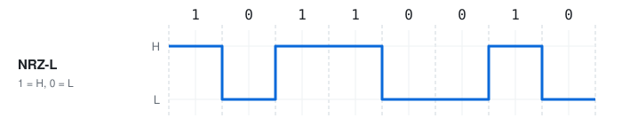

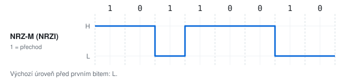

<small>Pozn.: NRZ-I je souhrnný název pro NRZ-M (1 = přechod, magnetické pásky, 100BASE-FX) a NRZ-S (0 = přechod, HDLC, USB). U NRZ-I nezáleží na polaritě vodičů - prohození drátů nic nezkazí.</small>

---

# NRZ-S, RZ

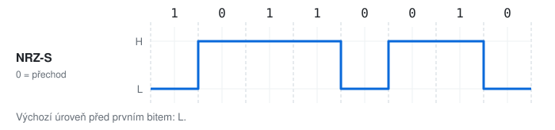

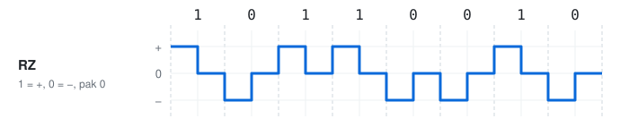

<small>Pozn.: RZ (Return to Zero) má 3 úrovně a v polovině každého bitu se vrací na 0 → hrana je v každém bitu, ale potřebuje dvojnásobnou modulační rychlost.</small>

---

# Manchester, diferenciální Manchester

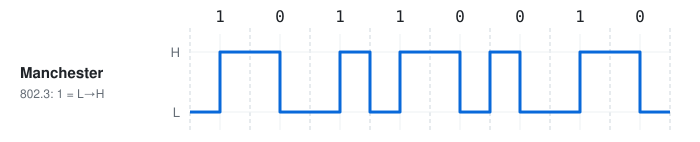

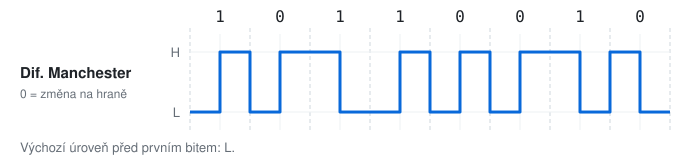

<small>Pozn.: Manchester má přechod uprostřed **každého** bitu (původní definice: H→L = 1; IEEE 802.3, 10BASE-T: L→H = 1). Diferenciální Manchester (Token Ring) kóduje bit přítomností změny na **začátku** intervalu, polarita vodičů je pak jedno.</small>

---

# Proč ne obyčejné NRZ-L?

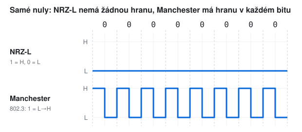

<small>Pozn.: Manchester tuto výhodu platí dvojnásobnou modulační rychlostí: 10 Mb/s = 20 MBd.</small>

---

# Příklad 1 - nakreslete

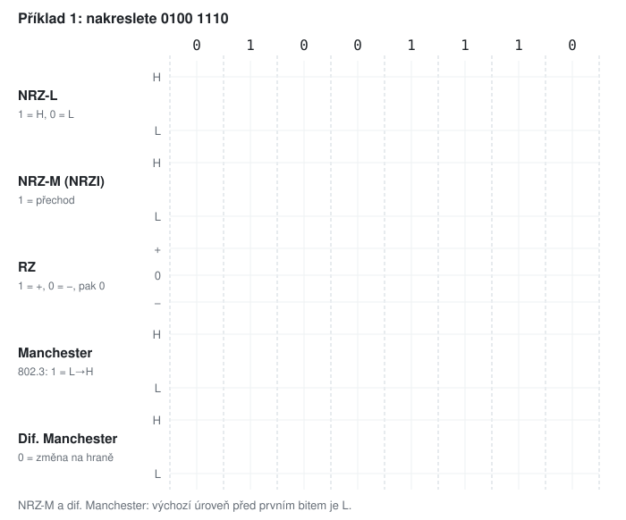

---

# Řešení 1

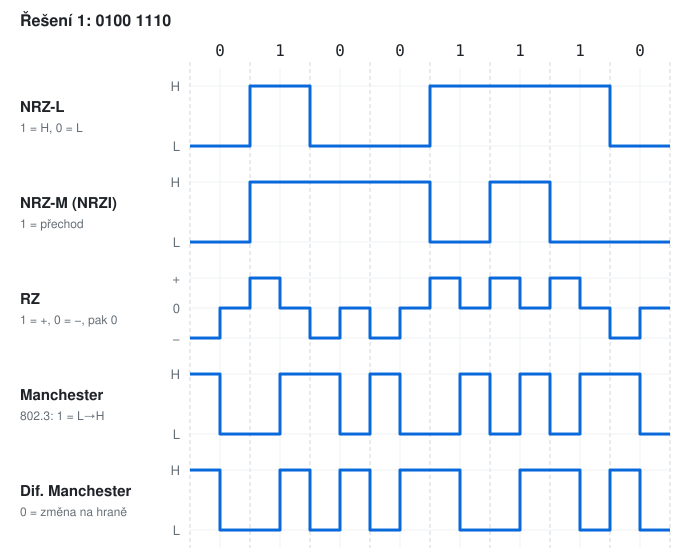

---

# Příklad 2 - dekódujte

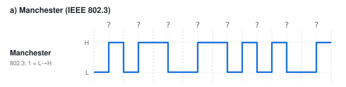

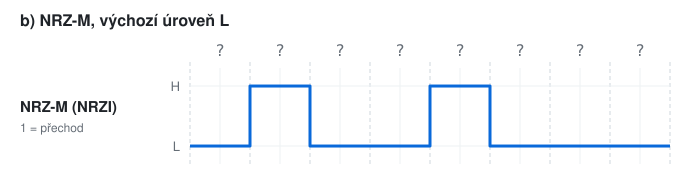

- napište bity a hodnotu v hexadecimálním zápisu

---

# Řešení 2

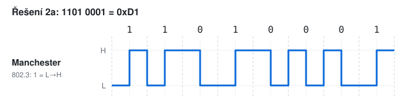

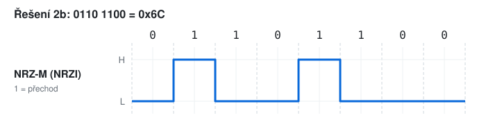

<small>Pozn.: u Manchesteru čteme jen přechod **uprostřed** bitu, přechody na hranách intervalů jsou jen "přípravné". U NRZ-M porovnáváme úroveň s předchozím bitem.</small>

---

# Příklad 3 - frekvence a pásmo

Přenášíme **10 Mb/s**.

- a) Jaká je modulační rychlost v NRZ-L a v Manchesteru?
- b) Jaká posloupnost bitů vytvoří nejvyšší základní frekvenci a jaká to je (NRZ-L, Manchester)?
- c) Kolik bitů nese 1 Bd u NRZ-L, Manchesteru a 4B/5B?
- d) Které kódy mají nulovou stejnosměrnou složku pro **libovolná** data (úrovně ±U)?

<small>Pozn.: základní frekvence obdélníkového průběhu = 1 / perioda; perioda = jedna celá vlna nahoru a dolů.</small>

---

# Řešení 3

- a) NRZ-L 10 MBd (1 bit = 1 symbol), Manchester **20 MBd** (2 půlbity na bit)
- b) NRZ-L: `1010…` → perioda 2 bity → **5 MHz**; Manchester: `0000…` nebo `1111…` → perioda 1 bit → **10 MHz**
- c) NRZ-L 1 b/Bd, Manchester 0,5 b/Bd, 4B/5B (+ NRZI) 0,8 b/Bd
- d) Manchester a diferenciální Manchester - každý bit je půl H a půl L

<small>Pozn.: proto 100 Mb/s Ethernet Manchester nepoužívá: potřeboval by 200 MBd a 100 MHz, což je celé pásmo Cat5. 4B/5B + MLT-3 vystačí s 125 MBd a 31,25 MHz.</small>

---

# Kódování 4B/5B

| data | 0000 | 0001 | 0010 | 0011 | 0100 | 0101 | 0110 | 0111 |
|------|------|------|------|------|------|------|------|------|
| kód | 11110 | 01001 | 10100 | 10101 | 01010 | 01011 | 01110 | 01111 |

| data | 1000 | 1001 | 1010 | 1011 | 1100 | 1101 | 1110 | 1111 |
|------|------|------|------|------|------|------|------|------|
| kód | 10010 | 10011 | 10110 | 10111 | 11010 | 11011 | 11100 | 11101 |

- každé 4 bity dat → 5 bitů na lince, kódy mají **nejvýš 3 nuly za sebou** (i přes hranice kódů)
- po zakódování NRZI (1 = přechod) → hrana nejpozději po 3 bitech

<small>Pozn.: 5 bitů = 32 kódů, data potřebují 16. Zbytek jsou řídicí symboly (`11111` = IDLE, J/K = začátek rámce, T/R = konec) nebo zakázané kombinace. Užitečných je 4/5 = 80 % (Manchester jen 50 %).</small>

---

# MLT-3 vs. NRZI

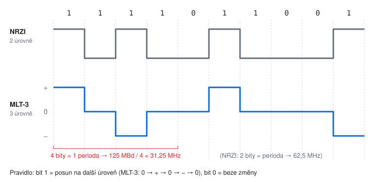

<small>Pozn.: MLT-3 (Multi-Level Transmit, 3 úrovně) potřebuje na celou periodu 4 jedničky → nejvyšší základní frekvence je čtvrtina modulační rychlosti. 100BASE-TX: 125 MBd → 31,25 MHz.</small>

---

# Příklad 4 - 4B/5B a MLT-3

- a) Zakódujte data `0001 0000 1110` pomocí 4B/5B.
- b) Výsledek nakreslete v NRZI a v MLT-3 (výchozí stav: NRZI L, MLT-3 na 0).
- c) Jak dlouhá je nejdelší řada nul v datech a v kódu?
- d) Kolik MBd je na lince, když data tečou rychlostí 100 Mb/s?

---

# Řešení 4

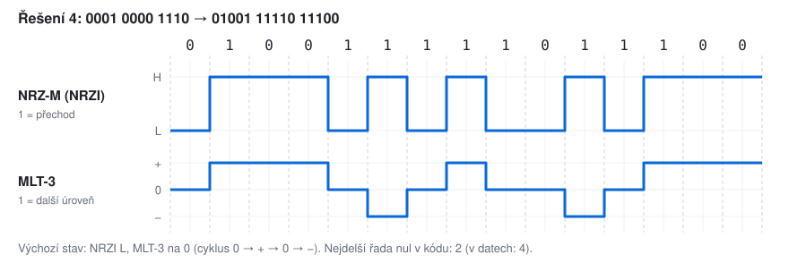

- d) 100 Mb/s · 5/4 = **125 MBd**

---

# Modulace

- přeložené pásmo: data nesou vlastnosti nosné `y(t) = A · sin(2π · f · t + φ)`
- měníme amplitudu **A** (ASK), frekvenci **f** (FSK), fázi **φ** (PSK) nebo jejich kombinaci
- **modulační tabulka**: který symbol (n-tice bitů) dostane jakou trojici `[A, f, φ]`

<small>Pozn.: modulaci potřebujeme všude, kde médium nepropustí nízké frekvence: rádio (anténa musí mít rozměr srovnatelný s vlnovou délkou), telefonní linka (300–3400 Hz), sdílení jednoho média více vysílači (FDM).</small>

---

# ASK - amplitudová

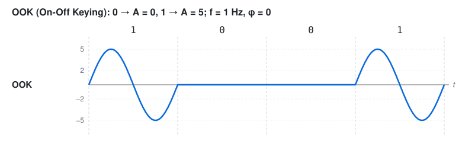

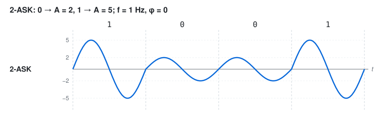

<small>Pozn.: OOK (On-Off Keying) je nejjednodušší, ale "nic" se nedá odlišit od přerušené linky. 2-ASK proto i pro 0 vysílá (menší amplitudou).</small>

---

# FSK a PSK

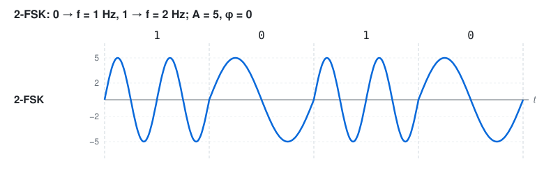

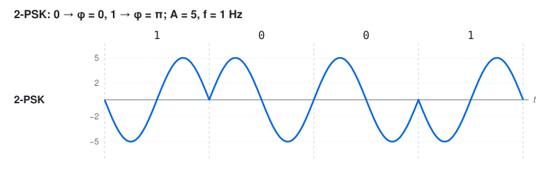

<small>Pozn.: fáze se počítá od začátku každého intervalu; φ = π znamená, že vlna začne směrem dolů. FSK používaly první modemy (V.21, 300 b/s), PSK Wi-Fi v nejnižších rychlostech (BPSK).</small>

---

# Kombinace - 4 a 8 stavů

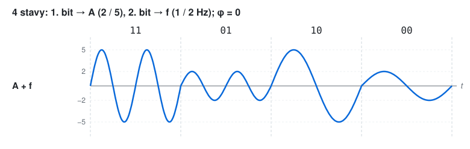

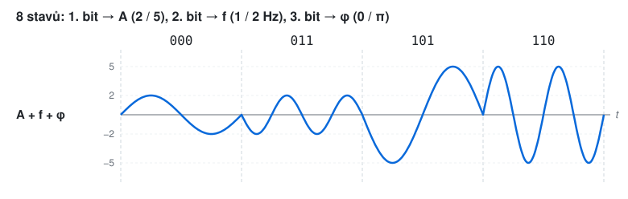

<small>Pozn.: tabulka se čte "odshora dolů" - 1. bit symbolu určuje A, 2. bit f, 3. bit φ. Tři binární veličiny = 2³ = 8 stavů = 3 bity na symbol.</small>

---

# Příklad 5 - nakreslete ASK, FSK, PSK

- 2-ASK: `0 → A = 2`, `1 → A = 5`; f = 1 Hz, φ = 0
- 2-FSK: `0 → f = 1 Hz`, `1 → f = 2 Hz`; A = 5, φ = 0
- 2-PSK: `0 → φ = 0`, `1 → φ = π`; A = 5, f = 1 Hz

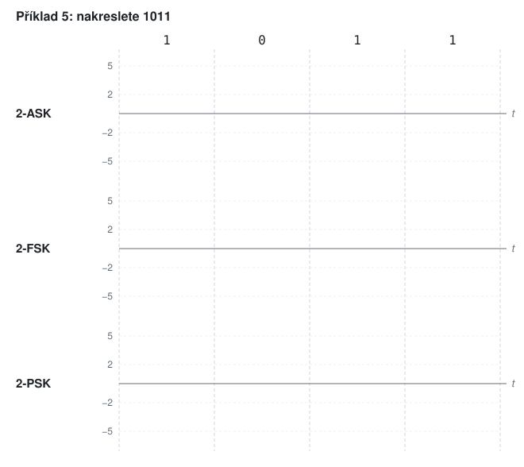

---

# Řešení 5

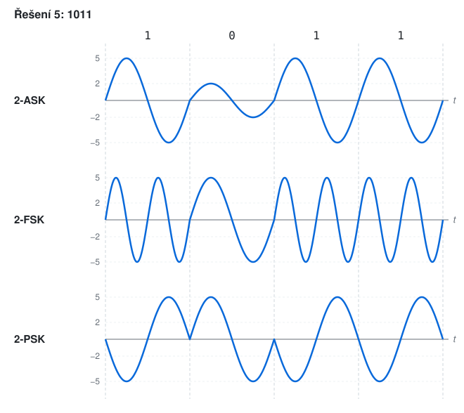

---

# Příklad 6 - navrhněte modulaci

- a) Navrhněte modulační tabulku pro **4 stavy** pomocí amplitudy (2 V / 5 V) a fáze (0 / π), f = 1 Hz.
- b) Nakreslete symboly `10 01 11 00`.
- c) Kolik b/s přenesete při 1200 Bd? A kolik se stejnou tabulkou rozšířenou o frekvenci (1 / 2 Hz)?

---

# Řešení 6

| | 0 | 1 |
|-|---|---|
| A (1. bit) | 2 V | 5 V |
| φ (2. bit) | 0 | π |

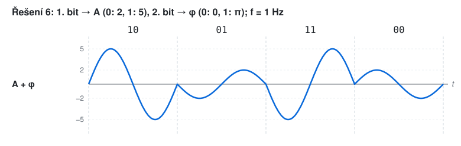

- c) 4 stavy = 2 bity → 1200 · 2 = **2400 b/s**; s frekvencí 8 stavů = 3 bity → **3600 b/s**

---

# Příklad 7 - dekódujte

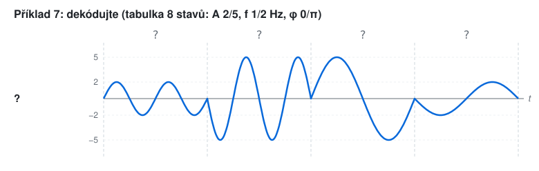

| | 0 | 1 |
|-|---|---|
| A (1. bit) | 2 | 5 |
| f (2. bit) | 1 Hz | 2 Hz |
| φ (3. bit) | 0 | π |

---

# Řešení 7

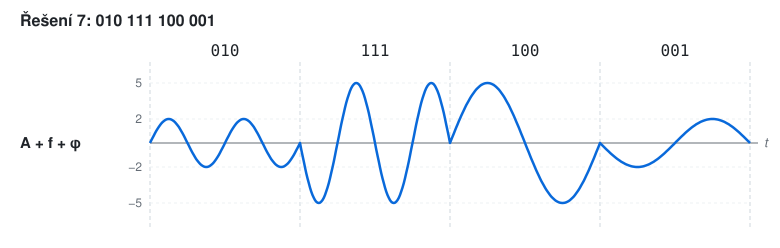

<small>Pozn.: postup pro každý interval: výška vrcholu → A, počet period → f, směr startu (nahoru = 0, dolů = π) → φ.</small>

---

# Konstelační diagram

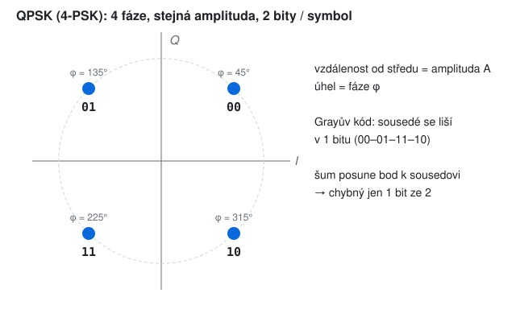

<small>Pozn.: bod v rovině = jeden stav. Vzdálenost od středu je amplituda, úhel od osy I je fáze. Frekvenci diagram nezobrazuje, je pro všechny stavy stejná.</small>

---

# QAM-16

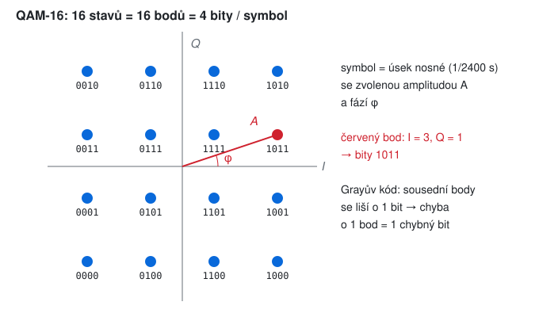

---

# Symbol na lince

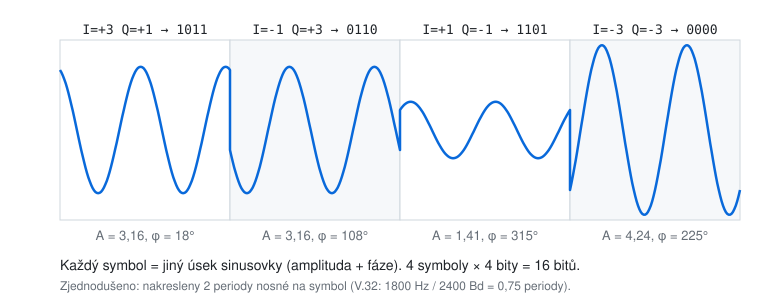

<small>Pozn.: přijímač každý úsek porovná s 16 body konstelace a vybere nejbližší. Šum bod "rozmaže" - čím blíž body jsou, tím dřív se splete.</small>

---

# Příklad 8 - kolik stavů?

- a) Modem V.32: 2400 Bd, 9600 b/s. Kolik stavů má konstelace?
- b) Modem V.22bis: 600 Bd, 2400 b/s. Kolik stavů?
- c) Při 2400 Bd chceme 14 400 b/s. Kolik stavů je potřeba?
- d) Wi-Fi 5 používá QAM-256, Wi-Fi 6 QAM-1024. O kolik procent vzroste rychlost při stejné modulační rychlosti?
- e) Nakreslete konstelaci 8-PSK s Grayovým kódem.

---

# Řešení 8

- a) 9600 / 2400 = 4 bity → 2⁴ = **16 stavů** (QAM-16)
- b) 2400 / 600 = 4 bity → **16 stavů**
- c) 14 400 / 2400 = 6 bitů → 2⁶ = **64 stavů**
- d) log2(256) = 8 bitů, log2(1024) = 10 bitů → 10 / 8 = **+25 %**
- e) 8 bodů na kružnici po 45°, sousední body se liší v 1 bitu: `000 001 011 010 110 111 101 100`

<small>Pozn.: +25 % není zadarmo - body QAM-1024 jsou 2× blíž než u QAM-256, takže je potřeba asi o 6 dB lepší odstup signálu od šumu (proto funguje jen blízko u access pointu).</small>

---

# Multiplex

- **FDM** (frekvenční) - každý kanál dostane vlastní nosnou
- **WDM** (vlnový) - totéž pro světlo, každý kanál = jiná barva (vlnová délka) ve vlákně
- **TDM** (časový) - každý kanál dostane pevný časový slot v rámci
- **statistický (STDM)** - sloty se přidělují jen tomu, kdo vysílá, každý blok nese adresu

<small>Pozn.: FDM a WDM se odehrávají na fyzické vrstvě (signály se sčítají v médiu), TDM a statistický multiplex prokládají rámce a patří spíš k linkové vrstvě.</small>

---

# FDM

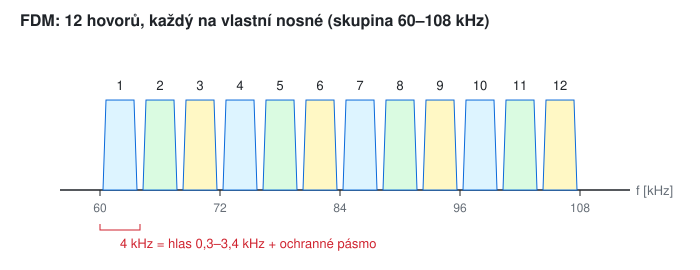

---

# Příklad 9 - FDM

- a) Kolik hovorů po 4 kHz se vejde do pásma 60–108 kHz?
- b) Wi-Fi v pásmu 2,4 GHz má k dispozici 2400–2483,5 MHz, kanál je široký 20 MHz. Kolik se vejde nepřekrývajících se kanálů?
- c) Kanály Wi-Fi 2,4 GHz jsou na mřížce po 5 MHz (kanál 1 = 2412 MHz, kanál 13 = 2472 MHz). Které kanály použijete, aby se nepřekrývaly?

---

# Řešení 9

- a) (108 − 60) / 4 = **12 hovorů** (základní skupina telefonního FDM)
- b) 83,5 / 20 = 4,17 → teoreticky **4**
- c) střední frekvence musí být od sebe ≥ 20 MHz = 4 kroky mřížky: **1, 5, 9, 13** (v Evropě), v USA kanály jen do 11, proto známé **1, 6, 11**

<small>Pozn.: 1, 6, 11 pochází z 802.11b, kde měl kanál šířku 22 MHz (5 kroků po 5 MHz).</small>

---

# TDM - rámec E1

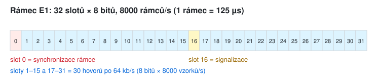

---

# Příklad 10 - TDM

- a) Jaká je bitová rychlost linky E1 (32 slotů × 8 bitů, 8000 rámců/s)?
- b) Kolik z toho jsou užitečná data hovorů a jaká je efektivita?
- c) Americká T1: 24 slotů × 8 bitů + 1 synchronizační bit, 8000 rámců/s. Rychlost a efektivita?
- d) Jak dlouho trvá jeden slot E1 a jeden bit?

---

# Řešení 10

- a) 32 · 8 · 8000 = **2 048 000 b/s = 2,048 Mb/s**
- b) 30 hovorů · 64 kb/s = 1,92 Mb/s → 30 / 32 = **93,75 %**
- c) (24 · 8 + 1) · 8000 = **1,544 Mb/s**, užitečných 24 · 64 = 1,536 Mb/s → 192 / 193 = **99,5 %**
- d) rámec 1 / 8000 s = 125 µs, slot 125 / 32 ≈ **3,9 µs**, bit 1 / 2,048 MHz ≈ **488 ns**

<small>Pozn.: 8000 rámců/s = vzorkovací frekvence telefonního hovoru (2 × 4 kHz, Nyquist z minula); 8 bitů na vzorek → 64 kb/s na hovor.</small>

---

# Příklad 11 - proč QAM, a ne 16-PSK? (bonus)
<!-- bonus -->

- obě mají 16 stavů a maximální amplitudu 1
- a) Jaká je vzdálenost sousedních bodů u 16-PSK (body na kružnici)?
- b) Jaká u QAM-16 (mřížka 4 × 4, roh v amplitudě 1)?
- c) Která modulace je odolnější vůči šumu?

---

# Řešení 11
<!-- bonus -->

- a) 16-PSK: úhel 360° / 16 = 22,5°, tětiva `d = 2 · sin(11,25°) ≈ 0,39`
- b) QAM-16: body na `±1, ±3`, roh má amplitudu `√(3² + 3²) = √18 ≈ 4,24`, krok mřížky 2 → `d = 2 / 4,24 ≈ 0,47`
- c) QAM-16 - body jsou o ~20 % dál od sebe, šum musí být větší, aby přijímač zaměnil sousední bod

<small>Pozn.: PSK využívá jen kružnici, QAM celou plochu kruhu. Při více stavech je rozdíl ještě větší, proto se nad 8 stavů používá skoro výhradně QAM.</small>

---

# TDM vs. statistický multiplex
<!-- bonus -->

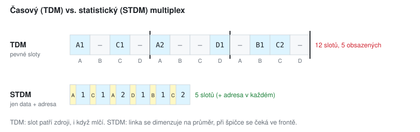

---

# Příklad 12 - statistický multiplex (bonus)
<!-- bonus -->

4 terminály po 9600 b/s, každý vysílá v průměru 25 % času.

- a) Jakou rychlost potřebuje linka s TDM?
- b) Jakou v průměru se statistickým multiplexem, pokud každý blok nese 15 B dat a 1 B adresy?
- c) Co se stane, když začnou vysílat všichni současně?

---

# Řešení 12
<!-- bonus -->

- a) TDM: 4 · 9600 = **38 400 b/s** (sloty se rezervují i pro mlčící terminály)
- b) průměr dat 4 · 9600 · 0,25 = 9600 b/s, s adresou × 16/15 → **10 240 b/s**
- c) linka nestíhá → data čekají ve **frontě** (zpoždění), při dlouhé špičce se fronta zaplní a data se zahazují

<small>Pozn.: na statistickém multiplexu stojí celý paketový internet - linky se dimenzují na průměr, ne na součet maxim.</small>

---

# Příklad 13 - WDM (z hlavy) (bonus)
<!-- bonus -->

- a) DWDM vlákno nese 80 kanálů po 100 Gb/s. Jaká je celková kapacita?
- b) Kolik takových vláken by bylo potřeba bez WDM pro stejnou kapacitu?

---

# Řešení 13
<!-- bonus -->

- a) 80 · 100 Gb/s = **8 Tb/s** na jednom vlákně
- b) **80** vláken (a 80 párů laserů a přijímačů na každém konci, ale bez drahých zesilovačů pro každé vlákno zvlášť)

<small>Pozn.: DWDM (Dense WDM) má kanály na mřížce 100 GHz (asi 0,8 nm) kolem 1550 nm. Jeden optický zesilovač zesílí všech 80 kanálů najednou.</small>

---

# Shrnutí

- linkový kód: úroveň nebo přechod nese bit; Manchester = hrana v každém bitu za cenu 2× Bd
- 4B/5B: synchronizace za 80 % místo 50 %; MLT-3 snižuje frekvenci na čtvrtinu Bd
- modulace mění A, f, φ nosné; N stavů = log2(N) bitů na symbol
- konstelační diagram: body = stavy; Grayův kód → chyba o 1 bod = 1 chybný bit
- multiplex: FDM/WDM (frekvence, barva), TDM (pevné sloty), statistický (podle potřeby)

---

# Slovníček zkratek (1/2)

| zkratka | význam |
|---------|--------|
| NRZ-L, NRZ-M, NRZ-S, NRZI | Non-Return-to-Zero Level / Mark / Space / Inverted |
| RZ | Return to Zero |
| 4B/5B | 4 datové bity kódované 5 bity na lince |
| MLT-3 | Multi-Level Transmit, 3 úrovně |
| 10BASE-T, 100BASE-TX, 100BASE-FX | Ethernet 10 Mb/s (Manchester), 100 Mb/s po metalice (4B/5B + MLT-3), 100 Mb/s po optice (4B/5B + NRZI) |

---

# Slovníček zkratek (2/2)

| zkratka | význam |
|---------|--------|
| ASK, OOK, FSK, PSK, BPSK, QPSK | Amplitude / On-Off / Frequency / Phase Shift Keying, Binary / Quadrature PSK |
| QAM-N | Quadrature Amplitude Modulation s N stavy |
| I, Q | In-phase a Quadrature - osy konstelačního diagramu |
| FDM, WDM, DWDM | Frequency / Wavelength / Dense Wavelength Division Multiplexing |
| TDM, STDM | Time Division Multiplexing, Statistical TDM |
| E1, T1 | evropská (2,048 Mb/s) a americká (1,544 Mb/s) linka TDM |
| HDLC, USB | linkový protokol High-Level Data Link Control, Universal Serial Bus |
| V.21, V.22bis, V.32 | ITU-T standardy modemů (300 / 2400 / 9600 b/s) |
