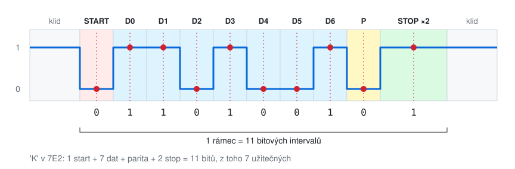
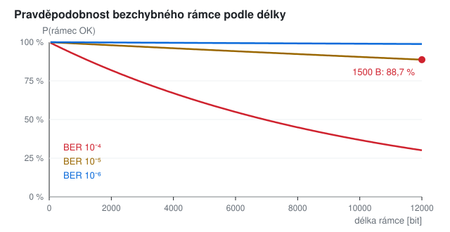
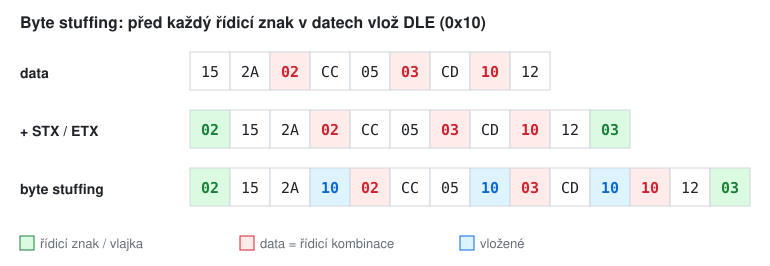
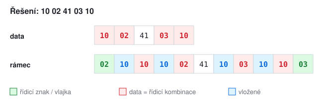
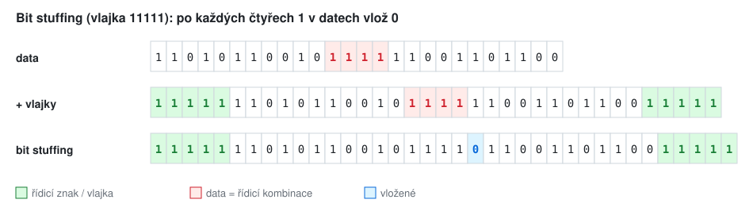
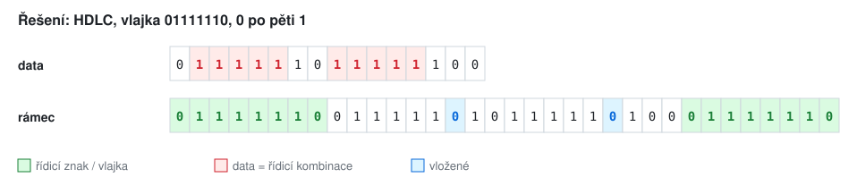
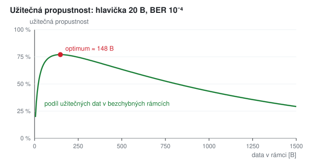

# KIV/UPS cvičení 7.

## Arytmický přenos, chybovost, transparentnost

Jindrich Skupa & Martin Ubl

### https://github.com/jindrichskupa/kiv-ups

---

# Agenda

- Efektivita arytmického přenosu (opakování z cvičení 5)
- Pravděpodobnost chyby při přenosu - jak velký rámec si můžeme dovolit
- Transparentnost: znakově orientovaný protokol (byte stuffing)
- Transparentnost: bitově orientovaný protokol (bit stuffing)
- Plán (90 min): opakování 5 → efektivita 10 → chybovost 22 → byte stuffing 20 → bit stuffing 23 → shrnutí 5 + rezerva 5; bonusové příklady na doma

---

# Arytmický přenos a efektivita



- efektivita `e = datové bity / všechny bity rámce` → 7E2: `e = 7 / (1 + 7 + 1 + 2) = 7 / 11 ≐ 63,6 %`

<small>Pozn.: rámec znaku z cvičení 5: klid H, start bit L, data od LSB, volitelně parita, stop bity H. Zápis 7E2 = 7 datových bitů, sudá (Even) parita, 2 stop bity.</small>

---

# Příklad 1 - efektivita a doba přenosu

- a) Spočítejte efektivitu pro 8N1, 7E1, 7E2, 8O2 a 5N1.
- b) Kolik znaků za sekundu přenese linka 115 200 Bd v 8N1? Jak dlouho trvá přenos souboru 1 MiB?
- c) Totéž pro 9600 Bd a 7E2 (7bitové ASCII znaky).
- d) Jak zvýšit efektivitu? Co za to zaplatíme?

---

# Řešení 1

<style scoped>table { font-size: 22px; }</style>

| formát | bitů v rámci | efektivita |
|--------|--------------|------------|
| 8N1 | 1 + 8 + 1 = 10 | 80 % |
| 7E1 | 1 + 7 + 1 + 1 = 10 | 70 % |
| 7E2 | 1 + 7 + 1 + 2 = 11 | 63,6 % |
| 8O2 | 1 + 8 + 1 + 2 = 12 | 66,7 % |
| 5N1 | 1 + 5 + 1 = 7 | 71,4 % |

- b) 115 200 / 10 = **11 520 znaků/s**; 1 048 576 / 11 520 ≐ **91 s**
- c) 9600 / 11 ≐ 872,7 znaků/s; 1 048 576 / 872,7 ≐ **1201 s ≈ 20 min**
- d) delší rámec (víc datových bitů na jeden start/stop) - ale delší rámec má větší šanci, že v něm bude chyba (další slide) a hodiny se víc rozejdou

---

# Pravděpodobnost chyby



- chyba bitu `p` nezávisle na ostatních → rámec n bitů je celý v pořádku s pravděpodobností `(1 − p)^n`

<small>Pozn.: BER (Bit Error Rate) = podíl chybných bitů. Pro malé p platí `(1 − p)^n ≈ 1 − n · p`, dokud je `n · p` malé.</small>

---

# Příklad 2 - jak velký rámec?

Pravděpodobnost chybného přenosu jednoho bitu je **1 %**. Jak velký rámec můžeme přenášet, aby se bezchybně přenesl s pravděpodobností alespoň **95 %**?

<small>Pozn.: nerovnici `0,99^n > 0,95` zlogaritmujte. Pozor na znaménko - logaritmus čísla menšího než 1 je záporný.</small>

---

# Řešení 2

```
p(bit OK) = 1 − 0,01 = 0,99
0,99^n > 0,95
n · log(0,99) > log(0,95)          | : log(0,99) < 0 → otočit nerovnost
n < log(0,95) / log(0,99) = 5,1036…
n = 5 bitů
```

- kontrola: `0,99^5 = 95,1 %` ✓, `0,99^6 = 94,1 %` ✗
- zaokrouhlujeme **dolů**, jinak pravděpodobnost klesne pod požadovanou mez

---

# Příklad 3 - Ethernet a BER

Ethernetový rámec má 1500 B.

- a) Jaká je pravděpodobnost bezchybného přenosu rámce při BER 10⁻⁶? A při 10⁻⁵?
- b) Jak velký rámec (v bajtech) si můžeme dovolit při BER 10⁻⁵, aby prošel s pravděpodobností 99 %?

---

# Řešení 3

```
a) n = 1500 · 8 = 12 000 bitů
   BER 10⁻⁶: (1 − 10⁻⁶)^12000 ≐ 0,988 = 98,8 %
   BER 10⁻⁵: (1 − 10⁻⁵)^12000 ≐ 0,887 = 88,7 %   → každý 9. rámec se zahodí

b) n < log(0,99) / log(1 − 10⁻⁵) = 1005,03
   n = 1005 bitů → 1005 / 8 = 125,6 → 125 B
```

<small>Pozn.: odhad `1 − n · p`: 1 − 12 000 · 10⁻⁶ = 98,8 %, sedí. Pro 10⁻⁵ dá 88 % - už je vidět, že je to jen přiblížení. Metalický Ethernet má BER kolem 10⁻¹⁰ a lepší, 10⁻⁵ je spíš rádio.</small>

---

# Znakově orientovaný protokol

- rámec ohraničují řídicí znaky ASCII: **STX** (`0x02`) začátek, **ETX** (`0x03`) konec
- když se `0x02` / `0x03` objeví v datech, přijímač by je pochopil jako hranici rámce
- **byte stuffing**: před každý řídicí znak v datech vlož **DLE** (`0x10`), i před DLE samotné
- přijímač: po DLE vezmi další bajt jako data, DLE zahoď

<small>Pozn.: DLE = Data Link Escape. Tak fungoval třeba IBM BISYNC. Stejný princip je v `\"` uvnitř řetězce v C nebo v escapování `|` v textovém protokolu semestrálky.</small>

---

# Příklad 4 - byte stuffing

Znakově orientovaný protokol, rámec ohraničený STX (`0x02`) a ETX (`0x03`), escape znak DLE (`0x10`). Zajistěte transparentnost pro data:

```
15 2A 02 CC 05 03 CD 10 12
```

---

# Řešení 4



```
02 15 2A 10 02 CC 05 10 03 CD 10 10 12 03
```

<small>Pozn.: escapovat se musí i `10` v datech - jinak by přijímač dvojici `10 12` četl jako "escapované 12" a bajt `10` by ztratil.</small>

---

# Příklad 5 - tam a zpět

- a) Zabalte do rámce data `10 02 41 03 10`.
- b) Přijali jste rámec `02 10 10 48 10 03 49 10 02 03`. Jaká data obsahuje?
- c) Kolik bajtů má rámec v a) a jaká je efektivita?

---

# Řešení 5



- b) `02 | 10 10 | 48 | 10 03 | 49 | 10 02 | 03` → data **`10 48 03 49 02`**
- c) 11 B rámce, 5 B dat → `5 / 11 ≐ 45 %`

---

# Bitově orientovaný protokol

- rámec ohraničuje **vlajka** (křídlová značka) - pevná posloupnost bitů
- v datech se vlajka nesmí objevit → **bit stuffing**: vysílač po určitém počtu jedniček **vždy** vloží 0
- přijímač stejnou 0 **vždy** zahodí; když místo ní přijde 1, je to vlajka
- PDF varianta: vlajka `11111`, 0 se vkládá po **čtyřech** jedničkách
- HDLC: vlajka `01111110`, 0 se vkládá po **pěti** jedničkách

<small>Pozn.: "vždy" je důležité - vkládá se i tehdy, když za jedničkami v datech stejně následuje 0. Jinak by přijímač nepoznal, kterou nulu má zahodit. HDLC a jeho potomci: PPP, frame relay, X.25.</small>

---

# Příklad 6 - bit stuffing

Bitově orientovaný protokol s vlajkou `11111`. Zajistěte transparentnost pro data:

```
11010110010111111001101100
```

---

# Řešení 6



```
11111 110101100101111011001101100 11111
```

---

# Příklad 7 - HDLC

Vlajka `01111110`, nula se vkládá po pěti jedničkách.

- a) Zabalte do rámce data `0111111011111100`.
- b) Přijali jste proud (bez mezer!) `0111111010111110011111011001111110`. Najděte vlajky a obnovte data.
- c) Kolik bitů jste v b) zahodili?

---

# Řešení 7



- b) vlajka `01111110` | `101111100111110110` | vlajka `01111110`
	- zahodit 0 za každými pěti 1: `10 11111 [0] 0 11111 [0] 110` → **`1011111011111110`**
- c) 2 vložené nuly (+ 2 × 8 bitů vlajek)

<small>Pozn.: data v b) obsahují sedm jedniček za sebou - bez stuffingu by to přijímač vzal jako chybu nebo konec rámce.</small>

---

# Příklad 8 - parita v praxi (bonus)
<!-- bonus -->

BER linky je 10⁻³, používáme 7E1 (10 bitů na znak).

- a) Jaká je pravděpodobnost, že znak dorazí s chybou?
- b) Jaká je pravděpodobnost právě jedné chyby (parita ji odhalí)?
- c) Jaká je pravděpodobnost dvou chyb (parita je neodhalí)?

---

# Řešení 8 (bonus)
<!-- bonus -->

```
a) 1 − 0,999^10 ≐ 0,995 %
b) 10 · 0,001 · 0,999^9 ≐ 0,991 %            → téměř všechny chyby jsou jednobitové
c) C(10, 2) · 0,001² · 0,999^8 = 45 · 10⁻⁶ · 0,992 ≐ 0,0045 %
```

<small>Pozn.: parita odhalí každý lichý počet chyb a žádný sudý. Při malém BER je ale dvojitá chyba asi 200× vzácnější než jednoduchá, proto parita u znaků stačí.</small>

---

# Příklad 9 - chyby za den (bonus)
<!-- bonus -->

Linka 100 Mb/s plně vytížená rámci po 1500 B, BER 10⁻¹⁰.

- a) Kolik rámců projde za sekundu?
- b) Jaká je pravděpodobnost chybného rámce?
- c) Kolik chybných rámců bude za den?

---

# Řešení 9 (bonus)
<!-- bonus -->

```
a) 100 · 10⁶ / 12 000 ≐ 8333 rámců/s
b) 1 − (1 − 10⁻¹⁰)^12000 ≈ 12 000 · 10⁻¹⁰ = 1,2 · 10⁻⁶
c) 8333 · 86 400 · 1,2 · 10⁻⁶ ≐ 864 chybných rámců za den
```

<small>Pozn.: i "skoro dokonalá" linka chybuje stovkykrát denně. Proto má každý rámec kontrolní součet (CRC, příště) a vyšší vrstva musí umět ztracená data poslat znovu.</small>

---

# Příklad 10 - optimální délka rámce (bonus)
<!-- bonus -->

Každý rámec má hlavičku 20 B, BER 10⁻⁴. Rámec s chybou se zahodí.

- a) Jaký podíl kapacity linky přenese užitečná data pro 64, 128, 512 a 1500 B dat v rámci?
- b) Proč je krátký rámec špatně a proč dlouhý?

<small>Pozn.: užitečná propustnost = `L / (L + 20)` · P(rámec OK), rámec má `8 · (L + 20)` bitů.</small>

---

# Řešení 10 (bonus)
<!-- bonus -->



- a) 64 B: 71,2 %, 128 B: **76,8 %**, 512 B: 62,9 %, 1500 B: 29,2 %
- b) krátký → velkou část tvoří hlavička; dlouhý → skoro každý rámec obsahuje chybu

---

# Příklad 11 - nejhorší případ (bonus)
<!-- bonus -->

- a) Kolik bajtů může mít po byte stuffingu rámec se 100 B dat? Jaká je pak efektivita?
- b) O kolik procent se v nejhorším případě prodlouží data bit stuffingem s vlajkou `11111` (0 po 4 jedničkách)?
- c) A u HDLC (0 po 5 jedničkách)?

---

# Řešení 11 (bonus)
<!-- bonus -->

- a) samé řídicí znaky → každý bajt zdvojený: `2 · 100 + 2 = 202 B`, efektivita `100 / 202 ≐ 49,5 %`
- b) samé jedničky → 1 nula na 4 bity: **+25 %**
- c) 1 nula na 5 bitů: **+20 %**

<small>Pozn.: byte stuffing má nejhorší případ až 2×, bit stuffing jen +20 %. Proto se pro binární data používají bitově orientované protokoly, nebo se místo stuffingu pošle v hlavičce délka rámce.</small>

---

# Příklad 12 - proč má HDLC vlajku 01111110? (bonus)
<!-- bonus -->

Vlajka `11111`, nula po čtyřech jedničkách. Data končí `…0111`, za nimi přijde koncová vlajka.

- a) Napište, co přijímač dostane, a sledujte ho bit po bitu. Kde pozná konec rámce?
- b) Proč tento problém nemá vlajka `01111110`?

---

# Řešení 12 (bonus)
<!-- bonus -->

- a) přijímač vidí `…0 111 11111`: po čtvrté jedničce (3 z dat + 1 z vlajky) přijde 1 → "vlajka!" Jenže tři jedničky z dat započítal do vlajky a zbylé tři jedničky vlajky mu přebývají (začátek dalšího rámce?) → data přijdou o `111`
- b) vlajka začíná i končí nulou → jedničky z dat se s vlajkou nikdy nespojí, nejdelší řada jedniček v datech po stuffingu je 5, vlajka má 6

<small>Pozn.: na začátku rámce problém nevzniká - přijímač po úvodní vlajce počítá jedničky znovu od nuly (data v příkladu 6 začínají `11`). Potíž je jen s jedničkami na konci dat.</small>

---

# Shrnutí

- efektivita = datové bity / všechny bity; start, parita a stop bity jsou režie
- P(rámec OK) = `(1 − p)^n` → n zaokrouhlit dolů; delší rámec = větší šance chyby
- znakově orientovaný protokol: STX / ETX, transparentnost přes DLE (byte stuffing)
- bitově orientovaný protokol: vlajka, vložená 0 (bit stuffing), vkládá se a zahazuje **vždy**

---

# Slovníček zkratek

<style scoped>table { font-size: 22px; }</style>

| zkratka | význam |
|---------|--------|
| 8N1, 7E2, 8O2 | datové bity, parita (None / Even / Odd), stop bity |
| LSB | Least Significant Bit - nejnižší bit, posílá se první |
| BER | Bit Error Rate - pravděpodobnost chyby jednoho bitu |
| STX, ETX | Start / End of Text - řídicí znaky ASCII `0x02`, `0x03` |
| DLE | Data Link Escape - escape znak `0x10` |
| BISYNC | Binary Synchronous Communications (IBM) - znakově orientovaný protokol |
| HDLC | High-Level Data Link Control - bitově orientovaný protokol |
| PPP, X.25 | Point-to-Point Protocol; starší paketová síť operátorů |
| CRC | Cyclic Redundancy Check - kontrolní součet rámce (příští cvičení) |
| MiB | mebibajt = 2²⁰ B = 1 048 576 B |
