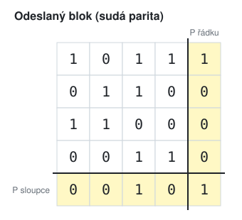
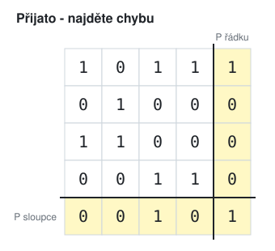
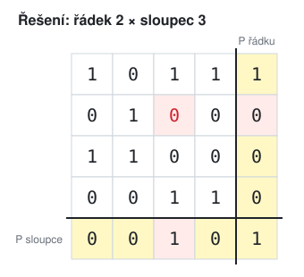
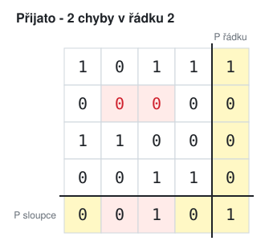
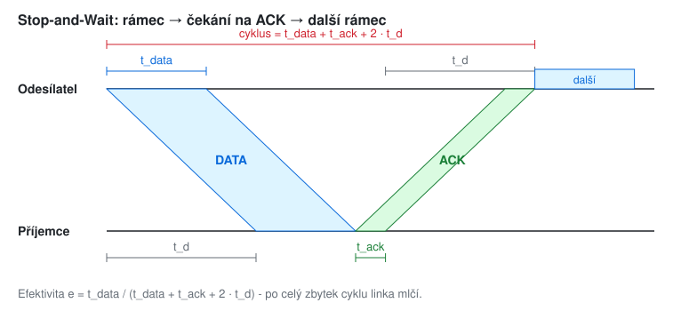
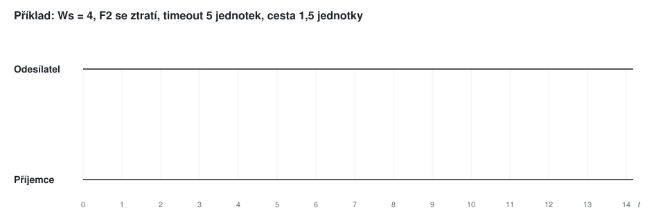
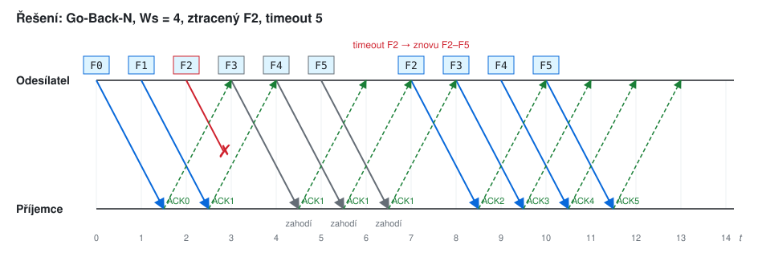
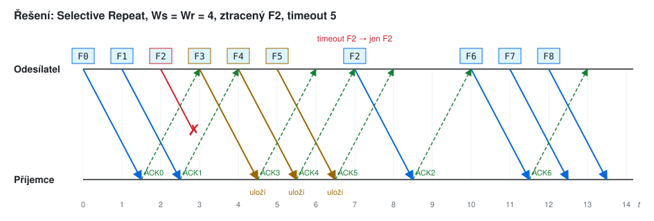

# KIV/UPS cvičení 8.

## Zabezpečení přenosu a potvrzovací schémata

Jindrich Skupa & Martin Ubl

### https://github.com/jindrichskupa/kiv-ups

---

# Agenda

- Parita, dvourozměrná parita, kontrolní součet
- CRC - dělení polynomů
- Stop-and-Wait, Go-Back-N, Selective Repeat, efektivita
- Plán (90 min): úvod a teorie 6, parita a součet 20, CRC 24, SnW a GBN 16, kreslení GBN/SR 12, rezerva 12

---

# Zabezpečení - přehled

<style scoped>table { font-size: 20px; }</style>

| metoda | zjistí | opraví | použití |
|--------|--------|--------|---------|
| parita (sudá / lichá) | lichý počet chyb | ne | UART, paměti |
| 2D parita (řádky + sloupce) | 1, 2 a 3 chyby | 1 chybu | starší pásky, výuka |
| kontrolní součet mod 2ⁿ | většinu chyb, ne "symetrické" | ne | IP, TCP, UDP |
| Hammingův kód (7,4) | 2 chyby, nebo opraví 1 | 1 chybu | ECC paměti |
| CRC | shluky chyb do délky stupně G | ne | Ethernet, Wi-Fi, ZIP |

<small>Pozn.: sudá parita = paritní bit doplní počet jedniček na sudý, lichá na lichý. Detekce = poznám, že je chyba; oprava = poznám i kde.</small>

---

# Příklad 1 - parita znaků

- a) Doplňte sudou i lichou paritu k 7bitovým ASCII znakům `K`, `I`, `V`.
- b) Při přenosu `K` v 7E1 se překlopí 2 bity. Pozná to příjemce?

---

# Řešení 1

| znak | ASCII (7 b) | počet 1 | sudá P | lichá P |
|------|-------------|---------|--------|---------|
| K | `100 1011` | 4 | 0 | 1 |
| I | `100 1001` | 3 | 1 | 0 |
| V | `101 0110` | 4 | 0 | 1 |

- b) **ne** - 2 chyby nezmění sudost počtu jedniček, parita vyjde správně

---

# Příklad 2 - dvourozměrná parita

 

- a) Najděte a opravte chybu v přijatém bloku.
- b) Co když se v řádku 2 překlopí dva bity?

---

# Řešení 2

 

- a) nesedí parita řádku 2 a sloupce 3 → chyba je na jejich průsečíku, bit se překlopí zpět
- b) parita řádku sedí, nesedí sloupce 2 a 3 → chyba **zjištěna**, ale nevíme, ve kterém řádku → **nelze opravit**

---

# Příklad 3 - kontrolní součet (mod 256)

- a) Spočítejte 8bitový součet zprávy `05 1A 20 44`.
- b) Spočítejte součet pro `Hello` = `48 65 6C 6C 6F`.
- c) Přijato `04 1B 20 44 | 83` a `1A 05 20 44 | 83`. Pozná příjemce chybu?

<small>Pozn.: mod 256 = počítáme jen spodní bajt, přetečení zahodíme.</small>

---

# Řešení 3

- a) `05 + 1A + 20 + 44 = 83` (5 + 26 + 32 + 68 = 131 = 0x83)
- b) `48 + 65 + 6C + 6C + 6F = 1F4` → mod 256 = **`F4`**
- c) ani jednu: `04 + 1B = 05 + 1A` (−1 a +1 se vyruší) a prohozené pořadí součet nezmění

<small>Pozn.: "symetrické" chyby a přeházené bajty součet neodhalí. CRC je odhalí, protože bity mají podle pozice různou váhu.</small>

---

# CRC - postup

- generující polynom `G(x) = x³ + x + 1` → bitově `1011` (stupeň 3 → zbytek má 3 bity)
- za zprávu připíšeme tolik nul, kolik je stupeň G
- dělíme: je-li na začátku 1, pod ni napíšeme G, jinak samé nuly; XOR; srazíme další bit
- zbytek nahradí připsané nuly → odešleme
- příjemce dělí celý rámec stejně - **zbytek 0 = bez chyby**

<small>Pozn.: XOR = sčítání bez přenosu (1 + 1 = 0). Stejně jako zbytek po dělení 5 je nejvýš 4, zbytek po dělení polynomem stupně 3 má nejvýš stupeň 2, tj. 3 bity.</small>

---

# Příklad 4 - CRC

- `G = 1011`, zpráva `M = 110101`
- a) Spočítejte CRC a napište odesílaný rámec.
- b) Ověřte rámec na straně příjemce.

---

# Řešení 4

```
110101000        110101111   (ověření)
1011             1011
01100            01100
 1011             1011
 01111            01111
  1011             1011
  01000            01001
   1011             1011
   00110            00101
    0000             0000
    01100            01011
     1011             1011
     0111             0000
```

- zbytek **`111`** → odesílá se **`110101111`**; ověření dá zbytek `000`

---

# Příklad 5 - CRC s G = x⁴ + x + 1

- `G = 10011`, zpráva `M = 1101011011`
- a) Spočítejte CRC a odesílaný rámec.
- b) Ověřte přijatý rámec.
- c) V přenosu se překlopil 7. bit zleva: přijato `1101010011 1110`. Co zjistí příjemce?

---

# Řešení 5a

<style scoped>pre { font-size: 17px; }</style>

```
11010110110000
10011
010011
 10011
 000001
  00000
  000010
   00000
   000101
    00000
    001011
     00000
     010110
      10011
      001010
       00000
       010100
        10011
        001110
         00000
         01110
```

- zbytek **`1110`** → odesílá se **`11010110111110`**

---

# Řešení 5b, 5c

- b) dělení `11010110111110 : 10011` → zbytek **`0000`** → v pořádku
- c) dělení `11010100111110 : 10011` → zbytek **`1011` ≠ 0** → chyba zjištěna, rámec se zahodí

<small>Pozn.: postup dělení je ve `ex08-reseni.md`. CRC chybu jen zjistí - opravu zařídí opakování rámce (potvrzovací schémata dál).</small>

---

# Potvrzovací schémata

| schéma | Ws | Wr | po chybě se opakuje |
|--------|----|----|---------------------|
| Stop-and-Wait | 1 | 1 | jen chybný rámec |
| Go-Back-N | N | 1 | chybný a **všechny** po něm |
| Selective Repeat | N | M | jen chybný rámec, příjemce si ostatní uloží |

- `t_data = L_data · 8 / v_p`, `t_ack = L_ack · 8 / v_p`, `t_d` = doba šíření médiem
- Stop-and-Wait: `e = t_data / (t_data + t_ack + 2 · t_d)`
- okno Ws: `e = Ws · t_data / (t_data + t_ack + 2 · t_d)`, nejvýš 100 %

<small>Pozn.: Ws / Wr = velikost odesílacího / přijímacího okénka = kolik rámců smí být "na cestě" nepotvrzených / kolik jich příjemce umí uložit mimo pořadí.</small>

---

# Příklad 6 - efektivita Stop-and-Wait



- `v_p = 14 400 b/s`, `L_data = 80 B`, `L_ack = 1 B`, bezchybný provoz
- a) `t_d = 1 ms`. Jaká je efektivita?
- b) `t_d = 270 ms` (geostacionární družice). Jaká je efektivita?

---

# Řešení 6

```
t_data = 80 · 8 / 14400 = 44,4 ms
t_ack  =  1 · 8 / 14400 = 0,55 ms
a) e = 44,4 / (44,4 + 0,55 + 2 · 1)   = 44,4 / 46,95  ≐ 94,56 %
b) e = 44,4 / (44,4 + 0,55 + 2 · 270) = 44,4 / 584,95 ≐ 7,59 %
```

<small>Pozn.: větší rámec by pomohl, ale roste pravděpodobnost chyby v rámci. Stop-and-Wait se hodí pro IoT a jednoduchá zařízení s malou pamětí a krátkou linkou.</small>

---

# Příklad 7 - okno Go-Back-N

- stejná linka: `14 400 b/s`, `80 B` data, `1 B` ACK, `t_d = 150 ms`
- a) Jaká je efektivita Stop-and-Wait?
- b) Jaké okno Ws vyplní linku? Jaká je efektivita pro Ws = 7 a Ws = 8?

---

# Řešení 7

```
cyklus = 44,4 + 0,55 + 2 · 150 = 344,95 ms
a) e = 44,4 / 344,95 ≐ 12,9 %
b) Ws = 344,95 / 44,4 ≐ 7,77
   Ws = 7: e = 7 · 44,4 / 344,95 ≐ 90,1 %
   Ws = 8: 8 · 44,4 = 355,2 ms ≥ 344,95 ms → linka nemá pauzu → e = 100 %
```

<small>Pozn.: ⌊7,77⌋ = 7 je největší okno, pro které vzorec vyjde ≤ 1 (linka ještě chvíli čeká). Nejmenší okno, které linku vyplní, je ⌈7,77⌉ = 8 - nad 100 % se vzorec nepočítá, odesílatel prostě nečeká.</small>

---

# Příklad 8 - nakreslete GBN a SR

- Ws = 4 (u SR i Wr = 4), 1 rámec se vysílá 1 jednotku času, cesta trvá 1,5 jednotky
- F2 se ztratí, timeout je 5 jednotek od odeslání
- a) Nakreslete průběh pro Go-Back-N a pro Selective Repeat.
- b) Kolikrát se celkem vysílalo, než příjemce dostal F0–F5?



---

# Řešení 8 - Go-Back-N



- příjemce F3–F5 zahodí (čeká F2) a opakuje ACK1; po timeoutu jde znovu F2, F3, F4, F5 → **10 vysílání**

---

# Řešení 8 - Selective Repeat



- příjemce F3–F5 uloží a potvrdí; po timeoutu jde jen F2 → **7 vysílání**, pak hned F6, F7…

<small>Pozn.: GBN šetří paměť příjemce (Wr = 1), SR šetří linku. Moderní TCP je někde mezi: kumulativní ACK jako GBN + SACK (selektivní potvrzení) jako SR.</small>

---

# Hammingův kód (7,4) (bonus)
<!-- bonus -->

- pozice `1 2 3 4 5 6 7` = `p1 p2 d1 p4 d2 d3 d4` - paritní bity na mocninách 2
- `p1` hlídá pozice 1, 3, 5, 7; `p2` 2, 3, 6, 7; `p4` 4, 5, 6, 7 (sudá parita)
- příjemce přepočítá kontroly `s4 s2 s1` → binární číslo = **pozice chyby** (0 = bez chyby)

<small>Pozn.: pozice k patří do kontroly p, když má v binárním zápisu jedničku na místě p (5 = 101 → p4 a p1).</small>

---

# Příklad 9 - Hamming (7,4) (bonus)
<!-- bonus -->

- a) Zakódujte data `1011` a `0110`.
- b) Přijato `0110111`. Je v něm chyba? Kde? Jaká data byla odeslána?

---

# Řešení 9 (bonus)
<!-- bonus -->

```
a) 1011: p1 = d1⊕d2⊕d4 = 1⊕0⊕1 = 0
         p2 = d1⊕d3⊕d4 = 1⊕1⊕1 = 1
         p4 = d2⊕d3⊕d4 = 0⊕1⊕1 = 0   → 0110011
   0110: p1 = 0⊕1⊕0 = 1, p2 = 0⊕1⊕0 = 1, p4 = 1⊕1⊕0 = 0 → 1100110
b) 0110111: s1 = b1⊕b3⊕b5⊕b7 = 0⊕1⊕1⊕1 = 1
            s2 = b2⊕b3⊕b6⊕b7 = 1⊕1⊕1⊕1 = 0
            s4 = b4⊕b5⊕b6⊕b7 = 0⊕1⊕1⊕1 = 1
   s4 s2 s1 = 101 = 5 → chyba na pozici 5 → 0110011 → data 1011
```

---

# Příklad 10 - rychlejší linka (bonus)
<!-- bonus -->

- `v_p = 1 Mb/s`, `L_data = 1000 B`, `L_ack = 64 B`, `t_d = 10 ms`
- a) Jaká je efektivita Stop-and-Wait?
- b) Jaké nejmenší okno Ws vyplní linku?

---

# Řešení 10 (bonus)
<!-- bonus -->

```
t_data = 1000 · 8 / 10^6 = 8 ms
t_ack  =   64 · 8 / 10^6 = 0,512 ms
cyklus = 8 + 0,512 + 2 · 10 = 28,512 ms
a) e = 8 / 28,512 ≐ 28,1 %
b) Ws = ⌈28,512 / 8⌉ = ⌈3,56⌉ = 4
```

---

# Příklad 11 - číslování rámců (bonus)
<!-- bonus -->

- pořadová čísla rámců mají k bitů (čísla 0 … 2ᵏ − 1, pak znovu od 0)
- a) Jaké největší Ws smí mít GBN a SR při k = 3?
- b) Ukažte, co se pokazí u GBN s k = 3 a Ws = 8.

---

# Řešení 11 (bonus)
<!-- bonus -->

- a) GBN: `Ws ≤ 2ᵏ − 1 = 7`; SR: `Ws ≤ 2ᵏ⁻¹ = 4`
- b) odešle se F0 … F7, všechny dojdou, ale **všechny ACK se ztratí** → timeout → znovu F0; příjemce teď čeká "nové" F0 (číslo 8 mod 8 = 0) → starý rámec přijme jako nový = **duplicita**

<small>Pozn.: u SR musí být přijímací okno a "staré" okno disjunktní - jinak opakovaný rámec padne do nového okna příjemce. Proto jen polovina čísel.</small>

---

# Příklad 12 - satelit (bonus)
<!-- bonus -->

- linka z příkladu 10, ale přes družici: `t_d = 270 ms`
- a) Jaká je efektivita Stop-and-Wait?
- b) Jaké okno vyplní linku?
- c) Kolik bitů pořadového čísla je potřeba pro GBN a pro SR?

---

# Řešení 12 (bonus)
<!-- bonus -->

```
cyklus = 8 + 0,512 + 2 · 270 = 548,512 ms
a) e = 8 / 548,512 ≐ 1,46 %
b) Ws = ⌈548,512 / 8⌉ = ⌈68,56⌉ = 69
c) GBN: 2^k − 1 ≥ 69 → k = 7 (Ws ≤ 127)
   SR:  2^(k−1) ≥ 69 → k = 8 (Ws ≤ 128)
```

<small>Pozn.: proto má TCP okno až 2³⁰ B (window scaling) a 32bitová pořadová čísla.</small>

---

# Shrnutí

- parita: 1 bit, zjistí lichý počet chyb; 2D parita opraví 1 chybu
- kontrolní součet neodhalí symetrické chyby ani přeházené pořadí
- CRC: připsat nuly, dělit XORem, zbytek přidat; příjemce čeká zbytek 0
- Stop-and-Wait je pomalé při dlouhém `t_d`; okno `Ws = ⌈cyklus / t_data⌉` vyplní linku
- GBN opakuje vše od chyby, SR jen chybný rámec

---

# Slovníček zkratek

<style scoped>table { font-size: 20px; }</style>

| zkratka | význam |
|---------|--------|
| CRC | Cyclic Redundancy Check - cyklický kontrolní kód |
| ECC | Error-Correcting Code - samoopravný kód (paměti) |
| ARQ | Automatic Repeat reQuest - opakování po chybě |
| SnW | Stop-and-Wait |
| GBN | Go-Back-N |
| SR | Selective Repeat |
| ACK, NACK | potvrzení / záporné potvrzení |
| Ws, Wr | velikost odesílacího / přijímacího okénka |
| SACK | Selective ACK - selektivní potvrzení v TCP |
| XOR (⊕) | exkluzivní součet, 1 ⊕ 1 = 0 |
| 7E1 | 7 datových bitů, sudá parita, 1 stop bit |
