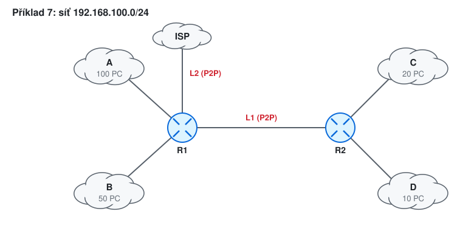
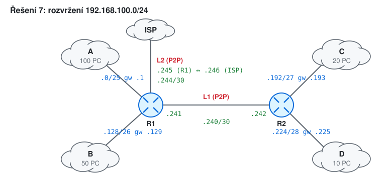
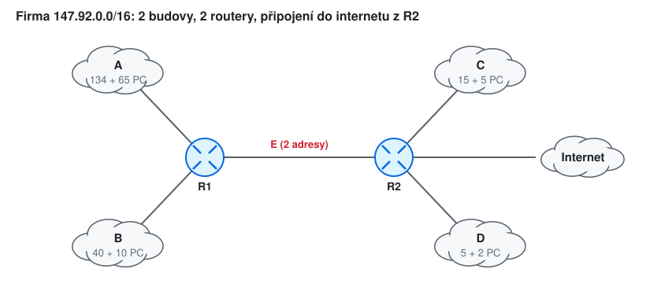

# KIV/UPS cvičení 9.

## IPv4 adresa, třídy, CIDR, směrování

Jindrich Skupa & Martin Ubl

### https://github.com/jindrichskupa/kiv-ups

---

# Agenda

- Třídy a speciální adresy
- Síť, broadcast, počet hostů z adresy a masky
- Maska z počtu hostů (bonus: dělení a agregace sítí)
- Směrovací tabulka a longest prefix match
- VLSM - rozvržení adres ve firmě a směrovací tabulky
- Příklady ke každému tématu (počítá se ručně, `ipcalc` jen na kontrolu)
- Plán (90 min): úvod a tahák 5 · př. 1 5 · př. 2 10 · př. 3 12 · př. 4 5 · př. 5 5 · př. 6 8 · př. 7 25 · rezerva a bonusy (př. 8–12) 15

---

# Tahák

| třída | 1. oktet binárně | rozsah 1. oktetu | výchozí maska |
|-------|------------------|------------------|---------------|
| A | `0…` | 0–127 | /8 |
| B | `10…` | 128–191 | /16 |
| C | `110…` | 192–223 | /24 |
| D | `1110…` | 224–239 | multicast |
| E | `1111…` | 240–255 | rezerva |

| adresa | význam |
|--------|--------|
| `127.0.0.0/8` | loopback (typicky `127.0.0.1`) |
| `10.0.0.0/8`, `172.16.0.0/12`, `192.168.0.0/16` | privátní |
| `169.254.0.0/16` | autokonfigurace, když selže DHCP |
| `0.0.0.0/8` | "tato síť" / neurčená adresa |

<style scoped>table { font-size: 19px; }</style>

<small>Pozn.: třída se pozná podle **prefixu adresy**, ne podle masky (CIDR přišlo později).</small>

---

# Postup výpočtu

- adresu a masku převeďte do binárního zápisu (stačí oktet, do kterého maska zasahuje)
- **síť** = adresa AND maska (hostitelské bity na 0)
- **broadcast** = síť a hostitelské bity na 1
- **počet hostů** = 2^(32 − prefix) − 2 (síť a broadcast)
- první host = síť + 1, poslední = broadcast − 1

<small>Pozn.: zkratka - "magické číslo" = 256 − maska v zasaženém oktetu (např. /21 → 248 → krok 8). Síť je nejbližší násobek kroku dolů: 28 → 24.</small>

---

# Příklad 1 - třída a typ adresy

Určete třídu a typ (veřejná, privátní, loopback, multicast, …):

- a) `145.12.28.140`
- b) `10.1.2.3`
- c) `172.31.255.254` a `172.32.0.1`
- d) `192.168.1.255`
- e) `224.0.0.5`
- f) `169.254.10.20`
- g) `127.0.0.53`
- h) `240.0.0.1`

---

# Řešení 1

| adresa | 1. oktet | třída | typ |
|--------|----------|-------|-----|
| `145.12.28.140` | `10010001` | B | veřejná |
| `10.1.2.3` | `00001010` | A | privátní |
| `172.31.255.254` | `10101100` | B | privátní (poslední z `172.16.0.0/12`) |
| `172.32.0.1` | `10101100` | B | **veřejná** - už mimo `/12` |
| `192.168.1.255` | `11000000` | C | privátní (při /24 broadcast) |
| `224.0.0.5` | `11100000` | D | multicast (OSPF routery) |
| `169.254.10.20` | `10101001` | B | link-local, nedostal DHCP |
| `127.0.0.53` | `01111111` | A | loopback (lokální DNS resolver) |
| `240.0.0.1` | `11110000` | E | rezerva |

<style scoped>table { font-size: 19px; }</style>

<small>Pozn.: `172.16.0.0/12` = 172.16.0.0–172.31.255.255. Pozor i na `100.64.0.0/10` - sdílený prostor pro CGNAT u operátorů, není veřejná ani privátní.</small>

---

# Příklad 2 - síť, broadcast, hosté

`145.12.28.140/21`

- a) Jaká je adresa sítě a broadcastu?
- b) Kolik hostitelů se vejde do sítě? Jaký je první a poslední?
- c) Jaká je to třída?

---

# Řešení 2

```
145.12.00011100.10001100      adresa
255.255.11111000.00000000     maska /21
145.12.00011000.00000000      AND → síť       145.12.24.0
145.12.00011111.11111111      broadcast        145.12.31.255
```

- b) 32 − 21 = 11 bitů → 2¹¹ − 2 = **2046** hostů, `145.12.24.1` až `145.12.31.254`
- c) `145` = `10010001` → prefix `10` → **třída B**

<small>Pozn.: zkratkou: /21 → maska 3. oktetu 248 → krok 8 → 28 leží v bloku 24–31.</small>

---

# Příklad 3 - spočítejte

| adresa | maska | síť | broadcast | hostů | první | poslední |
|--------|-------|-----|-----------|-------|-------|----------|
| `10.37.200.77/19` | | | | | | |
| `172.20.5.130/26` | | | | | | |
| `200.100.50.25/28` | | | | | | |
| `85.160.3.77/12` | | | | | | |

<style scoped>table { font-size: 20px; }</style>

---

# Řešení 3

| adresa | maska | síť | broadcast | hostů | první | poslední |
|--------|-------|-----|-----------|-------|-------|----------|
| `10.37.200.77/19` | 255.255.224.0 | 10.37.192.0 | 10.37.223.255 | 8190 | .192.1 | .223.254 |
| `172.20.5.130/26` | 255.255.255.192 | 172.20.5.128 | 172.20.5.191 | 62 | .129 | .190 |
| `200.100.50.25/28` | 255.255.255.240 | 200.100.50.16 | 200.100.50.31 | 14 | .17 | .30 |
| `85.160.3.77/12` | 255.240.0.0 | 85.160.0.0 | 85.175.255.255 | 1 048 574 | 85.160.0.1 | 85.175.255.254 |

<style scoped>table { font-size: 17px; }</style>

<small>Pozn.: krok = 256 − maska oktetu: /19 → 224 → krok 32 (200 je v bloku 192–223); /26 → 192 → krok 64; /28 → 240 → krok 16; /12 → 2. oktet 240 → krok 16 (160 je v bloku 160–175).</small>

---

# Příklad 4 - jsou ve stejné síti?

- a) `192.168.10.200/27` a `192.168.10.190/27`
- b) `192.168.10.200/25` a `192.168.10.190/25`
- c) PC A má `10.0.0.5/8`, PC B má `10.1.0.5/16`. Jak pošle A paket B a jak B paket A?

---

# Řešení 4

- a) /27 → krok 32: `200` je v bloku 192–223, `190` v bloku 160–191 → **ne**
- b) /25 → krok 128: oba v bloku 128–255 → **ano**
- c) A: `10.1.0.5` leží v `10.0.0.0/8` → posílá **přímo** (ARP na B). B: `10.0.0.5` neleží v `10.1.0.0/16` → posílá přes **bránu**

<small>Pozn.: maska je vlastnost konfigurace každého počítače zvlášť. Nesouhlasné masky ve stejném segmentu vedou k asymetrickým cestám, které "někdy fungují".</small>

---

# Příklad 5 - maska z počtu hostů

Jakou nejmenší síť (prefix a masku) potřebujete pro:

- a) 5 hostů
- b) 30 hostů
- c) 60 hostů
- d) 62 hostů
- e) 63 hostů
- f) 500 hostů
- g) 1000 hostů

---

# Řešení 5

| hostů | + 2 | blok | prefix | maska |
|-------|-----|------|--------|-------|
| 5 | 7 | 8 | /29 | 255.255.255.248 |
| 30 | 32 | 32 | /27 | 255.255.255.224 |
| 60 | 62 | 64 | /26 | 255.255.255.192 |
| 62 | 64 | 64 | /26 | 255.255.255.192 |
| 63 | 65 | 128 | **/25** | 255.255.255.128 |
| 500 | 502 | 512 | /23 | 255.255.254.0 |
| 1000 | 1002 | 1024 | /22 | 255.255.252.0 |

<style scoped>table { font-size: 19px; }</style>

<small>Pozn.: k hostům vždy přičtěte 2 (síť a broadcast) a zaokrouhlete nahoru na mocninu dvou. 62 se do /26 vejde přesně, 63 už ne.</small>

---

# Příklad 6 - longest prefix match

| cíl | next hop |
|-----|----------|
| `0.0.0.0/0` | R1 |
| `10.0.0.0/8` | R2 |
| `10.1.0.0/16` | R3 |
| `10.1.2.0/24` | R4 |

Kam půjde paket pro a) `10.1.2.5`, b) `10.1.3.5`, c) `10.2.0.1`, d) `8.8.8.8`, e) `10.1.2.255`?

---

# Řešení 6

- a) `10.1.2.5` → vyhovují /0, /8, /16, /24 → nejdelší **/24 → R4**
- b) `10.1.3.5` → /0, /8, /16 → **R3**
- c) `10.2.0.1` → /0, /8 → **R2**
- d) `8.8.8.8` → jen /0 → **R1** (výchozí cesta)
- e) `10.1.2.255` → **R4** (router broadcast cizí sítě normálně přepošle k jejímu routeru)

<small>Pozn.: `0.0.0.0/0` má nulovou masku, AND s čímkoli dá 0.0.0.0 → vyhovuje vždy, ale vyhraje jen tehdy, když nic jiného nevyhovuje. Linux: `ip route get 10.1.3.5`.</small>

---

# Příklad 7 - VLSM a směrovací tabulky



- a) Rozvrhněte `192.168.100.0/24`: A 100, B 50, C 20, D 10 PC, linky L1 (R1–R2) a L2 (R1–ISP).
- b) Kolik adres zbude?
- c) Napište směrovací tabulky R1 a R2 (včetně výchozí cesty).

<small>Pozn.: nakreslete síť dřív, než začnete počítat (linky mezi routery jsou také sítě). Přidělujte **od největší sítě** - každá pak začíná na násobku své velikosti a nevznikají díry.</small>

---

# Řešení 7a

| síť | hostů | velikost | adresa | brána | broadcast |
|-----|-------|----------|--------|-------|-----------|
| A | 100 | 128 | 192.168.100.0/25 | .1 | .127 |
| B | 50 | 64 | 192.168.100.128/26 | .129 | .191 |
| C | 20 | 32 | 192.168.100.192/27 | .193 | .223 |
| D | 10 | 16 | 192.168.100.224/28 | .225 | .239 |
| L1 | 2 | 4 | 192.168.100.240/30 | R1 .241, R2 .242 | .243 |
| L2 | 2 | 4 | 192.168.100.244/30 | R1 .245, ISP .246 | .247 |

<style scoped>table { font-size: 19px; }</style>

- b) volné `192.168.100.248/29` (8 adres)

---

# Řešení 7c



| R1: cíl | via | | R2: cíl | via |
|---------|-----|-|---------|-----|
| .0/25, .128/26 | přímo | | .192/27, .224/28 | přímo |
| .240/30, .244/30 | přímo | | .240/30 | přímo |
| .192/27, .224/28 (nebo `.192/26`) | .242 | | 0.0.0.0/0 | .241 |
| 0.0.0.0/0 | .246 | | | |

<style scoped>table { font-size: 17px; }</style>

<small>Pozn.: `.192/26` pokryje C, D i linky; přímo připojené /30 mají delší prefix a vyhrají. R2 si vystačí s výchozí cestou.</small>

---

# Příklad 8 - dělení sítě (bonus)
<!-- bonus -->

- a) Rozdělte `172.16.0.0/16` na 8 stejně velkých podsítí. Jaký mají prefix? Vypište první tři a poslední.
- b) Kolik podsítí /26 a kolik /30 vznikne z jedné /24?
- c) Kolik hostů má každá podsíť z a)?

---

# Řešení 8
<!-- bonus -->

- a) 8 = 2³ → prefix 16 + 3 = **/19** (krok 32 ve 3. oktetu): `172.16.0.0/19`, `172.16.32.0/19`, `172.16.64.0/19`, …, `172.16.224.0/19`
- b) /24 → /26: 2² = **4** podsítě; /24 → /30: 2⁶ = **64** podsítí
- c) 2¹³ − 2 = **8190** hostů

---

# Příklad 9 - agregace (bonus)
<!-- bonus -->

- a) Router R vede do jednoho směru sítě `192.168.4.0/24`, `192.168.5.0/24`, `192.168.6.0/24` a `192.168.7.0/24`. Napište jeden záznam, který je nahradí.
- b) Jde jedním záznamem nahradit `10.1.0.0/24`, `10.1.1.0/24` a `10.1.2.0/24`?

---

# Řešení 9
<!-- bonus -->

```
192.168.000001|00.0     4
192.168.000001|01.0     5
192.168.000001|10.0     6
192.168.000001|11.0     7
společných je 16 + 6 = 22 bitů → 192.168.4.0/22
```

- b) ne přesně: `10.1.0.0/23` pokryje 0 a 1, `10.1.2.0/24` musí zůstat. `10.1.0.0/22` by navíc zahrnula i `10.1.3.0/24`

<small>Pozn.: agregace zmenšuje směrovací tabulky v internetu. Zahrnout cizí síť navíc lze jen tehdy, když ji stejným směrem opravdu vedete (nebo neexistuje).</small>

---

# Příklad 10 - najděte chybu (bonus)
<!-- bonus -->

- a) PC: `192.168.1.10/24`, brána `192.168.2.1`
- b) PC: `192.168.1.255/24`
- c) PC: `192.168.1.0/24`
- d) PC: `192.168.1.64/26`, brána `192.168.1.1`
- e) PC: `172.16.5.10/16`, brána `172.16.0.1`, server `172.17.0.20` je "ve stejné firmě" a nejde přes bránu

---

# Řešení 10
<!-- bonus -->

- a) brána není ve vlastní síti `192.168.1.0/24` → PC ji nemůže dosáhnout přes ARP
- b) adresa je broadcast sítě - nelze přidělit hostu
- c) adresa je adresa sítě - nelze přidělit hostu
- d) `.64/26` je adresa sítě (blok 64–127), brána `.1` leží v jiné síti (0–63) → dvě chyby
- e) `172.17.0.20` je mimo `172.16.0.0/16` → jde přes bránu správně; pokud to nejde, chybí cesta na bráně, ne na PC

---

# Příklad 11 - VLSM ze zadání přednášky (bonus)
<!-- bonus -->



Přidělená síť `147.92.0.0/16`. S minimálním plýtváním přidělte rozsahy sítím A–E (počty včetně rezervy).

<small>Pozn.: síť E mezi routery má 2 adresy.</small>

---

# Řešení 11
<!-- bonus -->

| síť | hostů | velikost | maska | adresa | rozsah |
|-----|-------|----------|-------|--------|--------|
| A | 199 | 256 | /24 | 147.92.0.0/24 | 147.92.0.0 – 147.92.0.255 |
| B | 50 | 64 | /26 | 147.92.1.0/26 | 147.92.1.0 – 147.92.1.63 |
| C | 20 | 32 | /27 | 147.92.1.64/27 | 147.92.1.64 – 147.92.1.95 |
| D | 7 | 16 | /28 | 147.92.1.96/28 | 147.92.1.96 – 147.92.1.111 |
| E | 2 | 4 | /30 | 147.92.1.112/30 | 147.92.1.112 – 147.92.1.115 |

<style scoped>table { font-size: 19px; }</style>

<small>Pozn.: přidělujte **od největší sítě**. Každá síť pak začíná na násobku své velikosti a mezi sítěmi nevznikají díry.</small>

---

# Příklad 12 - a co IPv6? (bonus)
<!-- bonus -->

- a) Firma dostala `2001:db8:abcd::/48`. Každá LAN má /64. Kolik LAN může mít?
- b) Jaký prefix má desátá LAN (číslováno od 0)?
- c) Kolik adres je v jedné /64? Proč se nepočítá síť a broadcast?

---

# Řešení 12
<!-- bonus -->

- a) 64 − 48 = 16 bitů → 2¹⁶ = **65 536** sítí /64
- b) LAN 0 = `2001:db8:abcd:0::/64` … LAN 9 = **`2001:db8:abcd:9::/64`**
- c) 2⁶⁴ ≈ 1,8 · 10¹⁹; IPv6 nemá broadcast a adresa sítě se nepoužívá jako omezení - hosté jsou prakticky neomezení

<small>Pozn.: u IPv6 se nešetří adresami, ale počítá se se **4. skupinou** (16 bitů subnet ID). LAN je vždy /64, jinak nefunguje SLAAC. Dělí se po půlbajtech (hex číslicích): /48, /52, /56, /60, /64.</small>

---

# Shrnutí

- síť = adresa AND maska, broadcast = hostitelské bity na 1, hostů 2^n − 2
- krok = 256 − maska oktetu → rychlé určení bloku
- maska z počtu hostů: + 2, zaokrouhlit na mocninu dvou
- VLSM: kreslit síť, počítat od největší, nezapomenout na linky mezi routery
- směrování: vyhrává nejdelší shodný prefix, `0.0.0.0/0` až nakonec
- IPv6: LAN vždy /64, plánuje se po hex číslicích

---

# Slovníček zkratek

<style scoped>table { font-size: 19px; }</style>

| zkratka | význam |
|---------|--------|
| IPv4, IPv6 | Internet Protocol verze 4 (32 bitů) a 6 (128 bitů) |
| CIDR | Classless Inter-Domain Routing - prefix /n místo tříd |
| VLSM | Variable Length Subnet Mask - podsítě různé velikosti |
| LPM | Longest Prefix Match - výběr nejdelšího shodného prefixu |
| AND | logický součin bit po bitu |
| P2P | point-to-point - linka mezi dvěma routery (/30, případně /31) |
| ISP | Internet Service Provider - poskytovatel připojení |
| DHCP | Dynamic Host Configuration Protocol |
| CGNAT | Carrier-Grade NAT - NAT u operátora (`100.64.0.0/10`) |
| OSPF | Open Shortest Path First - směrovací protokol (multicast `224.0.0.5`) |
| SLAAC | Stateless Address Autoconfiguration (IPv6) |
