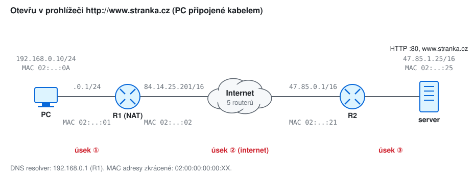
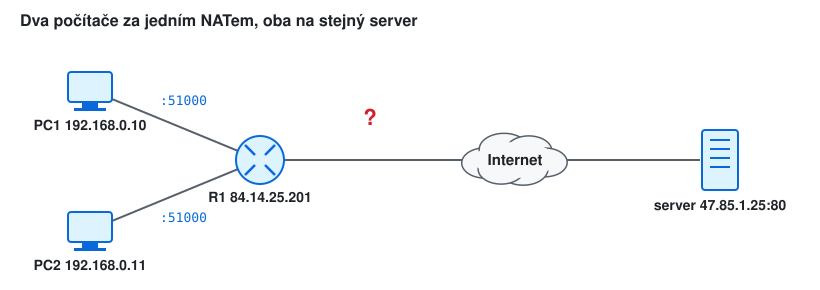
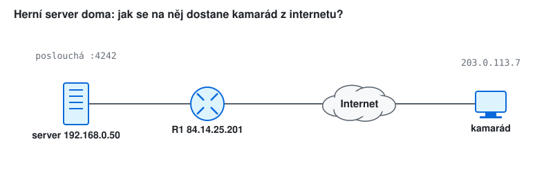

# KIV/UPS cvičení 10.

## Cesta paketu sítí

Jindrich Skupa & Martin Ubl

### https://github.com/jindrichskupa/kiv-ups

---

# Agenda

- Zadání: otevřu v prohlížeči `http://www.stranka.cz` - co se celou dobu děje?
- Hlavičky na každém úseku cesty: MAC, IP, port, TTL
- ARP, DNS a NAT po cestě
- Plán (90 min): zadání 5 · př. 1 15 · př. 2 15 · př. 3 10 · př. 4 8 · př. 5 8 · př. 6 5 · př. 7 8 · rezerva a bonusy (př. 8–11) 16

---

# Síť

| zařízení | IP | MAC |
|----------|----|-----|
| PC | `192.168.0.10/24`, brána `192.168.0.1`, DNS `192.168.0.1` | `02:00:00:00:00:0a` |
| R1 LAN / WAN | `192.168.0.1/24` / `84.14.25.201/16`, výchozí brána `84.14.0.1` | `…:01` / `…:02` |
| R2 | `47.85.0.1/16` (strana serveru) | `…:21` |
| server | `47.85.1.25/16`, HTTP na portu 80 | `…:25` |

---

# Co se kde mění

- **MAC** adresy se mění na **každém skoku** (každý router rámec rozbalí a zabalí znovu)
- **IP** adresy zůstávají celou cestu stejné - **kromě NAT**
- **porty** mění jen NAT (a jen zdrojový port, resp. cílový na zpáteční cestě)
- **TTL** sníží každý router o 1

<small>Pozn.: cílová MAC je vždy MAC **dalšího skoku** (brány), ne cílového serveru. Server je mimo naši síť, jeho MAC PC nikdy nezjistí.</small>

---

# Příklad 1 - co se děje? (u tabule)

- Seřaďte kroky od stisku Enter po zobrazení stránky. U každého kroku řekněte, **kdo** ho dělá a **na jaké vrstvě**.
- Nápověda - musí se objevit: DNS, TCP spojení, HTTP požadavek, směrovací tabulka, ARP, Ethernet rámec, NAT, příjem na serveru, odpověď.

<small>Pozn.: u kteréhokoli kroku se dá zastavit a jít do detailu - to jsou následující příklady.</small>

---

# Řešení 1

1. DNS dotaz: `www.stranka.cz` → `47.85.1.25` (příklad 5)
2. TCP: cíl `47.85.1.25:80`, zdrojový port z efemérního rozsahu (např. `51000`), 3-way handshake
3. HTTP `GET /` do TCP segmentu, ten do IP paketu (src `192.168.0.10`, dst `47.85.1.25`)
4. směrovací tabulka PC: cíl není v `192.168.0.0/24` → výchozí cesta přes `192.168.0.1`
5. ARP na MAC brány, Ethernet rámec (dst MAC = R1), odeslání
6. R1: rámec pro mě → paket ne pro mě → směrovat ven → **NAT** (src → `84.14.25.201:40001`) → nový rámec
7. internet: každý router TTL − 1, nové MAC
8. R2: přímo připojená síť → ARP na server → rámec
9. server: rámec a paket pro mě → port 80 → HTTP server → odpověď stejnou cestou zpět, R1 přeloží NAT zpět

---

# Příklad 2 - hlavičky cestou tam

Vyplňte pro první paket HTTP požadavku (po DNS a handshake):

| úsek | src MAC | dst MAC | src IP | dst IP | src port | dst port | TTL |
|------|---------|---------|--------|--------|----------|----------|-----|
| ① PC → R1 | | | | | | | |
| ② R1 → internet | | | | | | | |
| ③ R2 → server | | | | | | | |

<small>Pozn.: PC i server posílají s TTL 64 (Linux), v internetu je 5 routerů, NAT přidělí port `40001`.</small>

---

# Řešení 2

| úsek | src MAC | dst MAC | src IP | dst IP | src port | dst port | TTL |
|------|---------|---------|--------|--------|----------|----------|-----|
| ① | PC `…:0a` | R1 LAN `…:01` | 192.168.0.10 | 47.85.1.25 | 51000 | 80 | 64 |
| ② | R1 WAN `…:02` | `84.14.0.1` (ISP) | **84.14.25.201** | 47.85.1.25 | **40001** | 80 | 63 |
| ③ | R2 `…:21` | server `…:25` | 84.14.25.201 | 47.85.1.25 | 40001 | 80 | 57 |

<small>Pozn.: TTL na ③ = 64 − 1 (R1) − 5 (internet) − 1 (R2) = 57. Server nikdy nevidí adresu `192.168.0.10` - pro něj je klientem `84.14.25.201:40001`.</small>

---

# Příklad 3 - cesta zpět a NAT tabulka

- a) Vyplňte stejnou tabulku pro odpověď serveru (úseky ③ → ② → ①).
- b) Jaký záznam musí mít R1 v NAT tabulce, aby odpověď doručil?
- c) Co se stane, když odpověď přijde až po smazání záznamu z NAT tabulky?

---

# Řešení 3

| úsek | src MAC | dst MAC | src IP | dst IP | src port | dst port | TTL |
|------|---------|---------|--------|--------|----------|----------|-----|
| ③ server → R2 | `…:25` | `…:21` | 47.85.1.25 | 84.14.25.201 | 80 | 40001 | 64 |
| ② internet → R1 | poslední router ISP | R1 WAN `…:02` | 47.85.1.25 | 84.14.25.201 | 80 | 40001 | 58 |
| ① R1 → PC | R1 LAN `…:01` | PC `…:0a` | 47.85.1.25 | **192.168.0.10** | 80 | **51000** | 57 |

- b) `TCP 192.168.0.10:51000 ↔ 84.14.25.201:40001 ↔ 47.85.1.25:80`
- c) R1 neví, komu paket patří → zahodí ho (nebo pošle RST) → spojení se rozpadne

<small>Pozn.: záznam vzniká prvním odchozím paketem (SYN) a maže se po FIN nebo po timeoutu nečinnosti. Proto dlouho nečinná TCP spojení za NATem "umírají" - aplikace posílají keepalive zprávy (týká se i semestrálky).</small>

---

# Příklad 4 - ARP

- a) Kdo během celé komunikace posílá ARP dotaz a na jakou IP adresu se ptá?
- b) Zeptá se PC někdy na MAC adresu serveru? Proč?
- c) Co bude v ARP cache PC po načtení stránky?

---

# Řešení 4

- a) PC → `192.168.0.1` (brána); R1 → `84.14.0.1` (svoje brána); každý router v internetu → svůj další skok; R2 → `47.85.1.25` (server); server → `47.85.0.1` (svoje brána, pro odpověď)
- b) **nikdy** - server není v `192.168.0.0/24`, ARP funguje jen v rámci jedné L2 sítě
- c) jen `192.168.0.1 → 02:00:00:00:00:01`

<small>Pozn.: ARP probíhá jen při prázdné cache (záznam vydrží typicky desítky sekund až minuty). Odpovědi se ukládají na obou stranách - kdo dostane dotaz, zapamatuje si i tazatele.</small>

---

# Příklad 5 - DNS dotaz

- a) Jakým transportním protokolem a na jaký port jde dotaz z PC?
- b) Komu PC dotaz posílá a kdo zjišťuje odpověď v internetu?
- c) Prochází dotaz z PC NATem? A dotaz R1 do internetu?
- d) Co se změní, když má PC jako DNS server nastavené `8.8.8.8`?

---

# Řešení 5

- a) **UDP**, cílový port **53** (zdrojový efemérní, např. `53000`)
- b) PC → R1 (`192.168.0.1`), R1 je rekurzivní resolver: ptá se kořenových serverů, pak `.cz`, pak serveru `stranka.cz`, odpověď uloží do cache
- c) dotaz PC → R1 NATem **neprochází** (zůstává v LAN); dotazy R1 jsou vlastní provoz routeru se zdrojem `84.14.25.201` - NAT není potřeba
- d) dotaz jde jako paket do internetu stejnou cestou jako HTTP → **UDP záznam v NAT tabulce**; ARP jen na bránu

<small>Pozn.: odpověď nese TTL záznamu (např. 3600 s) - po tu dobu se PC znovu neptá. TTL záznamu DNS ≠ TTL v IP hlavičce.</small>

---

# Příklad 6 - TTL

- a) S jakým TTL dorazí HTTP požadavek na server?
- b) PC spustí `ping 47.85.1.25`. Jaké `ttl=` uvidí v odpovědi?
- c) Kolik řádků vypíše `traceroute 47.85.1.25`?

---

# Řešení 6

- a) 64 − 7 routerů (R1, 5 v internetu, R2) = **57**
- b) server odpovídá s 64, cestou zpět stejných 7 routerů → **`ttl=57`**
- c) **8** řádků: R1, 5 routerů internetu, R2, server

<small>Pozn.: první řádek traceroute je brána `192.168.0.1` - R1 odpoví ze svého LAN rozhraní, protože sondu dostal tam.</small>

---

# Příklad 7 - dva počítače za NATem

- a) Oba PC se připojí ze stejného zdrojového portu `51000` na stejný server. Jak R1 rozliší odpovědi?
- b) Napište NAT tabulku.
- c) Co uvidí server ve výpisu `ss -tn`?

---

# Řešení 7

- a) R1 přidělí každému spojení **jiný vnější port**
- b) NAT tabulka:

| protokol | vnitřní | vnější | vzdálený |
|----------|---------|--------|----------|
| TCP | 192.168.0.10:51000 | 84.14.25.201:40001 | 47.85.1.25:80 |
| TCP | 192.168.0.11:51000 | 84.14.25.201:40002 | 47.85.1.25:80 |

- c) dvě spojení `47.85.1.25:80 ↔ 84.14.25.201:40001` a `… ↔ 84.14.25.201:40002` - server nepozná, že jde o dva počítače

<small>Pozn.: spojení je určeno pěticí (protokol, src IP, src port, dst IP, dst port). Vnější porty jsou 16bitové → na jeden vzdálený server a port zvládne jedna veřejná IP ~64 tisíc současných spojení.</small>

---

# Příklad 8 - cíl ve stejné síti (bonus)
<!-- bonus -->

PC otevře `http://192.168.0.20` (tiskárna ve stejné LAN).

- a) Komu PC pošle ARP dotaz?
- b) Jaká bude cílová MAC rámce? Projde paket přes R1?
- c) S jakým TTL dorazí? Proběhne NAT?

---

# Řešení 8
<!-- bonus -->

- a) přímo na `192.168.0.20` - cíl leží v `192.168.0.0/24`
- b) MAC tiskárny; rámec projde jen **switchem**, router se neúčastní
- c) TTL **64** (žádný router), NAT **ne**

<small>Pozn.: rozhodnutí "přímo, nebo přes bránu" dělá PC podle své směrovací tabulky (`ip route get 192.168.0.20`), ne router.</small>

---

# Příklad 9 - port forwarding (bonus)
<!-- bonus -->

- a) Proč se kamarád nemůže připojit přímo na `192.168.0.50:4242`?
- b) Jaké pravidlo musí mít R1?
- c) Vyplňte src/dst IP a port před R1 a za R1 pro první paket kamaráda (zdrojový port `55555`) i pro odpověď.

---

# Řešení 9
<!-- bonus -->

- a) `192.168.0.50` je privátní adresa - v internetu se nesměruje, každá domácnost ji může mít
- b) DNAT: `TCP 84.14.25.201:4242 → 192.168.0.50:4242`

| směr | úsek | src | dst |
|------|------|-----|-----|
| tam | internet → R1 | 203.0.113.7:55555 | 84.14.25.201:4242 |
| tam | R1 → server | 203.0.113.7:55555 | **192.168.0.50**:4242 |
| zpět | server → R1 | 192.168.0.50:4242 | 203.0.113.7:55555 |
| zpět | R1 → internet | **84.14.25.201**:4242 | 203.0.113.7:55555 |

<small>Pozn.: u běžného NAT se mění zdroj (SNAT), u port forwardingu cíl (DNAT). Server vidí skutečnou adresu kamaráda.</small>

---

# Příklad 10 - co je rozbité? (bonus)
<!-- bonus -->

Kde na cestě je chyba a jak to ověříte?

- a) `ping 192.168.0.1` jde, `ping 47.85.1.25` ne
- b) `ping 47.85.1.25` jde, prohlížeč hlásí, že `www.stranka.cz` nezná
- c) `ping 47.85.1.25` jde, prohlížeč čeká a nakonec hlásí timeout
- d) prohlížeč hned hlásí "Connection refused"

---

# Řešení 10
<!-- bonus -->

- a) za R1: R1 nemá výchozí cestu, NAT nefunguje nebo nefunguje ISP → `traceroute 47.85.1.25` ukáže, kde se cesta zastaví
- b) DNS: `dig www.stranka.cz`, `dig @8.8.8.8 www.stranka.cz` (jde → chyba resolveru R1)
- c) port 80 filtruje firewall (na R2 nebo na serveru) → `nc -zv 47.85.1.25 80`
- d) paket dorazil, ale na portu 80 nikdo neposlouchá → na serveru `ss -tlnp`

<small>Pozn.: podrobný postup diagnostiky je v cvičení 1.</small>

---

# Příklad 11 - a s IPv6? (bonus)
<!-- bonus -->

PC má `2001:db8:1::10/64`, server `2001:db8:85::25/64`, oba routery IPv6 směrují.

- a) Jaká bude zdrojová IP adresa paketu na úseku ② a ③?
- b) Co nahradí ARP? Co nahradí TTL?
- c) Co se stane s NAT tabulkou? Co pak chrání PC před příchozími spojeními?

---

# Řešení 11
<!-- bonus -->

- a) `2001:db8:1::10` - celou cestu stejná, NAT se u IPv6 běžně nepoužívá
- b) **NDP** (Neighbor Solicitation / Advertisement přes ICMPv6); **Hop Limit** (snižuje se stejně jako TTL)
- c) NAT tabulka není; ochranu zajišťuje **stavový firewall** na R1 (pouští jen odpovědi na odchozí spojení)

<small>Pozn.: MAC adresy se mění na každém skoku úplně stejně jako u IPv4 - to je věc linkové vrstvy, ne IP.</small>

---

# Shrnutí

- MAC = další skok (mění se na každém routeru), IP = koncové body (mění jen NAT)
- PC rozhoduje podle směrovací tabulky: přímo (ARP na cíl), nebo přes bránu (ARP na bránu)
- NAT přepisuje zdrojovou IP a port, záznam v tabulce vrací odpovědi správnému PC
- DNS: UDP 53, resolver se ptá za nás a odpovědi drží v cache podle TTL záznamu
- TTL − 1 na každém routeru → traceroute, odhad počtu skoků

---

# Slovníček zkratek

| zkratka | význam |
|---------|--------|
| MAC | Media Access Control - adresa síťové karty (linková vrstva) |
| ARP, NDP | překlad IP → MAC (IPv4 / IPv6) |
| NAT, SNAT, DNAT | Network Address Translation - překlad zdrojové / cílové adresy |
| TTL, Hop Limit | počet routerů, kterými paket ještě smí projít |
| DNS, resolver | překlad jmen; server, který se ptá za klienta |
| TCP, UDP | spojovaný / nespojovaný transportní protokol |
| HTTP | Hypertext Transfer Protocol (port 80) |
| ISP | Internet Service Provider |
| LAN, WAN | lokální síť; rozhraní routeru směrem do internetu |
| RST, FIN, SYN | příznaky TCP: odmítnutí, ukončení, navázání |

