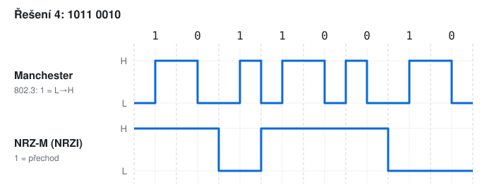

# KIV/UPS cvičení 11. - řešení vzorového testu

Vzorce:

```
v_p = v_m · log2(N)              Nyquist: v_m ≤ 2B, C = 2B · log2(N)
Shannon: C = B · log2(1 + S/N)   S/N = 10^(SNR_dB / 10)
efektivita znaku = datové bity / všechny bity
P(rámec OK) = (1 − p)^n
SnW: e = t_data / (t_data + t_ack + 2 · t_d)
```

---

## Úloha 1 - Nyquist (2 b)

```
B = 8000 − 4000 = 4000 Hz
a) v_m = 2 · B = 8000 Bd
b) C = v_m · log2(8) = 8000 · 3 = 24 000 b/s = 24 kb/s
```

---

## Úloha 2 - Shannon (2 b)

```
S/N = 10^(20/10) = 100
a) C = 10^6 · log2(1 + 100) = 10^6 · 6,658 ≈ 6,66 Mb/s
b) Nyquist: v_m = 2 · B = 2 MBd
   6,66 · 10^6 = 2 · 10^6 · log2(N)  →  log2(N) = 3,33  →  N = 10,05
   mocnina 2 pod mezí: N = 8  →  v_p = 2 · 10^6 · 3 = 6 Mb/s
```

N = 16 by dalo 8 Mb/s, což je víc než Shannonova kapacita - takový přenos by nebyl spolehlivý.

---

## Úloha 3 - decibely (1 b)

```
zisk = −6 + 20 − 6 − 1 = +7 dB
+7 dB = +10 dB − 3 dB  →  × 10 / 2 = × 5
P = 1 mW · 5 = 5 mW            (přesně 10^0,7 = 5,01)
```

---

## Úloha 4 - linkové kódy (2 b)



```
bit:         1    0    1    1    0    0    1    0
Manchester:  L→H  H→L  L→H  L→H  H→L  H→L  L→H  H→L     (IEEE 802.3: 1 = L→H)
NRZ-M:       H    H    L    H    H    H    L    L        (1 = přechod, start L)
```

---

## Úloha 5 - modulace (2 b)

**a)**

| | 0 | 1 |
|-|---|---|
| A (1. bit) | 2 | 5 |
| φ (2. bit) | 0 | π |

```
01 → A = 2, φ = π   (malá vlna, začíná dolů)
10 → A = 5, φ = 0   (velká vlna, začíná nahoru)
```

**b)** `log2(16) = 4 b/symbol → 2400 · 4 = 9600 b/s`

---

## Úloha 6 - arytmický přenos (2 b)

```
'M' = 0x4D = 100 1101b (7 bitů)
LSB první: D0..D6 = 1 0 1 1 0 0 1
počet jedniček = 4 → lichá parita P = 1 (celkem 5 jedniček)

klid | START | D0 D1 D2 D3 D4 D5 D6 | P | STOP | klid
 H   |   L   | H  L  H  H  L  L  H  | H |  H   |  H
```

**b)** `e = 7 / (1 + 7 + 1 + 1) = 7 / 10 = 70 %`

---

## Úloha 7 - chybovost (1 b)

```
(1 − 10^−4)^n ≥ 0,9
n ≤ log(0,9) / log(0,9999) = 1053,6
n = 1053 bitů → 1053 / 8 = 131,6 → 131 B   (zaokrouhlit dolů)
```

---

## Úloha 8 - transparentnost (2 b)

**a)** Každé `02`, `03` a `10` v datech dostane před sebe DLE:

```
data:   02       10       03       41
rámec:  02 | 10 02  10 10  10 03  41 | 03
        STX                           ETX
```

**b)** Za každých 5 jedniček vložit 0:

```
data:    0 11111 0 11111 1
odeslat: 0 11111 0 0 11111 0 1   = 011111001111101
```

---

## Úloha 9 - CRC (2 b)

`G(x) = x³ + x + 1 = 1011`, zbytek má 3 bity → za zprávu připsat 3 nuly a dělit (XOR), dokud nezpracujeme poslední bit zprávy:

```
1100101000
1011   (vedoucí 1 → XOR 1011)
0111
 1011   (vedoucí 1 → XOR 1011)
 0100
  1011   (vedoucí 1 → XOR 1011)
  0011
   0000   (vedoucí 0 → XOR 0000)
   0111
    1011   (vedoucí 1 → XOR 1011)
    0101
     1011   (vedoucí 1 → XOR 1011)
     0001
      0000   (vedoucí 0 → XOR 0000)
      0010
```

Zbytek `R = 010`, odesílá se `1100101 010` = `1100101010`. Kontrola: příjemce vydělí `1100101010` polynomem `1011` a dostane zbytek `000`.

---

## Úloha 10 - potvrzování (2 b)

```
t_data = 1000 · 8 / 2·10^6 = 4 ms
t_ack  = 64 · 8 / 2·10^6  = 0,256 ms
a) e = 4 / (4 + 0,256 + 2 · 5) = 4 / 14,256 = 28,1 %
b) W_s = ⌈14,256 / 4⌉ = ⌈3,56⌉ = 4
```

---

## Úloha 11 - IPv4 (2 b)

```
/20 → maska 255.255.240.0, 3. oktet: bloky po 16
77 = 0100 1101 → 77 AND 240 = 64 (0100 0000)
a) síť      172.16.64.0
   broadcast 172.16.79.255   (64 + 15 = 79)
b) 2^(32 − 20) − 2 = 4096 − 2 = 4094
c) ano - 172.16.0.0/12 (172.16.0.0 – 172.31.255.255)
```
