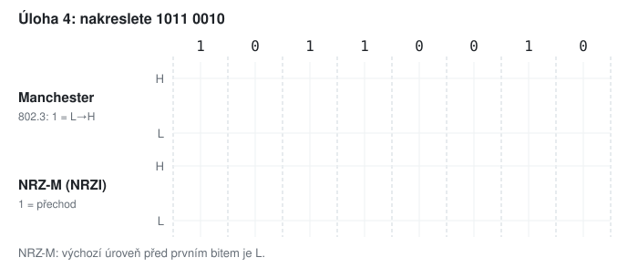

# KIV/UPS cvičení 11.

## Zápočtový test - vzorové zadání

Jindrich Skupa & Martin Ubl

### https://github.com/jindrichskupa/kiv-ups

---

# Organizace

- test: teorie + výpočty, max **20 b** (50 % zápočtu)
- s sebou **kalkulačku** (s logaritmem), psací potřeby, nic dalšího
- u výpočtů pište postup a jednotky - za výsledek bez postupu jen část bodů
- následuje vzorové zadání, řešení je v `ex11-reseni.md`
- Plán (90 min): test 60 min, společná kontrola vzorového zadání 30 min

---

# Úloha 1 - Nyquist (2 b)

Kanál bez šumu má pásmo 4–8 kHz, signál má 8 úrovní.

- a) Jaká je maximální modulační rychlost?
- b) Jaká je maximální přenosová rychlost?

---

# Úloha 2 - Shannon (2 b)

Kanál má šířku pásma 1 MHz a odstup signálu od šumu 20 dB.

- a) Jaká je kapacita kanálu?
- b) Kolik úrovní signálu (mocnina 2) má smysl použít a jakou přenosovou rychlost dosáhneme?

---

# Úloha 3 - decibely (1 b)

Signál 1 mW projde kabelem s útlumem 6 dB, zesilovačem +20 dB, dalším kabelem s útlumem 6 dB a konektorem s útlumem 1 dB.

- Jaký je výsledný zisk v dB a jaký výkon dorazí (přibližně)?

---

# Úloha 4 - linkové kódy (2 b)

---

# Úloha 5 - modulace (2 b)

- a) Navrhněte modulační tabulku pro 4 stavy pomocí amplitudy (2 / 5) a fáze (0 / π) a nakreslete symboly `01 10`.
- b) Modem přenáší 2400 Bd a používá konstelaci se 16 stavy. Jaká je přenosová rychlost?

---

# Úloha 6 - arytmický přenos (2 b)

- a) Nakreslete přenos znaku `'M'` (ASCII `0x4D`) ve formátu **7O1** (klidová úroveň H, LSB první).
- b) Jaká je efektivita formátu 7O1?

---

# Úloha 7 - chybovost (1 b)

Pravděpodobnost chyby jednoho bitu je 10⁻⁴. Jak velký může být rámec (v bajtech), aby se bezchybně přenesl s pravděpodobností alespoň 90 %?

---

# Úloha 8 - transparentnost (2 b)

- a) Znakově orientovaný protokol: STX = `02`, ETX = `03`, DLE = `10`. Zapište rámec pro data `02 10 03 41`.
- b) Bitově orientovaný protokol HDLC (vlajka `01111110`). Proveďte bit stuffing dat `0111110111111`.

---

# Úloha 9 - CRC (2 b)

Zabezpečte zprávu `M = 1100101` pomocí CRC s generujícím polynomem `G(x) = x³ + x + 1`. Jaká zpráva se odešle?

---

# Úloha 10 - potvrzování (2 b)

Linka 2 Mb/s, datový rámec 1000 B, potvrzení 64 B, doba šíření 5 ms, bez chyb.

- a) Jaká je efektivita Stop-and-Wait?
- b) Jak velké musí být odesílací okno Go-Back-N, aby se linka vytížila naplno?

---

# Úloha 11 - IPv4 (2 b)

Pro adresu `172.16.77.200/20` určete:

- a) adresu sítě a broadcastu
- b) počet adres pro počítače
- c) zda je adresa privátní

---

# Bodování

| úloha | 1 | 2 | 3 | 4 | 5 | 6 | 7 | 8 | 9 | 10 | 11 | celkem |
|-------|---|---|---|---|---|---|---|---|---|----|----|--------|
| body | 2 | 2 | 1 | 2 | 2 | 2 | 1 | 2 | 2 | 2 | 2 | **20** |

<small>Pozn.: úlohy odpovídají jádrovým příkladům cvičení 5–10. Na stejný typ úloh se připravíte z `exNN-reseni.md`.</small>
