# KIV/UPS cvičení 12.

## Emulátor sítě: přepínané sítě a VLAN

Jindrich Skupa & Martin Ubl

### https://github.com/jindrichskupa/kiv-ups

---

# Agenda

- Switch: učení MAC adres, kolizní a broadcastové domény
- VLAN, 802.1Q, access a trunk porty, router-on-a-stick
- Úloha v emulátoru (GNS3 / Packet Tracer / containerlab)
- Plán (90 min): teorie 10, příklady 1–4 35, úloha v emulátoru 40, rezerva 5

---

# Switch: jak se učí a přeposílá

- **učení:** zdrojová MAC rámce → zapíše si port, odkud přišel
- **forward:** cílová MAC je v tabulce na jiném portu → pošle jen tam
- **filter:** cílová MAC je na stejném portu, odkud rámec přišel → zahodí
- **flood:** cíl neznámý nebo broadcast (`FF:FF:FF:FF:FF:FF`) → pošle všude kromě vstupního portu
- kolizní doména = co sdílí jedno médium (každý port switche zvlášť, hub = jedna doména); broadcastová doména = kam dojde broadcast (končí na routeru)

<small>Pozn.: záznamy v MAC tabulce stárnou (typicky 300 s), proto se tabulka po přesunutí počítače sama opraví.</small>

---

# Příklad 1 - MAC tabulka (jeden switch)

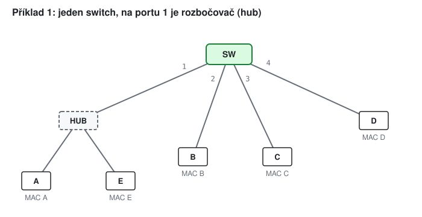

Tabulka je na začátku prázdná. Pro každý rámec určete akci switche (forward / filter / flood + porty) a obsah tabulky:

`A→B`, `B→A`, `E→A`, `C→broadcast`, `D→C`, `B→E`

---

# Řešení 1

<style scoped>table { font-size: 22px; }</style>

| rámec | vstup | akce | MAC tabulka po rámci |
|-------|-------|------|----------------------|
| A → B | 1 | flood 2, 3, 4 | A:1 |
| B → A | 2 | forward 1 | A:1, B:2 |
| E → A | 1 | **filter** (A je na portu 1) | A:1, B:2, E:1 |
| C → FF… | 3 | flood 1, 2, 4 | + C:3 |
| D → C | 4 | forward 3 | + D:4 |
| B → E | 2 | forward 1 | A:1, B:2, C:3, D:4, E:1 |

<small>Pozn.: rámec E → A doručil A už hub (posílá vše na všechny porty). Switch ho zahodí, protože by ho posílal zpátky tam, odkud přišel.</small>

---

# Příklad 2 - kolizní a broadcastové domény

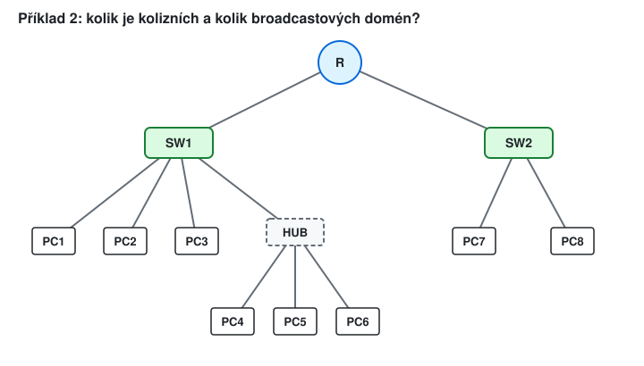

- a) Kolik je kolizních a kolik broadcastových domén?
- b) Jak se to změní, když SW2 nahradíme hubem?
- c) PC4 pošle broadcast. Kdo ho dostane?

---

# Řešení 2

- a) kolizní: SW1 má 5 portů (R, PC1, PC2, PC3, hub) + SW2 má 3 (R, PC7, PC8) = **8**; broadcastové: **2** (router je odděluje)
- b) za hubem je jedno sdílené médium: 5 + 1 = **6** kolizních, broadcastové pořád **2**
- c) PC1, PC2, PC3, PC5, PC6 a rozhraní routeru do SW1; PC7 a PC8 **ne**

<small>Pozn.: u plně duplexních linek (switch ↔ PC) ke kolizím vůbec nedochází. Kolizní doména tak dnes dává smysl hlavně u hubu a u Wi-Fi.</small>

---

# VLAN a 802.1Q

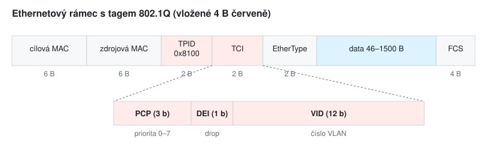

- **access port** - patří do jedné VLAN, rámce jsou bez tagu (počítač o VLAN neví)
- **trunk** - nese více VLAN, rámce mají tag s číslem VLAN (VID)
- mezi VLAN se dá dostat jen přes **router** (nebo L3 switch)

---

# Příklad 3 - návrh VLAN

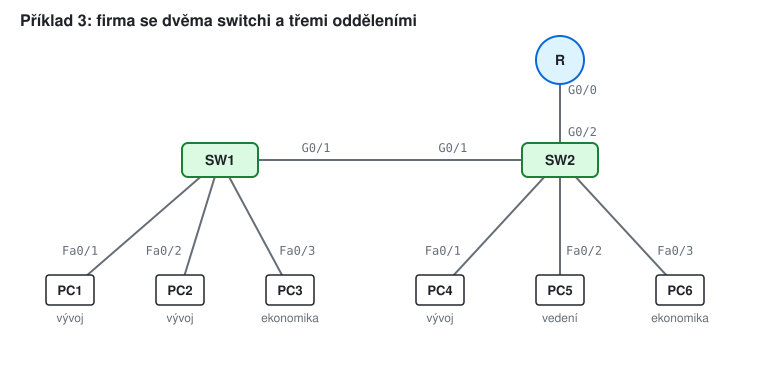

- a) Navrhněte VLAN 10 (vývoj), 20 (ekonomika), 30 (vedení), sítě `192.168.<VLAN>.0/24`. Které porty jsou access (a v jaké VLAN), které trunk (a jaké VLAN nesou)?
- b) Kdo koho pingne, dokud není nastavený router?
- c) Co se stane, když na SW1 zapomenete G0/1 přepnout na trunk?

---

# Řešení 3

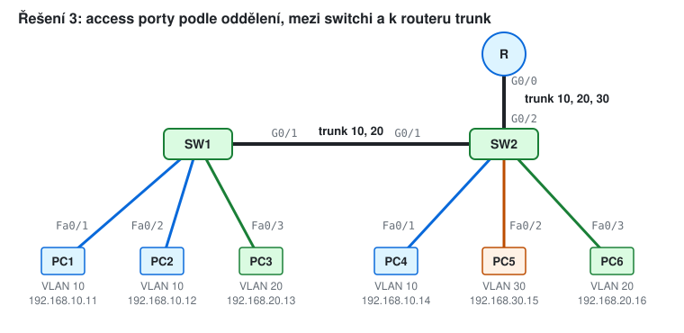

- b) PC1 ↔ PC2 ↔ PC4 (VLAN 10, i přes trunk), PC3 ↔ PC6 (VLAN 20); PC5 nikoho
- c) SW2 posílá rámce s tagem, access port SW1 je zahodí → PC1 ↔ PC4 a PC3 ↔ PC6 přestanou fungovat

<small>Pozn.: trunk SW1–SW2 VLAN 30 nepotřebuje (na SW1 nikdo z vedení není), ale povolit ji nevadí.</small>

---

# Příklad 4 - router-on-a-stick

- a) Router má jeden fyzický port G0/0 (trunk). Navrhněte podrozhraní, jejich adresy a výchozí brány počítačů.
- b) Napište konfiguraci routeru (Cisco IOS nebo Linux).
- c) PC1 pingne PC5. Popište cestu rámce: kterými porty jde a s jakým tagem? Kolikrát projde linkou SW2–R?
- d) Proč je linka SW2–R úzké hrdlo?

---

# Řešení 4

- a) `G0/0.10` = `192.168.10.1/24`, `.20` = `192.168.20.1`, `.30` = `192.168.30.1`; brána PC = `.1` ve své VLAN
- b) Cisco: `interface g0/0.10` / `encapsulation dot1Q 10` / `ip address 192.168.10.1 255.255.255.0` (a totéž pro 20, 30); Linux: `ip link add link eth0 name eth0.10 type vlan id 10`
- c) PC1 → SW1 Fa0/1 (bez tagu) → G0/1 (tag 10) → SW2 → G0/2 (tag 10) → **R** → G0/2 (tag 30) → Fa0/2 (bez tagu) → PC5; linkou SW2–R projde **2×**
- d) veškerý provoz mezi VLAN jde po jedné lince tam i zpět

<small>Pozn.: před prvním pingem pošle PC1 ARP na `192.168.10.1` - broadcast zůstane ve VLAN 10 (PC2, PC4, R.10). Ve větších sítích místo routeru-on-a-stick směruje L3 switch.</small>

---

# Úloha v emulátoru

1. Postavte topologii z příkladu 3 (2 switche, 6 PC, router).
2. Na switchích vytvořte VLAN 10, 20, 30, nastavte access porty a trunky.
3. Nastavte PC adresy a brány podle řešení 3 a 4.
4. Ověřte: ping uvnitř VLAN funguje, mezi VLAN (bez routeru) ne.
5. Nastavte router-on-a-stick, ověřte ping a `traceroute` PC1 → PC5.
6. Zachyťte provoz na trunku SW1–SW2 (Wireshark): najděte tag 802.1Q a VID.
7. Vypište MAC tabulku switche a vysvětlete záznamy (VLAN, MAC, port).

---

# Úloha - příkazy

<style scoped>pre { font-size: 17px; }</style>

```
! Cisco IOS (switch)                          # Linux bridge
vlan 10                                       ip link add br0 type bridge vlan_filtering 1
 name VYVOJ                                   ip link set eth1 master br0
interface fa0/1                               bridge vlan add dev eth1 vid 10 pvid untagged
 switchport mode access                       bridge vlan add dev eth4 vid 10      # trunk
 switchport access vlan 10                    bridge vlan add dev eth4 vid 20
interface g0/1                                bridge vlan show
 switchport mode trunk                        bridge fdb show
 switchport trunk allowed vlan 10,20
show vlan brief                               # router-on-a-stick (Linux)
show interfaces trunk                         ip link add link eth0 name eth0.10 type vlan id 10
show mac address-table                        ip addr add 192.168.10.1/24 dev eth0.10
                                              sysctl -w net.ipv4.ip_forward=1
```

<small>Pozn.: na některých modelech switchů je před `switchport mode trunk` potřeba `switchport trunk encapsulation dot1q`.</small>

---

# Příklad 5 - MAC tabulka (dva switche) (bonus)
<!-- bonus -->

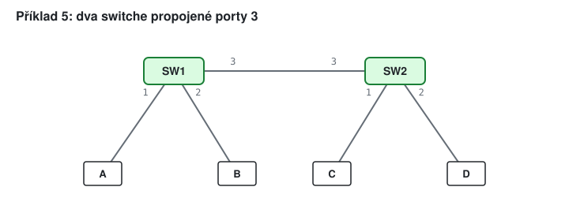

Obě tabulky jsou prázdné. Pro rámce `A→D`, `D→A`, `B→A`, `C→B`, `A→B` určete akci **každého** switche, který rámec uvidí, a obsah obou tabulek.

---

# Řešení 5 (bonus)
<!-- bonus -->

<style scoped>table { font-size: 21px; }</style>

| rámec | SW1 | SW2 | SW1 po rámci | SW2 po rámci |
|-------|-----|-----|--------------|--------------|
| A → D | flood 2, 3 | flood 1, 2 | A:1 | A:3 |
| D → A | forward 1 | forward 3 | A:1, D:3 | A:3, D:2 |
| B → A | forward 1 | (nevidí) | + B:2 | - |
| C → B | forward 2 | flood 2, 3 | + C:3 | + C:1 |
| A → B | forward 2 | (nevidí) | A:1, B:2, C:3, D:3 | A:3, C:1, D:2 |

<small>Pozn.: SW1 má C i D na portu 3 - za jedním portem může být libovolně mnoho MAC adres. SW2 B nikdy neviděl jako zdroj, proto pro něj zaplavoval.</small>

---

# Příklad 6 - 802.1Q (bonus)
<!-- bonus -->

- a) Kolik VLAN lze očíslovat (VID má 12 bitů, hodnoty 0 a 4095 jsou rezervované)?
- b) Maximální ethernetový rámec má 1518 B (bez preambule). Kolik má s tagem?
- c) Kolik tříd priority umožňuje pole PCP?
- d) Poskytovatel přidá vlastní tag nad tag zákazníka (Q-in-Q, 802.1ad). Kolik kombinací VLAN tím vznikne?

---

# Řešení 6 (bonus)
<!-- bonus -->

- a) 2¹² − 2 = **4094** VLAN
- b) 1518 + 4 = **1522 B**
- c) PCP má 3 bity → **8** tříd (0–7)
- d) 4094 · 4094 ≈ **16,8 milionu** kombinací

<small>Pozn.: Q-in-Q vzniklo, protože 4094 VLAN poskytovateli nestačí - každý zákazník si chce číslovat vlastní VLAN od 1.</small>

---

# STP v kostce (bonus)
<!-- bonus -->

- smyčka switchů = rámce obíhají navždy (Ethernet nemá TTL)
- STP (Spanning Tree Protocol) vybere **root bridge** = nejnižší bridge ID (priorita, při shodě MAC)
- každý další switch: **root port** = nejlevnější cesta k rootu (1 Gb/s = 4, 100 Mb/s = 19)
- na každé lince: **designated port** = strana blíž k rootu (při shodě nižší bridge ID), zbylé porty **blokuje**

<small>Pozn.: ceny jsou z 802.1D-1998; novější RSTP (802.1w) používá jiné ceny, ale princip je stejný.</small>

---

# Příklad 7 - smyčka bez STP (bonus)
<!-- bonus -->

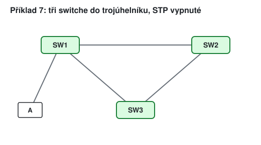

A pošle ARP (broadcast).

- a) Co udělá SW1, SW2, SW3?
- b) Jak dlouho bude rámec v síti?
- c) Co se děje s MAC tabulkami?

---

# Řešení 7 (bonus)
<!-- bonus -->

- a) SW1 zaplaví k SW2 i SW3; SW2 pošle dál k SW3, SW3 k SW2 → oba pošlou kopii zpět SW1 → SW1 ji pošle A a dál dokola
- b) **navždy** - dvě kopie obíhají trojúhelník oběma směry, A dostává pořád nové kopie
- c) MAC A "skáče" mezi porty (jednou přijde zleva, jednou zprava) → switch posílá rámce pro A špatně

<small>Pozn.: když má switch víc než dvě linky do smyčky, každá kopie se znovu rozdělí → počet kopií roste exponenciálně (broadcast storm), linky i CPU switchů jsou během vteřin plné.</small>

---

# Příklad 8 - STP (bonus)
<!-- bonus -->

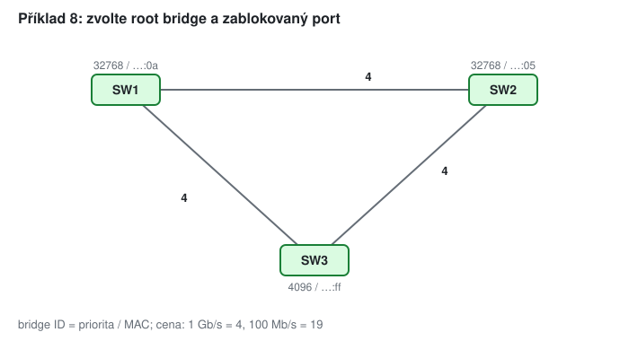

- a) Který switch je root bridge? Které porty jsou root, designated a blokované?
- b) Totéž, když mají všechny switche prioritu 32768.
- c) Totéž jako a), ale linka SW1–SW3 má jen 100 Mb/s (cena 19).

---

# Řešení 8a (bonus)
<!-- bonus -->

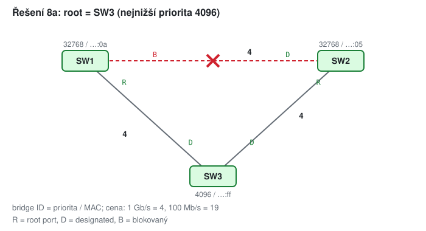

<small>Pozn.: root = SW3 (priorita 4096). SW1 i SW2 mají root port přímo k SW3 (cena 4). Na lince SW1–SW2 nabízejí oba cenu 4 → rozhoduje nižší bridge ID: SW2 (…:05) má designated port, SW1 blokuje.</small>

---

# Řešení 8b, 8c (bonus)
<!-- bonus -->

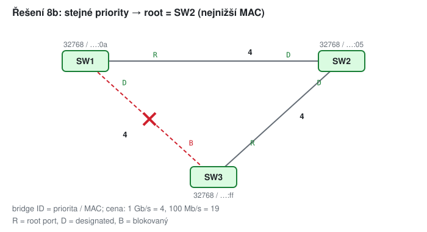 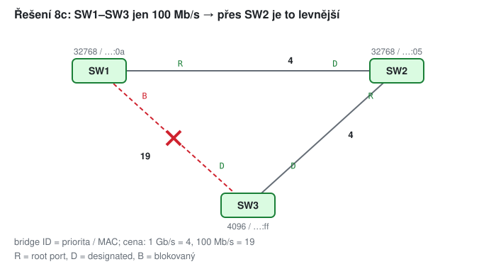

- b) root = SW2 (nejnižší MAC …:05); na lince SW1–SW3 vyhraje SW1 (…:0a) → SW3 blokuje
- c) SW1 má k rootu přímo 19, přes SW2 jen 4 + 4 = 8 → root port k SW2; port SW1 k SW3 blokuje

---

# Úloha v emulátoru (bonus)
<!-- bonus -->

1. Propojte SW1 a SW2 druhou linkou (vznikne smyčka).
2. `show spanning-tree`: který switch je root, který port je blokovaný (BLK)?
3. Změňte prioritu `spanning-tree vlan 10 priority 4096` na SW2 a ověřte, že se root přesunul.
4. Vypněte blokující linku a změřte (`ping -t`), jak dlouho trvá, než STP odblokuje záložní cestu.

<small>Pozn.: STP úplně nevypínejte - broadcast storm v emulátoru umí zahltit CPU celého počítače. Linux: `ip link set br0 type bridge stp_state 1`, stav ukáže `bridge link`.</small>

---

# Shrnutí

- switch se učí ze **zdrojových** MAC, neznámé cíle zaplaví
- každý port switche = kolizní doména; broadcastová doména končí na routeru (nebo VLAN)
- VLAN dělí jeden switch na několik; access port bez tagu, trunk s tagem 802.1Q
- mezi VLAN jen přes router (router-on-a-stick, L3 switch)
- smyčky řeší STP: root bridge, root a designated porty, zbytek blokuje

---

# Slovníček zkratek

<style scoped>table { font-size: 20px; }</style>

| zkratka | význam |
|---------|--------|
| MAC | Media Access Control - 48bitová adresa síťové karty |
| VLAN, VID | Virtual LAN, VLAN Identifier (12 bitů) |
| 802.1Q, TPID, TCI | standard tagování VLAN; Tag Protocol ID (`0x8100`); Tag Control Information |
| PCP, DEI | Priority Code Point (3 b priority); Drop Eligible Indicator |
| Q-in-Q (802.1ad) | dvojitý tag (poskytovatel + zákazník) |
| STP, RSTP | Spanning Tree Protocol (802.1D), Rapid STP (802.1w) |
| BPDU | Bridge Protocol Data Unit - zpráva STP |
| L3 switch | switch, který umí i směrovat mezi VLAN |
| FCS | Frame Check Sequence - CRC rámce |
| ARP | Address Resolution Protocol - překlad IP → MAC |
