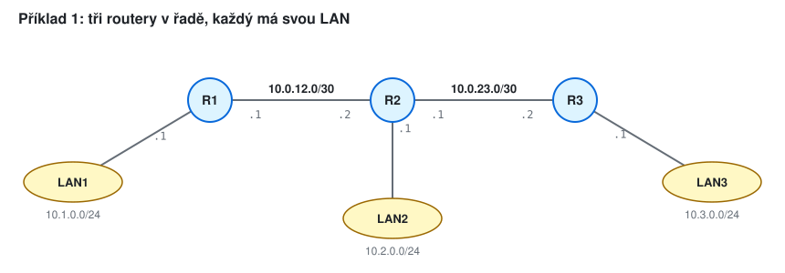
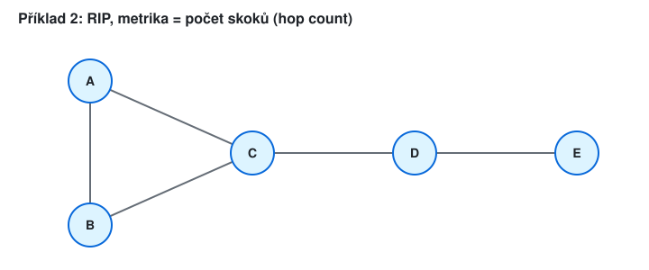
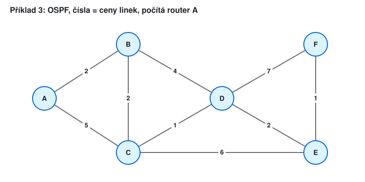
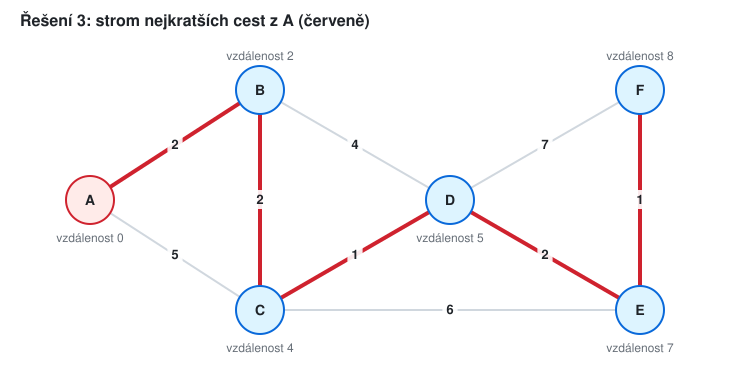
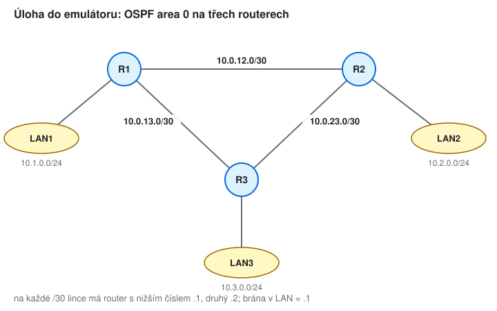
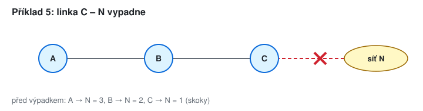
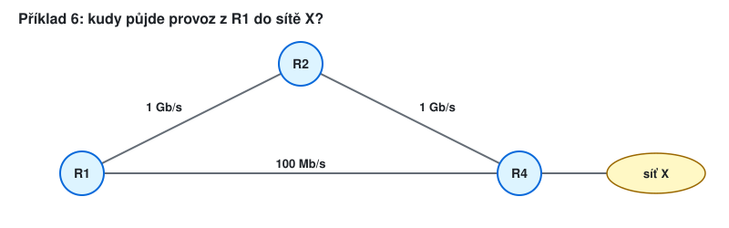

# KIV/UPS cvičení 13.

## Emulátor sítě: směrovací protokoly

Jindrich Skupa & Martin Ubl

### https://github.com/jindrichskupa/kiv-ups

---

# Agenda

- Statické a dynamické směrování
- Distance vector (RIP), link state (OSPF)
- Výběr cesty: prefix, administrativní vzdálenost, metrika
- Úloha v emulátoru: OSPF na třech routerech
- Plán (90 min): teorie 10, příklady 1–4 35, úloha v emulátoru 40, rezerva 5

---

# Statické vs. dynamické směrování

- **statické** - cesty zadá admin ručně (`ip route síť maska next-hop`); jednoduché, ale při výpadku se samo nepřizpůsobí
- **dynamické** - routery si cesty vyměňují protokolem a samy je přepočítají
	- **distance vector** (RIP): sousedům posílám svou tabulku "síť → vzdálenost"
	- **link state** (OSPF): všem posílám stav svých linek, každý si spočítá Dijkstru

<small>Pozn.: výchozí cesta `0.0.0.0/0` sedí na všechno - koncovým sítím s jedním výstupem stačí jen ona.</small>

---

# Příklad 1 - statické cesty



- a) Napište statické cesty pro R1, R2 a R3 (bez výchozí cesty). Kolik jich je?
- b) Zjednodušte pomocí výchozí cesty tam, kde to jde.
- c) Za R3 přibude LAN4 `10.4.0.0/24`. Které routery musíte upravit (varianta b)?
- d) Co se stane při výpadku linky R1–R2?

---

# Řešení 1

<style scoped>pre { font-size: 18px; }</style>

```
R1: ip route 10.2.0.0 255.255.255.0 10.0.12.2      R3: ip route 10.1.0.0 255.255.255.0 10.0.23.1
    ip route 10.3.0.0 255.255.255.0 10.0.12.2          ip route 10.2.0.0 255.255.255.0 10.0.23.1
    ip route 10.0.23.0 255.255.255.252 10.0.12.2       ip route 10.0.12.0 255.255.255.252 10.0.23.1
R2: ip route 10.1.0.0 255.255.255.0 10.0.12.1
    ip route 10.3.0.0 255.255.255.0 10.0.23.2
```

- a) 3 + 2 + 3 = **8** cest
- b) R1: `ip route 0.0.0.0 0.0.0.0 10.0.12.2`, R3: `ip route 0.0.0.0 0.0.0.0 10.0.23.1`, R2 beze změny → **4** cesty
- c) jen **R2** (`ip route 10.4.0.0 255.255.255.0 10.0.23.2`), R1 má výchozí cestu, R3 má LAN4 připojenou přímo
- d) LAN1 je odříznutá - jiná cesta neexistuje a statická cesta by ji ani sama nenašla

---

# Distance vector (RIP)

- každý router zná jen vzdálenosti, které mu řekli sousedé ("pověsti")
- vzdálenost do sítě X = min přes sousedy (1 + vzdálenost souseda do X)
- RIP: metrika = počet skoků, **16 = nedosažitelné**, výměna tabulek každých 30 s

<small>Pozn.: je to Bellmanův-Fordův algoritmus rozprostřený po síti - každá výměna posune znalost o jeden skok dál.</small>

---

# Příklad 2 - iterace distance vector



- Na začátku zná každý router jen sám sebe (vzdálenost 0).
- a) Napište vektory vzdáleností (k A, B, C, D, E) všech routerů po 1., 2. a 3. výměně.
- b) Po kolika výměnách se síť ustálí? Proč právě po tolika?

---

# Řešení 2

<style scoped>table { font-size: 22px; }</style>

| router | po 1. výměně | po 2. výměně | po 3. výměně |
|--------|--------------|--------------|--------------|
| A | 0 1 1 ∞ ∞ | 0 1 1 2 ∞ | **0 1 1 2 3** |
| B | 1 0 1 ∞ ∞ | 1 0 1 2 ∞ | **1 0 1 2 3** |
| C | 1 1 0 1 ∞ | 1 1 0 1 2 | **1 1 0 1 2** |
| D | ∞ ∞ 1 0 1 | 2 2 1 0 1 | **2 2 1 0 1** |
| E | ∞ ∞ ∞ 1 0 | ∞ ∞ 2 1 0 | **3 3 2 1 0** |

- b) po **3** výměnách (4. už nic nezmění): nejdelší nejkratší cesta (A–E, B–E) má 3 skoky

<small>Pozn.: s výměnou každých 30 s trvá ustálení této malé sítě až 1,5 minuty.</small>

---

# Link state (OSPF)

- každý router rozešle všem (zaplaví) stav svých linek a jejich ceny
- všichni mají stejnou mapu sítě (LSDB) a každý si sám spočítá **Dijkstrův algoritmus**
- cena linky = referenční šířka pásma / šířka pásma linky (výchozí reference 100 Mb/s)

<small>Pozn.: Dijkstra - opakuj: z nehotových uzlů vyber ten s nejmenší vzdáleností, označ ho jako hotový a přepočítej jeho sousedy (vzdálenost + cena linky).</small>

---

# Příklad 3 - Dijkstra



- a) Spočítejte z A nejkratší cesty do všech routerů (tabulka krok po kroku).
- b) Napište směrovací tabulku A: cíl, cena, next hop.
- c) Vypadne linka C–D. Jak se změní ceny?

---

# Řešení 3a

<style scoped>table { font-size: 21px; }</style>

| krok | hotový | B | C | D | E | F |
|------|--------|---|---|---|---|---|
| 1 | A (0) | 2 / A | 5 / A | ∞ | ∞ | ∞ |
| 2 | B (2) | - | **4 / B** | 6 / B | ∞ | ∞ |
| 3 | C (4) | - | - | **5 / C** | 10 / C | ∞ |
| 4 | D (5) | - | - | - | **7 / D** | 12 / D |
| 5 | E (7) | - | - | - | - | **8 / E** |
| 6 | F (8) | - | - | - | - | - |

<small>Pozn.: zápis "4 / B" = vzdálenost 4, předchůdce B. Tučně = zlepšení oproti předchozímu kroku.</small>

---

# Řešení 3b, 3c



- b) B 2, C 4, D 5, E 7, F 8 - next hop je pro všechny **B**
- c) bez C–D: C 4, D **6** (A–B–D), E **8**, F **9** - next hop pořád B

---

# Výběr cesty

1. **nejdelší shodný prefix** - `/24` vyhrává nad `/16`, ať ji naučil kdokoli
2. při stejném prefixu **administrativní vzdálenost** (AD): přímo připojená 0, statická 1, OSPF 110, RIP 120
3. při stejném protokolu **metrika** (skoky, cena)

<small>Pozn.: AD porovnává důvěryhodnost zdrojů, metriky různých protokolů (skoky vs. cena) se porovnat nedají.</small>

---

# Příklad 4 - kterou cestu?

Router zná síť `10.5.0.0/16` z RIP (2 skoky, přes `10.0.1.2`), z OSPF (cena 30, přes `10.0.2.2`) a jako statickou (přes `10.0.3.2`).

- a) Kterou cestu použije?
- b) Kterou, když statickou cestu smažeme?
- c) OSPF navíc přinese `10.5.1.0/24` přes `10.0.2.2`, statická `/16` zůstává. Kudy půjde paket na `10.5.1.7` a kudy na `10.5.2.7`?
- d) Jak nastavit statickou cestu jen jako zálohu, když OSPF i RIP selžou?

---

# Řešení 4

- a) **statická** (AD 1)
- b) **OSPF** (110 < 120)
- c) `10.5.1.7` → OSPF `/24` přes `10.0.2.2` (delší prefix); `10.5.2.7` → statická `/16` přes `10.0.3.2`
- d) plovoucí statická cesta s AD vyšší než RIP: `ip route 10.5.0.0 255.255.0.0 10.0.3.2 200`

---

# Úloha v emulátoru - OSPF



1. Postavte topologii, nastavte adresy, ověřte ping mezi sousedy.
2. Zapněte OSPF area 0 na všech routerech.
3. Ověřte sousedy (`FULL`) a směrovací tabulky (záznamy `O`).
4. `traceroute` z LAN1 do LAN2.
5. Spusťte nepřetržitý ping LAN1 → LAN2 a vypněte linku R1–R2. Kolik pingů se ztratí? Kudy jde provoz teď?

---

# Úloha - příkazy

<style scoped>pre { font-size: 18px; }</style>

```
! Cisco IOS                                  # Linux s FRRouting (vtysh, stejná syntaxe)
interface g0/0                               ip addr add 10.0.12.1/30 dev eth0
 ip address 10.0.12.1 255.255.255.252        sysctl -w net.ipv4.ip_forward=1
 no shutdown                                 vtysh
router ospf 1                                 configure terminal
 network 10.0.0.0 0.255.255.255 area 0        router ospf
show ip ospf neighbor                          network 10.0.0.0/8 area 0
show ip route                                 show ip ospf neighbor
show ip ospf database                         show ip route
interface g0/0                               ip link set eth0 down      # výpadek linky
 shutdown
```

<small>Pozn.: `network … 0.255.255.255` je wildcard maska (obrácená maska) - zapne OSPF na všech rozhraních s adresou z `10.0.0.0/8`.</small>

---

# Příklad 5 - count to infinity (bonus)
<!-- bonus -->



- a) Bez split horizonu: jak se mění vzdálenosti A, B, C do N po 1., 2., 3., 4. výměně? Kdy všichni zjistí, že N je nedosažitelná?
- b) Jak dlouho to trvá v RIP (výměna každých 30 s)?
- c) Totéž se split horizonem (router neposílá cestu zpět sousedovi, od kterého se ji naučil).
- d) Proč má RIP maximum 15 skoků?

---

# Řešení 5 (bonus)
<!-- bonus -->

<style scoped>table { font-size: 22px; }</style>

| výměna | A | B | C |
|--------|---|---|---|
| před výpadkem | 3 | 2 | 1 → **16** |
| 1. | 3 | 4 | 3 (od B!) |
| 2. | 5 | 4 | 5 |
| 3. | 5 | 6 | 5 |
| 4. | 7 | 6 | 7 |
| … 15. | 16 | 16 | 16 |

- a) až po **15** výměnách; b) 15 · 30 s = **7,5 minuty**
- c) se split horizonem: 1. výměna B = 16, 2. výměna A = 16 → **2 výměny**
- d) 16 = nekonečno → počítání do nekonečna skončí; zároveň RIP nezvládne síť širší než 15 skoků

<small>Pozn.: split horizon pomáhá jen na lince mezi dvěma routery. Ve smyčce (trojúhelník) se pověst vrátí jinou cestou - proto RIP přidává ještě hold-down timery a poison reverse.</small>

---

# Příklad 6 - referenční šířka pásma (bonus)
<!-- bonus -->



- a) Spočítejte ceny linek a cestu R1 → X při výchozí referenci 100 Mb/s.
- b) Totéž s `auto-cost reference-bandwidth 100000` (100 Gb/s).
- c) Jakou cenu má linka 10 Gb/s a 25 Gb/s při obou referencích?

---

# Řešení 6 (bonus)
<!-- bonus -->

- a) 100 Mb/s / 1 Gb/s = 0,1 → **1** (cena je nejméně 1); 100 Mb/s → **1**; přes R2 = 2, přímo = 1 → provoz jde **pomalou 100 Mb/s linkou**
- b) 1 Gb/s → 100, 100 Mb/s → 1000; přes R2 = 200, přímo = 1000 → **přes R2**
- c) reference 100 Mb/s: obě **1**; reference 100 Gb/s: 10 Gb/s = **10**, 25 Gb/s = **4**

<small>Pozn.: referenci je nutné nastavit stejně na všech routerech, jinak každý počítá s jinými cenami a cesty nejsou konzistentní.</small>

---

# Příklad 7 - oblasti OSPF (bonus)
<!-- bonus -->

Síť má 200 routerů v jedné oblasti. Rozdělíme ji na páteř (area 0) a 4 oblasti po 50 routerech.

- a) Které routery přepočítávají Dijkstru při výpadku linky v area 1 - před a po rozdělení?
- b) Co je ABR a kde leží?
- c) Proč musí každá oblast sousedit s area 0?

---

# Řešení 7 (bonus)
<!-- bonus -->

- a) před: všech **200**; po: jen routery v **area 1** (ostatní dostanou od ABR jen souhrnnou změnu sítí, mapu nepřepočítávají)
- b) Area Border Router - má rozhraní v area 0 i v jiné oblasti, předává souhrny mezi nimi
- c) provoz mezi oblastmi jde vždy přes páteř → mezi oblastmi nevznikne smyčka (mezi oblastmi se OSPF chová jako distance vector)

---

# Úloha v emulátoru (bonus)
<!-- bonus -->

1. Na lince R1–R2 nastavte `ip ospf cost 100` (na obou koncích). Kudy teď jde provoz LAN1 → LAN2?
2. `show ip ospf database`: najděte LSA každého routeru.
3. Zapněte na všech routerech navíc RIP (`router rip`, `version 2`, `network 10.0.0.0`). Který protokol vyhraje v `show ip route` a proč?
4. Vypněte OSPF a změřte, jak dlouho RIP konverguje po výpadku linky.

---

# Shrnutí

- statické cesty: jednoduché, ale bez reakce na výpadky; výchozí cesta = "všechno ostatní"
- distance vector (RIP): tabulky sousedům, ustálení po průměru sítě výměn, hrozí count to infinity
- link state (OSPF): stav linek všem, každý počítá Dijkstru, cena = reference / šířka pásma
- výběr cesty: nejdelší prefix → administrativní vzdálenost → metrika

---

# Slovníček zkratek

<style scoped>table { font-size: 20px; }</style>

| zkratka | význam |
|---------|--------|
| RIP | Routing Information Protocol - distance vector, metrika = skoky |
| OSPF | Open Shortest Path First - link state, metrika = cena |
| LSA, LSDB | Link State Advertisement (zpráva o linkách); Link State Database (mapa sítě) |
| ABR | Area Border Router - router na hranici oblasti OSPF |
| AD | administrativní vzdálenost - důvěryhodnost zdroje cesty |
| FRR | FRRouting - směrovací démon pro Linux (`vtysh`) |
| BGP | Border Gateway Protocol - směrování mezi poskytovateli (není náplní cvičení) |
| next hop | adresa souseda, kterému router paket předá |
